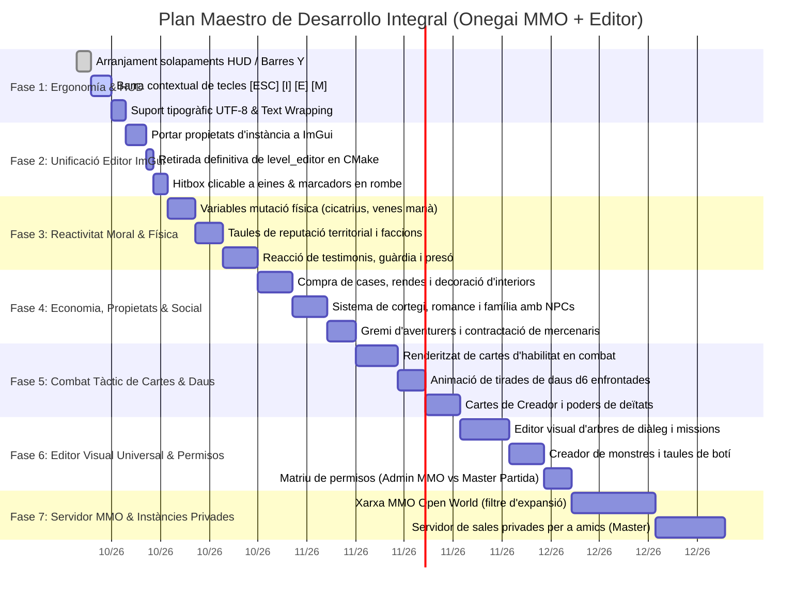

# GDD & DOCUMENTO MAESTRO DE ALCANCE: EL UNIVERSO DE ONEGAI
### MMO Masivo D&D + Instancias Personalizadas entre Amigos

> **Estado**: Documento Canónico de Visión y Alcance  
> **Fecha**: 28 de septiembre de 2026  
> **Autor / Dirección Creativa**: Oriol  
> **Ámbito de Aplicación**: Todo el workspace `Software/` (Onegai 2, dndWeebCC, MotorGraphico, Onegai-Core)

---

## 1. El Alma y la Filosofía del Juego

El objetivo primordial e innegociable de este proyecto es: **QUE SEA MUY DIVERTIDO**.

1. **Roleo por encima de la Técnica**:
   * Priorizamos la experiencia narrativa, la libertad de decisión, la inmersión y las sensaciones orgánicas de una partida de rol real de mesa frente al tecnicismo frío u obsesiones puramente numéricas.
   * La técnica, el motor C++ y las matemáticas deben estar al servicio del rol y de la diversión, nunca al revés.

2. **Libertad Total de Rumbo**:
   * El jugador debe sentir en todo momento que **va por donde él quiere ir**. El mundo no lo empuja por un pasillo; si quiere ignorar el destino del mundo para abrir una panadería en Boundington, comprar casas y alquilarlas, o viajar al territorio Drow para ganarse su favor, el juego lo apoya.

3. **El Canon: En su Momento y con Impacto Épico**:
   * La historia principal del canon de Onegai no abruma al jugador desde el segundo uno. Aparece **cuando toca**, solo cuando es estrictamente necesaria, y cuando lo hace aporta **contenido de alto valor, conocimiento profundo, lore revelador y un combate verdaderamente épico**.

4. **Nuestros Cuatro Grandes Referentes**:
   * **Baldur's Gate 3**: Profundidad de rol, compañeros con personalidad propia, reactividad situacional y riqueza táctica.
   * **Fable 2**: Consecuencias físicas visibles de tus actos en el cuerpo, moralidad palpable, economía de propiedades, compra de negocios y vida personal/familiar.
   * **GTA 5**: Sensación de mundo abierto vivo, libertad de interacción sistémica, criminalidad vs ley y consecuencias en el entorno.
   * **Fallout**: Relaciones complejas entre facciones y comunidades, decisiones grises y reputación regional contradictoria.

---

## 2. La Dualidad Fundamental: Open World vs. Modo Partidas

El juego se vertebra en dos realidades conectadas pero con reglas de diseño estrictas:

```
                               ┌────────────────────────────────┐
                               │       UNIVERSO DE ONEGAI       │
                               └────────────────┬───────────────┘
                                                │
                 ┌──────────────────────────────┴──────────────────────────────┐
                 ▼                                                             ▼
   ┌───────────────────────────┐                                 ┌───────────────────────────┐
   │     MODO OPEN WORLD       │                                 │       MODO PARTIDAS       │
   │  (MMO Persistente Online) │                                 │  (Instancias con Amigos)  │
   ├───────────────────────────┤                                 ├───────────────────────────┤
   │ • Solo contenido EXPANSIÓN│                                 │ • Libertad ABSOLUTA       │
   │ • Sin oficiales 5e sueltos│                                 │ • Oficial D&D permitido   │
   │ • Sin custom desbalanceado│                                 │ • Custom / Homebrew libre │
   │ • Economía unificada      │                                 │ • Expansión permitida     │
   │ • Servidor masivo central │                                 │ • Herramientas para Master│
   └───────────────────────────┘                                 └───────────────────────────┘
```

* **Regla Sagrada del Open World**:
  * Para garantizar el equilibrio, la inmersión y la integridad de la base de datos en el mundo masivo, **solo se puede jugar con contenido de EXPANSIÓN** (clases, razas, armas, objetos, trasfondos y magias diseñadas para el lore canónico). Queda expresamente vetado el material oficial descontextualizado o el custom desbalanceado.
* **Regla Sagrada del Modo Partidas**:
  * Es el espacio privado para disfrutar con amigos. Aquí **se puede utilizar lo que sea**: material oficial de 5ª edición, expansiones canónicas o creaciones caseras (homebrew/custom) aprobadas por el grupo.

---

## 3. Reactividad Moral y Mutación Física (El Legado Fable)

El cuerpo y la apariencia del personaje son el reflejo físico directo de cómo juegas y de tu moralidad:

### 3.1. Mutaciones por Estilo de Juego y Hábitos
* **Abuso de Magia**: Al personaje le brotan **venas de maná brillantes** que recorren sus brazos, cuello y rostro.
* **Uso Equilibrado**: El cuerpo mantiene una complexión armónica y estilizada.
* **Uso Exclusivo de Combate Físico (Cero Magia)**: El personaje ensancha su complexión, ganando musculatura imponente, postura agresiva y aspecto bárbaro.
* **Derrotas en Combate**: Cada vez que el personaje cae en batalla y se recupera, gana una **cicatriz permanente** en el rostro o cuerpo. Estas marcas impactan en la percepción de los NPCs (algunos sentirán respeto por un veterano curtido; otros, rechazo por un rostro desfigurado).
* **Tatuajes y Marcas de Prisión**: Pasar tiempo en prisión o cometer actos delictivos deja marcas corporales y tatuajes carcelarios visibles.
* **Ropa y Vanidad**: La vestimenta, tintes y adornos no solo son defensas; determinan el estatus social y la elegancia percibida.

### 3.2. Afinidad Comunitaria vs. Moralidad y Pureza
* **La Paradoja de Facciones**: No existe un "karma plano". Tu reputación está compartimentada territorialmente:
  * Puedes ser considerado un **tirano cruel e indeseable en el Reino de Ecla**, pero ser el **salvador y héroe sagrado para los Drow**.
* **Fronteras y Espacios Cerrados**: El acceso a ciudades amuralladas, castillos o naciones cerradas dependerá de tus salvoconductos y de tu fama local.
* **Reacción Social Viva**: La gente del pueblo te aplaude, huye de ti despavorida, te escupe o te rinde pleitesía según tus actos en esa región.

---

## 4. Simulación Social, Vínculos y Familia

El mundo no es un decorado de enemigos para farmear; es una sociedad viva:

1. **Compañeros de Aventura**:
   * No son bots mudos. Tienes que socializar con ellos, entender sus metas personales y **ganarte su confianza** para que decidan unirse a tu grupo y cubrirte las espaldas.
2. **Relaciones Íntimas y Sexo-Afectivas**:
   * Posibilidad de forjar vínculos románticos profundos con NPCs, relaciones sexo-afectivas, formalizar compromisos y **tener una familia**.
3. **Persuasión, Seducción y Corrupción**:
   * Puedes entablar amistad con figuras influyentes (gobernadores, sacerdotes, tenderos) o **seducirlos para influir en su alineamiento**, llevándolos hacia el camino del bien o corrompiéndolos hacia el mal.
4. **El Gremio de Aventureros**:
   * Contratación de mercenarios para expediciones peligrosas.
   * Sistema de publicación de encargos: Puedes **pagar oro al gremio para poner tú mismo una misión** que otros aventureros o mercenarios resuelvan por ti.

---

## 5. Economía, Negocios y Urbanismo

El dinero tiene un propósito real más allá de comprar pociones:

1. **Imperio Inmobiliario y Negocios**:
   * Posibilidad de **comprar tiendas, tabernas, talleres y edificios de viviendas**.
   * Gestión de rentas: Subir o bajar el alquiler de tus propiedades.
     * Alquiler bajo: Los inquilinos te aman, la zona gana prosperidad y población.
     * Alquiler abusivo: Te enriquece rápidamente, pero genera odio popular y atrae delincuencia.
2. **Inversión Urbana y Prosperidad**:
   * Puedes **invertir tu propia fortuna en reparar y mejorar las infraestructuras del pueblo** (arreglar caminos, mejorar farolas, reconstruir edificios derruidos), transformando una aldea pobre en una villa boyante.
3. **Decoración de Edificios**:
   * Comprar mobiliario, cuadros, estanterías, alfombras y trofeos para personalizar y decorar tus casas, sedes o negocios.
4. **Comercio Profundo**:
   * Negociación y regateo activo de precios según tu carisma y reputación mercantil.

---

## 6. Combate Táctico: Cartas, Dados y Habilidades

El sistema de combate une la emoción del juego de mesa con la agilidad de los videojuegos:

1. **Mazo de Habilidades Táctico**:
   * El combate se siente como manejar tu propia **mano de cartas de habilidad**. Cada carta representa un ataque, conjuro, postura o maniobra con coste de recurso (maná, energía, fatiga), tiempo de enfriamiento y rango.
2. **Las Cartas de Habilidad de Creadores**:
   * Cartas legendarias vinculadas a las deidades y creadores del lore (Run'Vel, Voluntades Gemelas, TML), con efectos épicos que alteran el campo de batalla.
3. **Tiradas Enfrentadas con Representación Visual de Dados (Pool de d6)**:
   * La resolución de impactos, salvaciones y daños muestra **dados animados en pantalla (d6)**. La información de la tirada debe ser sintética, clara y visualmente emocionante, sin pantallas de texto farragosas.

---

## 7. Exploración, Secretos e Investigación

1. **Bibliotecas Secretas y Tomos Perdidos**:
   * El lore no se lee en menús aburridos; se descubre explorando estanterías prohibidas, descifrando manuscritos arcanos y recopilando páginas arrancadas.
2. **Misiones Orgánicas**:
   * Investigar un rumor en una taberna o encontrar un mapa antiguo desbloquea cadenas de misiones secundarias con botín único y repercusiones regionales.

---

## 8. El Editor Visual Universal con Matriz de Privilegios

La herramienta de autoría definitiva (`motor_editor` en Dear ImGui, sustituyendo para siempre al viejo `level_editor`):

```
┌────────────────────────────────────────────────────────────────────────┐
│                   EDITOR VISUAL UNIVERSAL (Dear ImGui)                 │
├─────────────┬─────────────┬─────────────┬─────────────┬────────────────┤
│    Mapas    │  Partidas   │  Monstruos  │    NPCs     │    Objetos /   │
│   e Inter.  │ e Instancias│ y Enemigos  │ y Diálogos  │ Eventos / Loot │
└─────────────┴─────────────┴─────────────┴─────────────┴────────────────┘
```

### Matriz de Privilegios y Acceso por Roles
Para proteger la integridad de la base de datos y la experiencia de juego:

| Rol | Ámbito Permitido | Capacidades de Edición |
| :--- | :--- | :--- |
| **Administrador (Dev / Worldbuilder)** | **Mundo Abierto (MMO)** + Base de Datos Central | Creación y modificación del mapa del mundo, fijación de spawns de monstruos de expansión, balance económico troncal, gestión de catálogos canónicos. |
| **Game Master (Master de Partida)** | **Instancias Privadas** + Campañas Personalizadas | Creación de mapas locales para su partida con amigos, diseño de NPCs propios, ajuste de monstruos, creación de eventos y ramas de diálogo personalizadas. |
| **Jugador (Player)** | **Espacio Personal** + Ficha de Personaje | Personalización estética de su personaje, colocación de muebles en sus propiedades compradas, gestión de su inventario y familia. |

---

## 9. Hoja de Ruta de Desarrollo Resumida

1. **Fase 1: Cimientos Visuales, Legibilidad y HUD**: Solucionar solapamientos de barras (PV/PM/Moral), barra contextual fija de controles (`[ESC]`, `[I]`, `[E]`, `[M]`), tipografía UTF-8 limpia y `wrapWidth` automático.
2. **Fase 2: Unificación del Editor**: Migrar propiedades de instancia y gestor de proyectos a `motor_editor`; retirar `level_editor` de CMake; herramientas clicables completas y marcadores de rombo.
3. **Fase 3: Reactividad Física y Reputación**: Cicatrices por derrota, venas de maná, musculatura bárbara, tablas de reputación por facción.
4. **Fase 4: Vida Social y Economía**: Compra de casas/negocios, rentas, diálogos de cortejo/romance con NPCs, gremio de aventureros.
5. **Fase 5: Combate Táctico con Cartas y Dados**: Mazo de cartas visible, tiradas de dados d6 animadas, cartas de Creadores.
6. **Fase 6: Red MMO e Instancias**: Servidor central para mundo abierto (expansión) y servidor de salas privadas para amigos (con Master).

---

## 10. Flujos de Actividad y Ejecuciones del Jugador (Mecánicas Sistémicas en Profundidad)

Esta sección define al detalle las máquinas de estados, sistemas de detección, consecuencias visuales y ciclos de vida de las acciones del jugador.

> **📐 Especificación ejecutable de estos flujos (28/09/2026).** Cada ciclo de esta sección
> está desarrollado como *workflow* de diseño en `planificacion_alcance_y_vision/workflows_juego/`
> (7 nucleares + 8 secundarios), con su máquina de estados en Mermaid, sus números, qué existe
> YA en el motor con fichero y línea, y qué decisión lo bloquea. Índice: `workflows_juego/INDICE.md`.
> Esta sección sigue siendo la **visión**; los workflows son la capa que la traduce a tareas.

---

### 10.1. El Ciclo de Crimen, Cono de Visión, Guardias y Prisión Profunda

El sistema de justicia es una simulación física y social que ocurre en tiempo real en los mapas del juego.

#### A. Tipos de Delito y Gravedad
1. **Delitos Menores (Infracciones)**: Allanamiento de morada durante el día, empujar civiles, desenvainar armas en palacios o templos, embriaguez agresiva.
2. **Delitos Medios (Crimen Patrimonial y Religioso)**: Hurto/carterismo, forzado de cerraduras de tiendas, robo de ganado, uso visible de magia de nigromancia o piromancia en calles transitadas, blasfemia contra la deidad local.
3. **Delitos Mayores (Alta Traición y Sangre)**: Asesinato de civiles o guardias, quema de infraestructuras, saqueo de tumbas sagradas, contrabando entre fronteras enemigas.

#### B. Detección, Conos de Visión y Acústica
* **Cono de Visión de NPCs**: Cada NPC proyecta un arco de visión de 120º en el plano isométrico con tres zonas:
  * *Zona Central (hasta 6 metros)*: Detección instantánea.
  * *Zona Periférica (hasta 12 metros)*: Detección gradual (barra de sospecha que se llena).
  * *Espalda*: Ciego, excepto si el jugador genera ruido.
* **Propagación Acústica de Pasos**:
  * El calzado y el peso de la armadura definen el radio sonoro: armadura de placas genera un radio de 8 metros al correr; botas de cuero agachado generan 0 metros.
* **Mecánica del Cadáver**:
  * Al asesinar a un civil, el cuerpo queda en el suelo como entidad física interactiva.
  * El jugador tiene una ventana de tiempo para **agarrar y arrastrar el cadáver** hacia callejones oscuros, pozos, pajares o arrojarlos a los ríos.
  * Si un civil descubre un cadáver: entra en pánico, grita pidiendo auxilio y corre hacia la campana del pueblo o hacia la patrulla más cercana.

#### C. Niveles de Alerta de la Guardia (1 a 5 Estrellas de Infamia)
* **Nivel 1 (Sospecha)**: Los guardias se acercan a interrogarte, te ordenan envainar el arma o despejar la zona.
* **Nivel 2 (Orden de Detención Local)**: La guardia de la ciudad te intercepta activamente con bastones y redes de captura.
* **Nivel 3 (Alarma General de la Villa)**: Toque de campana en la torre, rastrillos de la muralla cerrados para impedir la huida a caballo, arqueros apostados en las almenas.
* **Nivel 4 (Cazarrecompensas de Élite)**: La facción contrata mercenarios y rastreadores que colocan emboscadas en caminos, puentes y vades de río fuera de la ciudad.
* **Nivel 5 (Proscripción Imperial)**: Carteles de «Se busca vivo o muerto» en todas las tabernas de la región, precio de miles de monedas de oro por tu cabeza, patrullas militares hostiles a la vista.

```
       [Comisión del Delito] ──> ¿Hay testigos o cadáver descubierto?
                                          │
                   ┌──────────────────────┴──────────────────────┐
                   ▼                                             ▼
                 [NO]                                           [SÍ]
        Crimen impune / Sospecha                       Se activa Alerta de Guardia
                   │                                             │
                   └──────────────────────┬──────────────────────┘
                                          ▼
                             [Intercepción por la Guardia]
                                          │
            ┌─────────────────────────────┼─────────────────────────────┐
            ▼                             ▼                             ▼
     [1. Rendición]                [2. Soborno / Engaño]         [3. Resistencia Armada]
            │                             │                             │
    Desarme y Prisión             Tirada de Carisma             Combate directo. Matar
            │                     vs Honestidad Guardia         guardias eleva a Nivel 5
            │                             │
            │                     Éxito: "No he visto nada"
            │                     Fallo: Cargo de soborno (+Nivel)
            │
            ▼
    [Ingreso en Prisión con Jugabilidad Real]
    • Confiscación de equipo y armas (almacenadas en el cofre del alcaide).
    • Salto temporal en el calendario del mundo (pérdida de cosechas y cobros de rentas).
    • Rutina carcelaria viva:
      - Conversar con otros presos (líderes de sectas, ladrones con información oculta).
      - Trabajos forzados picando piedra: reduce días de condena pero fatiga y ensancha musculatura.
      - **Marcaje corporal permanente**: Tatuaje carcelario grabado a fuego en el brazo o espalda.
    • Vías de Salida:
      * Opción A: Cumplir la condena y pagar fianza residual.
      * Opción B: Fuga carcelaria (robar ganzúa al carcelero borracho, huir por el pozo ciego a las cloacas).
```

---

### 10.2. El Ciclo de Transvestismo, Disfraz, Identidad y Subculturas

Cambiar de indumentaria no es solo un cosmético; es una mecánica sistémica de engaño, provocación e infiltración.

#### A. El Sistema de Verosimilitud (Passing Score)
El juego calcula el éxito del disfraz combinando:
1. **Ropa y Atrezo**: Vestimenta del género opuesto, hábitos monacales, uniformes militares o harapos de mendigo.
2. **Cosmética y Tintes**: Maquillaje facial, pelucas, vendajes corporales, perfumes.
3. **Anatomía vs Disfraz**:
   * Un elfo o humano estilizado tiene una bonificación natural para pasar desapercibido al vestir atuendos del género opuesto.
   * Un orco de 130 kg de músculo vistiendo un corpiño de seda de corte femenino tiene un Passing Score bajo a menos que utilice magia de Ilusión (*Disfrazarse de D&D*).
4. **Tirada de Engaño pasivo vs Percepción de NPCs**: Se evalúa cada vez que un guardia o NPC te mira fijamente a menos de 3 metros.

#### B. Repercusiones Culturales según la Región
* **En Ciudades Cosmopolitas / Mágicas (Boundington, enclaves élficos)**:
  * Los bardos y círculos de artistas celebran la transgresión estética; se abren líneas de diálogo en cabarets y tabernas nocturnas.
  * Posibilidad de actuar en escenarios de teatro o locales bohemios para ganar oro y afinidad con la burguesía culta.
* **En Feudos Ultraconservadores / Teocracias de Egaroth**:
  * Considerado «afrenta al orden natural y a los ancestros».
  * Los tenderos puritanos se niegan a comerciar («¡Fuera de mi vista, engendro!») a menos que se use Intimidación.
  * Si los alguaciles te descubren usando vestimentas prohibidas por edicto moral, te expulsan de la ciudad amurallada.
* **Infiltración en Zonas Segregadas**:
  * Entrar en conventos de clausura femeninos, harenes de gobernadores, baños turcos exclusivos o cofradías masculinas cerradas para robar documentos secretos o asesinar a un objetivo sin levantar sospechas.

---

### 10.3. El Ciclo Geopolítico: Odio de una Facción vs. Devoción de Otra (El Caso Ecla vs. Drow)

El mundo de Onegai no tiene un karma plano universal; la moral está territorializada entre sus 19 naciones canónicas.

#### A. Matriz de Afinidad de Facción (-100 a +100)
* **-100 a -60 (Enemigo Público / Odio Mortal)**: Centinelas disparan flechas a la vista, emboscadas en caminos, posaderos te niegan cama, templos te anatematizan.
* **-59 a -20 (Hostil / Odiado)**: Precios de tiendas triplicados, guardias te siguen de cerca con la mano en la espada, civiles cierran ventanas a tu paso.
* **-19 a +19 (Neutral / Desconocido)**: Trato comercial estándar sin privilegios ni hostilidades.
* **+20 a +59 (Respetado / Aliado Local)**: Descuento del 15% en tiendas, acceso a barrios cerrados, bienvenida cordial de guardias.
* **+60 a +100 (Salvador / Héroe Venerado)**: Monumentos o canciones en tu honor, derecho a audiencia con los monarcas, regalos de los aldeanos al verte pasar.

#### B. Cómo Ganarse el Odio y el Amor Cruzado
* **Acciones en Territorio del Reino de Ecla**:
  * Ejecutar a un noble corrupto de Ecla que traficaba con esclavos.
  * *Resultado en Ecla*: -40 de reputación inmediata. Se pone precio a tu cabeza, los guardias te declaran forajido y asesino de la corona.
* **Efecto Espejo en las Galerías Drow**:
  * Los esclavos liberados regresan a su comunidad subterránea y cuentan tu hazaña.
  * *Resultado con los Drow*: +60 de reputación de golpe. Eres proclamado «Rompedor de Cadenas». Te otorgan un medallón de sangre que te abre las puertas de su ciudad oculta.

#### C. La Dinámica de Fronteras Vivas
Si los caballeros de Ecla te persiguen a caballo hasta el desfiladero que marca la frontera con los dominios Drow:
* La guardia de Ecla duda en cruzar por miedo a desatar una guerra internacional.
* Si cruzas la frontera malherido, los arqueros Drow ocultos en las cornisas abren fuego defensivo contra los caballeros de Ecla para proteger a su salvador.
* Tu presencia física puede desatar o evitar escaramuzas geopolíticas en tiempo real.

---

### 10.4. El Ciclo de Vínculos, Cortejo, Romance, Sexo-Afectividad y Familia

Los NPCs tienen vida, anhelos, orientación y principios. La seducción no se reduce a pulsar un botón.

#### A. Los Tres Medidores del NPC hacia el Jugador
1. **Afecto / Romance (0..100)**: Nivel de atracción emocional y física.
2. **Respeto / Admiración (0..100)**: Valoración de tu destreza, honor, títulos o inteligencia.
3. **Confianza (0..100)**: Certeza de que eres leal, no traicionarás sus secretos ni lo pondrás en peligro.

#### B. Las 5 Fases del Cortejo y Romance
1. **Fase 1: Primer Contacto y Primera Impresión**:
   * Influyen la higiene/olor, la ropa vestida, el carisma y tu aspecto físico (p. ej. a una hechicera le atraen tus venas de maná luminiscentes; a una cazadora salvaje, tu porte musculoso y cicatrices).
2. **Fase 2: Conexión Dialéctica y Gustos Personales**:
   * Conversar sobre sus ideales (arte, política, dioses, vivencias).
   * Tiradas sociales de *Persuasión* o *Empatía* para descubrir qué regalos le agradan y cuáles detesta (regalar carne a una druida vegetariana destruye el afecto).
3. **Fase 3: Regalos, Favores y Citas**:
   * Llevarle presentes significativos (un tomo descatalogado de la biblioteca, una joya engarzada, flores de la cumbre).
   * Invitarle a una velada en la taberna con música, o ayudar a resolver un problema personal de su familia.
4. **Fase 4: Intimidad y Vínculo Sexo-Afectivo**:
   * Declaración mutua de intenciones.
   * Escenas de intimidad y diálogo honesto con consentimiento explícito.
   * Modelos de relación adaptados a la cultura del lore: exclusividad conyugal, amantes secretos, o relaciones abiertas según la tradición de su raza.
5. **Fase 5: Matrimonio, Convivencia y Familia**:
   * Celebrar enlace matrimonial (en un templo, en un bosque sagrado o ante un magistrado).
   * Mudanza conjunta a una de tus casas compradas y decoradas.
   * **Descendencia**: Posibilidad de tener hijos que crecen con el tiempo en el hogar.
   * **Beneficios de Hogar**: Al regresar tras largas semanas de viaje, tu cónyuge te prepara comidas calientes con bonificaciones de descanso («Consuelo del Hogar») y gestiona los ingresos pasivos de la vivienda.

---

### 10.5. El Ciclo de Corrupción y Redención Moral de Personajes

Tus acciones y tus palabras pueden moldear la brújula moral de tus allegados y de personalidades importantes:

* **Seducir al Pecado / Corrupción Moral**:
  * Ejemplo: Un joven sacerdote devoto en Boundington.
  * Paso 1: Invitarlo a copas en la taberna y sembrar dudas teológicas sobre los dogmas de su orden.
  * Paso 2: Romper sus votos de castidad mediante seducción romántica.
  * Paso 3: Convencerlo de que robe el cáliz de oro del templo para financiar vuestro viaje juntos.
  * *Resultado*: El sacerdote abandona el hábito, se viste de forajido y se convierte en un compañero leal pero atormentado por su herejía.
* **Redención Heroica**:
  * Ejemplo: Una capitana mercenaria despiadada que degüella prisioneros sin pestañear.
  * A través de tu ejemplo ético, salvándola en combate y mostrándole misericordia cuando te traiciona, despiertas sus remordimientos.
  * *Resultado*: Renuncia al dinero sucio, cuelga las armas de asesina y jura defender a los inocentes como tu escudo jurado.

---

### 10.6. El Ciclo de Combate Táctico con Cartas, Dados d6 y Caída sin Game Over

El combate traslada la mesa de rol D&D a una interfaz táctica ágil con cartas y dados animados:

#### A. Fases del Turno de Combate

> ✅ **DECIDIDO por Oriol (28/09).** Ganan el reglamento y el motor: éxitos Ed. 3 (6 = 1, 5 = 0.5; los 4 solo con ventaja), **crítico = la mitad o más de los dados son 6** (esto SÍ cambia el motor: `DicePoolEngine`), pifia sin cambio, **iniciativa 1d6 + DES sí** (nueva tarea AV5-11) y **sin PA/PM: solo cooldown** por reposo corto o largo —por defecto largo si la habilidad no lo indica. El texto de este apartado queda pendiente de reescritura (AV12-06).
>
> ⚠️ **Nota original (D-COMB-01/02/03/06).** El reglamento ya implementado en el motor
> (`RPG/DicePoolEngine.h`, Ed. 3) resuelve distinto: cada **6 = 1 éxito** y cada **5 = 0.5**
> (los 4 solo con ventaja); crítico = **todos** los dados 6; pifia = **ningún** 5/6 **y** mínimo
> dos 1es; y **no hay CA ni CD** (todo es tirada enfrentada). Además `Game/BattleState.h` evita
> la iniciativa a propósito. Por la regla de autoridad (BITÁCORA 2.1: `canon → cartas → motor`),
> la recomendación es corregir estos puntos del documento, no el reglamento. Registrado en
> `workflows_juego/DISCREPANCIAS_Y_DECISIONES.md` (A1, A2, A3, A13). Pendiente de Oriol.
1. **Fase de Inicio**: Cálculo de Iniciativa ($1d6 + \text{Destreza}$). Activación de estados temporales (sangrado, veneno, bendición).
2. **Fase de Robo**: Robas cartas de tu mazo personal hasta el límite de mano (marcado por Inteligencia/Sabiduría).
3. **Fase de Acción**:
   * Cada carta tiene un coste en Puntos de Acción (PA) o Maná (PM).
   * Tipos de cartas:
     * *Ataques Físicos*: Estocada, Tajo Hendidor, Disparo Certero.
     * *Conjuros Arcanos / Divinos*: Proyectil de Maná, Curación Menor, Muro de Sombras.
     * *Cartas de Creadores (Legendarias)*: «Pacto de las Almas», «Ira de Run'Vel», que alteran el clima o la física del campo.
4. **Fase de Resolución con Dados en Pantalla**:
   * Al ejecutar una carta ofensiva, se despliega en el centro del HUD la animación 3D de **dados d6 rodando**.
   * Pool de dados: Se cuentan éxitos (caras 4, 5 y 6). Doble 6 es Crítico demoledor; doble 1 es Pifia con rebote de arma o pérdida de equilibrio.
5. **Fase del Enemigo**: La IA enemiga evalúa su mano y juega sus cartas tácticas.

#### B. La Caída en Combate (Muerte No Bloqueante)
En Onegai no existe una pantalla negra de «Game Over» que te obligue a recargar partida:
* **Si caes ante Bandidos**: Te noquean, te roban el oro acumulado en la bolsa y despiertas atado a un árbol o tirado en la cuneta en ropa interior.
* **Si caes ante Fieras / Monstruos en el bosque**: Un cazador o un eremita que escuchó los rugidos te rescata in extremis y te arrastra malherido hasta su cabaña.
* **Consecuencia Física Indeleble**: Cada derrota agrega una **Cicatriz Permanente** a tu personaje (un corte en el labio, quemadura en el torso, marca en la mejilla). Tu aspecto se vuelve más tosco y curtido.

---

### 10.7. El Ciclo de Progresión, Ficha D&D, Niveles y Construcción del Mazo

> ✅ **DECIDIDO por Oriol (28/09).** El juego de mesa sigue con **tiers e hitos**; la EXP de este documento se reutiliza como **afinidad / maestría** (oficio, fe y dominio de clase) para dar progresión al videojuego — nueva tarea AV0-07. Atributos: **cuatro (CON, DES, INT, CAR) con rango 0…8 según tier**, y las cartas canónicas que dicen «Fue» se mapean a CON.
>
> ⚠️ **Nota original (D-EQU-01/02).** El motor no progresa por EXP ni por niveles: «el reglamento
> no va de XP, va de **hitos**» (`RPG/CharacterSheet.h:72`), con `grantMilestones()` → `tierUp()`
> (`needed = tier + 1`, tiers 0…5). Y los atributos son **cuatro** (CON, DES, INT, CAR; rango 0…8
> en `RPG/Stat.h`), no seis. La construcción del mazo sí encaja: los catálogos ya traen
> `maxSkillCards`, `startingCards` y `handLimit` por tier. Registrado como A5 y A6.

* **Cómo se Gana Experiencia (EXP)**:
  * No solo matando monstruos: descubriendo bibliotecas secretas, ganando debates dialécticos, resolviendo misterios sin derramar sangre y forjando obras maestras artesanales.
* **Subida de Nivel**:
  * Puntos a Atributos primarios: Fuerza, Destreza, Constitución, Inteligencia, Sabiduría, Carisma.
  * Desbloqueo de cartas: Al subir de nivel, eliges 1 carta entre 3 opciones de tu clase o especialidad para incorporarla permanentemente a tu mazo de combate.
  * Personalización del Mazo: Entre combates puedes retirar cartas obsoletas y ajustar el equilibrio entre ataque, defensa y magia.

---

### 10.8. El Ciclo de Oficios, Profesiones y Jornada Laboral

Si el jugador decide aparcar la espada y dedicarse a un oficio en el pueblo:

* **Herrería**:
  1. Comprar lingotes de hierro o extraer mineral con pico en las minas.
  2. Llevar el lingote a la forja: calentar al rojo vivo.
  3. Minijuego de ritmo y precisión en el yunque: golpear en los puntos débiles para forjar la hoja.
  4. Temple en agua fría y afilado en la muela de piedra.
  5. Calidades resultantes: Tosca, Estándar, Refinada u Obra Maestra (con ranura de runa mágica).
* **Alquimia y Boticario**:
  1. Pasear por el bosque recolectando flores de luna, setas fosforescentes y raíces de mandrágora.
  2. En el laboratorio: triturar en mortero, mezclar con alcohol base y destilar al fuego.
  3. Crear pociones de curación, filtros de amor, venenos paralizantes o elixires de visión nocturna.
* **Jornada y Economía**:
  * Colocar tus creaciones en el mostrador de tu tienda o venderlas al gremio.
  * Al final del día, cuentas las monedas ganadas, pagas el diezmo o impuestos locales y ganas maestría profesional.

---

### 10.9. El Ciclo Inmobiliario, Decoración en Grid 2.5D y Urbanismo Municipal

* **Compra de Propiedades**: Acercarse al cartel de «Se Vende» de una vivienda en ruinas o una tienda embargada y pagar su tasación.
* **Modo Decoración Interior**:
  * Al cruzar la puerta de tu casa, se activa la cuadrícula isométrica en el suelo.
  * Abres el inventario de muebles y colocas: camas (para dormir y restaurar fatiga), baúles privados (para almacenar botín que nadie puede saquear), mesas de trabajo alquímico y estanterías con libros de lore.
* **Gestión de Inquilinos y Rentas**:
  * Si alquilas la vivienda: Ajustar el precio mensual. Si cobras poco, el inquilino cuida la casa y te regala tartas caseras; si cobras un alquiler usurero, el inquilino destrozará las paredes antes de marcharse.
* **Inversión Pública en el Pueblo**:
  * Puedes donar 5.000 monedas de oro al concejo municipal para **«Pavimentar la Plaza del Mercado»** o **«Reparar las Murallas Caídas»**.
  * Efecto: El aspecto visual del pueblo cambia, aparecen flores en las ventanas, la tasa de delincuencia cae a cero y los vecinos erigen una placa conmemorativa en tu honor.

---

### 10.10. El Ciclo de Misiones Orgánicas e Investigación en Bibliotecas Secretas

* **Sin Iconos Flotantes**: Las aventuras nacen de la curiosidad, el sigilo y la lectura del entorno.
* **Investigación en Bibliotecas**:
  * Las bibliotecas no son fondos decorativos: puedes interactuar con las estanterías.
  * Tirada de *Investigación* o *Historia*: encuentras un diario censurado que habla de una deidad olvidada.
  * El libro te da la pista de una contraseña para abrir la puerta de una bodega sellada en la taberna del pueblo.

---

### 10.11. El Gremio de Aventureros, Mercenarios y Encargos Pagados por el Jugador

* **Reclutar Compañeros de Verdad**:
  * Los mercenarios del gremio cobran una tarifa diaria por sus servicios.
  * Tienen moralidad: si contratas a un pícaro ladrón y le pides asaltar un orfanato, lo hará con gusto; si se lo pides a un templario, te atacará en el acto.
* **Publicar Misiones Propias en el Tablón**:
  * Si necesitas 20 pieles de lobo para tu taller de sastrería o limpiar una cueva peligrosa pero no quieres mancharte las manos:
  * Vas al mostrador del Gremio, depositas 600 monedas de recompensa y publicas el anuncio en el tablón.
  * Al cabo de 3 días de juego, vuelves al gremio y recoges el saco de materiales que otro grupo de aventureros ha traído para ti.

---

### 10.12. El Ciclo de Locomoción y Físicas del Jugador (Movimiento Profundo Isométrico)

El movimiento en Onegai no es un simple desplazamiento sobre una rejilla plana; tiene peso, inercia, fatiga y reactividad física con el entorno:

#### A. Modos de Locomoción y Gasto de Estamina
1. **Paseo Cauteloso**:
   * Tecla de paso suave o inclinación leve del stick. Ruido: 0 metros. Gasto de estamina: 0. Permite observar detalles sutiles del decorado (marcas de ladrones en puertas, trampas en baldosas).
2. **Caminar Estándar**:
   * Velocidad base de exploración ($1.0\times$). Ruido audible a 3 metros. Gasto de estamina: 0.
3. **Carrera Ligera (Jog)**:
   * Velocidad $1.8\times$. Ruido audible a 8 metros. Gasto de estamina: 2 puntos/segundo.
4. **Sprint de Emergencia**:
   * Mantener pulsado Shift/Botón de Sprint. Velocidad $2.6\times$. Gasto acelerado de estamina (12 puntos/segundo).
   * *Física de Inercia*: Al frenar en seco o cambiar de dirección $180^\circ$, el personaje derrapa levantando polvo o barro, tardando 0.4 segundos en recuperar el control.
   * *Impacto en Multitudes*: Correr a máxima velocidad y chocar con un civil lo desequilibra, tira lo que lleva en las manos (cestas de fruta, jarras de leche) y provoca enfado inmediato.
5. **Sigilo / Modo Agachado**:
   * Silueta visual reducida un 50% (permite ocultarse tras mostradores, barricas y parapetos de piedra).
   * El cono de visión enemigo tarda el triple en detectarte si estás en sombras. Ruido amortiguado.
6. **Esquiva Táctica (Roll / Dash)**:
   * Consumo instantáneo de 20 de estamina. Otorga fotogramas de invulnerabilidad parcial (I-frames) o bonificación de $+4$ a la Clase de Armadura contra proyectiles y tajos en el segundo de salto.
7. **Salto, Desniveles y Escalada**:
   * Superación fluida de obstáculos de media altura (vallas de huertos, mesas volcadas, muretes de piedra).
   * Subir por escaleras de mano de madera hacia andamios, tejados o almenas de vigilancia.
8. **Vadeo de Aguas y Natación**:
   * *Vadeo de charcos y arroyos*: Sonido de chapoteo sonoro (delata posición en sigilo), velocidad reducida al 70%.
   * *Natación en ríos y lagos*: Requiere no sobrepasar el límite de peso. Si el jugador nada con armadura completa de placas de hierro ($30\text{ kg}$), se hunde hacia el fondo sufriendo daño por asfixia a menos que use conjuros de respiración acuática o flotación mágica.

#### B. Sistema de Carga, Peso y Encumbrance

> ✅ **DECIDIDO por Oriol (28/09).** La carga va en **kg**, con CON haciendo de Fuerza (bandas sobre CON × 5 kg). Y el movimiento sigue **por celdas** con pathfinding **A\*** y **clic de ratón**, con interpolación visual para la inercia y el derrape (nueva tarea AV7-08): no se pasa a continuo, porque eso invalidaría colisión, IA, patrullas, editor y pruebas.
>
> ⚠️ **Nota original (D-EQU-04 / D-MOV-03).** El motor no pesa en kg: clasifica el equipo por
> `weightCategory` (light/medium/heavy) contra `maxArmorWeight` de la clase
> (`RPG/InventoryEngine.h:70-101`). Las cuatro bandas de abajo necesitan decidir si el kg entra
> como dato de catálogo (recomendado) o si se mapean las categorías existentes. Registrado como A7.
El peso del inventario altera drásticamente la movilidad del personaje:
* **Carga Ligera ($< 33\%$ de Fuerza $\times 5\text{ kg}$)**:
  * Movilidad al $100\%$. Sprint veloz, esquiva ágil (salto acrobático fluido), recuperación rápida de estamina.
* **Carga Media ($33\% - 66\%$)**:
  * Movilidad al $85\%$. Gasto de estamina aumentado en un $25\%$. Rodadura estándar.
* **Carga Pesada ($66\% - 100\%$)**:
  * Movilidad al $65\%$. Prohibido el sprint continuo. La esquiva se convierte en un «Fat Roll» pesado que hace crujir el suelo. Ruido de armadura metálica que suena como cascabeles alertando a guardias.
* **Sobrecarga ($> 100\%$)**:
  * El personaje solo puede arrastrar los pies caminando despacio ($30\%$ de velocidad). No puede esquivar ni saltar. Si supera el $150\%$, sufre daño gradual por aplastamiento lumbar.

#### C. Biomecánica según la Superficie del Suelo
* **Adoquín Seco de Ciudad**: Tracción $100\%$. Sonido de taconeo claro.
* **Barro Profundo de Arrabales o Lluvia**:
  * Velocidad reducida al $60\%$. El personaje deja **huellas visibles en el barro durante 45 segundos**. Los sabuesos de los guardias o los cazarrecompensas pueden seguir el rastro exacto de tus pisadas.
* **Hielo o Charcos de Aceite**:
  * Si el jugador corre o gira bruscamente sobre hielo/aceite: Tirada de *Salvación de Destreza DC 11*. Si fracasa, cae de espaldas al suelo quedando derribado durante 2 segundos y vulnerable a golpes críticos.
* **Madera Vieja de Buhardillas / Tabernas**:
  * Tablones crujientes aleatorios. En sigilo, pisar una tabla en mal estado genera un «¡CRACK!» que alerta inmediatamente a la habitación contigua.

---

### 10.13. El Sistema de IA Viva: Rutinas 24 Horas, Árboles de Comportamiento y Patrullas

Los habitantes de Onegai no son maniquíes esperando a que el jugador pulse una tecla. Tienen vidas, necesidades biológicas y ciclos circadianos gobernados por Árboles de Comportamiento (*Behavior Trees*):

#### A. El Horario Circadiano de un Ciudadano Común (Ciclo de 24 Horas)
* **06:00 (Despertar y Aseo)**: El NPC se levanta de la cama, animación de bostezar y estirarse, enciende el fuego del hogar con pedernal, come un mendrugo de pan y queso sentado a la mesa.
* **07:15 (Salida a la Calle)**: Abre el cerrojo de su casa y sale a la vía pública. Saluda a vecinos que se cruzan: diálogo ambiental dinámico con memoria de sucesos recientes («¿Supiste que ayer ahorcaron a un ladrón en la plaza?»).
* **08:00 (Apertura de Jornada Laboral)**:
  * El campesino camina al huerto exterior con su azadón.
  * El herrero bombea el fuelle de la fragua para avivar las brasas.
  * La frutera coloca los cestos de manzanas frescas en el mostrador exterior de la tienda.
* **13:30 (Almuerzo y Descanso de Mediodía)**:
  * Pausa laboral. Se sientan en bancos de madera a la sombra de los olmos, sacan una bota de vino y conversan sobre la subida de impuestos locales.
* **18:30 (Cierre y Recogida de Mercancía)**:
  * Los tenderos recogen los toldos de tela para protegerlos de la intemperie, guardan las mercancías valiosas en el arcón con candado interior y echan la tranca de madera a la puerta.
* **19:30 (Vida Social Nocturna en la Taberna)**:
  * La taberna del pueblo se llena de humo de pipa, música de laúd y olor a cerveza agria.
  * Los NPCs beben, ríen, cantan salomas marineras, juegan a los dados apostando monedas de cobre o cortejan a otros parroquianos. Si dos NPCs ebrios chocan, puede desatarse una pelea a puñetazos espontánea.
* **23:00 (Regreso al Hogar y Sueño Profundo)**:
  * Caminan de vuelta a casa (si bebieron de más, caminan con animación tambaleante).
  * Entran a su vivienda, apagan los candiles uno a uno, cierran con cerrojo y se meten bajo las mantas en la cama.
  * *Estado Dormido*: Cono de visión desactivado; radio auditivo reducido al $10\%$. Es la ventana dorada para el asesinato silencioso o el robo con ganzúa en sus cajones privados.

#### B. Patrullas de Guardia: Rutas Tácticas, Relevos y Niveles de Conciencia
Las patrullas militares siguen protocolos estrictos de vigilancia:

```
               [Ruta de Patrulla Rutinaria (Waypoints)]
                                   │
              ┌────────────────────┴────────────────────┐
              ▼                                         ▼
      [Día: Buena Visibilidad]               [Noche: Cono de Antorcha]
      Guardias con alabarda / porra          Llevan antorcha que ilumina 10m
      Vigilan calles y callejones             Sombras fuera de la luz = invisibles
                                   │
             ¿Ocurre un estímulo sospechoso?
             (Ruido de pasos, silbido, sombra fugaz, sangre)
                                   │
                                   ▼
             [ESTADOS DE ALERTA DE LA IA DE PATRULLA]
```

1. **Estado Verde (Patrulla Desprevenida)**:
   * Arma envainada. Velocidad de paseo ($0.8\times$).
   * Paradas tácticas en esquinas predefinidas: el guardia se detiene 10 segundos, mira a izquierda y derecha, bosteza o comenta el frío con su compañero de patrulla.
2. **Estado Amarillo (Alerta por Estímulo Sospechoso)**:
   * El guardia escucha un cristal romperse o ve pasar una silueta rápida por una esquina.
   * *Acción*: Detiene su ruta de inmediato. Desenvaina la espada corta con sonido metálico y dice en voz alta: *«¿Quién anda ahí? ¡Sal con las manos a la vista!»*.
   * Camina con cautela hacia el punto exacto de donde provino el sonido, barriendo el cono de luz de su antorcha por los rincones oscuros y tras los barriles.
   * *Resolución*: Si tras 15 segundos no encuentra nada, resopla (*«Malditas ratas de alcantarilla...»*), enfunda el arma y regresa lentamente a su ruta de waypoints original.
3. **Estado Naranja (Rastreo / Indicio Grave de Delito)**:
   * El guardia descubre un rastro de sangre en el suelo, una cerradura rota forzada o un cadáver escondido a medias.
   * *Acción*: Hace sonar con fuerza el **silbato metálico de la guardia**.
   * *Respuesta en Enjambre*: Todas las patrullas en un radio de 60 metros cambian de rumbo de inmediato y corren a la posición del silbato en menos de 10 segundos.
   * Forman un círculo defensivo de búsqueda con espadas y escudos en alto, registrando armarios, pajares y callejones sin salida.
4. **Estado Rojo (Combate Activo / Persecución Coordinada)**:
   * El fugitivo ha sido identificado visualmente.
   * *Tácticas de Enjambre*: Los soldados no corren en línea recta tontamente:
     * El guardia más cercano inicia persecución frontal al sprint.
     * Dos guardias corren por las calles paralelas laterales para **cortarte el paso por delante y acorralarte en un callejón**.
     * Los arqueros toman distancia y disparan flechas ralentizadoras a tus piernas.
     * Si el jugador salta a un tejado, los guardias gritan pidiendo ballestas y rodean el edificio para esperar a que bajes.

#### C. Vida Animal y Dinámicas Urbanas Espontáneas
* **Fauna Urbana**: Perros callejeros que siguen al carnicero mendigando huesos (si el jugador huele a carne fresca, el perro lo sigue ladrando, delatando su posición en sigilo); gatos sobre los tejados que tiran macetas si pasas cerca; ratas en las alcantarillas que chillan al pisarlas.
* **Pilluelos y Carteristas**: Niños huérfanos que corren en tropel entre la multitud; uno tropieza deliberadamente contigo intentando sustraerte 5 monedas de oro (tirada pasiva de *Percepción* para agarrarle la muñeca y decidir si darle una moneda o entregarlo al alguacil).

---

### 10.14. Escenografía Viva: Ciudades, Distritos, Clima Dinámico y Tiendas Físicas

Las ciudades no son mapas estáticos de fondo; son decorados vivos de arquitectura, atmósfera, física de objetos y comercio palpable.

#### A. Anatomía y Diferenciación Radical de Distritos Urbanos

```
┌────────────────────────────────────────────────────────────────────────┐
│                        ANATOMÍA DE UNA GRAN CIUDAD                     │
├────────────────────┬────────────────────┬──────────────────────────────┤
│ 1. DISTRITO NOBLE  │ 2. MERCADO CENTRAL │ 3. ARRABALES Y BAJO MUNDO    │
│ • Pavimento blanco │ • Toldos de colores│ • Calles de barro cenagoso   │
│ • Fuentes mármol   │ • Gritos de pregón │ • Tablones rotos y leña      │
│ • Guardias dorados │ • Carretas de buey │ • Humo negro de chimeneas    │
│ • Mansiones rejas  │ • Especias y carne │ • Cloacas abiertas y mendigos│
└────────────────────┴────────────────────┴──────────────────────────────┘
```

1. **Distrito Nobiliario / Palaciego**:
   * *Estética*: Suelo de baldosas de mármol pulido que reflejan los rayos del sol, fuentes ornamentales con estatuas de los dioses de Onegai, carruajes dorados tirados por corceles empenachados.
   * *Seguridad*: Guardia de honor con armaduras completas bruñidas y lanzas ornamentales. Exigen salvoconducto aristocrático para cruzar la cancela de hierro forjado.
   * *Ambiente Sonoro*: Violines amortiguados tras los ventanales de cristal emplomado, murmullo suave de nobles murmurando conspiraciones cortesanas, perfume a jazmín y sándalo.
2. **Distrito Comercial y Plaza del Mercado**:
   * *Estética*: Toldos de lona roja, azul y azerada; carretas descargando toneles de sidra y cajas de mimbre; estantes de verduras rebosantes; alfombras persas colgadas en cordeles.
   * *Sonoridad*: Pregones a viva voz de los mercaderes (*«¡Sardinas traídas de la costa esta misma alborada! ¡Pieles de zorro del norte a mitad de tasación!»*), risas, regateos agresivos, campanas de tenderos.
   * *Densidad*: Decenas de ciudadanos cruzándose, niños jugando al aro, sacerdotes repartiendo folletines doctrinales.
3. **Arrabales / Distrito de los Parias (Barrio Bajo)**:
   * *Estética*: Calles estrechas donde no entra la luz del sol, barro repugnante mezclado con aguas fecales, muros de madera podrida apuntalados con vigas inclinadas, tejados con agujeros tapados con paja.
   * *Ambiente*: Hogueras encendidas dentro de bidones de hierro oxidado alrededor de las cuales se calientan los mendigos; jugadores clandestinos tirando dados sobre un tonel sucio; matones de taberna apoyados en esquinas masticando tabaco; ratas gordas paseando por los canalones.
4. **Muelles Fluviales / Portuarios**:
   * *Estética*: Grúas monumentales de madera accionadas por ruedas de tracción humana, barcazas de río amarradas con gruesas cuerdas de cáñamo, redes de pesca secándose al viento, escamas de pescado en el suelo de tablones de madera crujiente.
   * *Ambiente*: Olor a salitre, brea caliente y podredumbre marina; marineros tatuados descargando barriles de ron; gaviotas graznando en lo alto.

#### B. El Clima Dinámico y su Impacto en el Decorado y los Ciudadanos
El clima altera la estética y la jugabilidad de cada calle:
* **Día Soleado Radiante**:
  * Sombras nítidas de 45º proyectadas por los edificios; toldos extendidos; terrazas de taberna llenas de clientes sentados al aire libre; ropa tendida secándose en las cuerdas entre balcones.
* **Lluvia Torrencial y Tormenta**:
  * Las calles se oscurecen en tonos grisáceos y azulados.
  * Los adoquines adquieren un **brillo especular reflectante** donde se reflejan los faroles y las ventanas iluminadas.
  * Se forman **charcos de agua física**: correr sobre ellos genera salpicaduras visibles y sonido de chapoteo sonoro.
  * *Reacción Social*: Los transeúntes sacan paraguas de tela encerada o echan a correr cubriéndose la cabeza con las capas hacia los soportales; los tenderos recogen los fardos de tela al interior a toda prisa; los fuegos de los herreros en la calle chisporrotean con humo blanco espeso.
* **Niebla Densa / Bruma de Río**:
  * Visibilidad reducida a menos de 8 metros. La niebla de guerra cubre los callejones. Los conos de visión de los guardias caen un $50\%$.
  * Los faroles de gas o aceite proyectan un aura esférica difusa de color ámbar. Las siluetas de las gárgolas de los tejados parecen amenazantes. Máxima ventaja para pícaros, asesinos y rateros.
* **Viento Huracanado**:
  * Letreros de madera de las tabernas chirriando y balanceándose violentamente; banderas y estandartes ondeando al límite; hojas secas arremolinándose en los callejones.

#### C. Tiendas con Mercancía Física Tangible en Mostradores y Estanterías
En Onegai, el comercio no se limita a abrir un menú flotante de lista de textos. **Los objetos existen físicamente colocados sobre el mostrador, los estantes y los ganchos de la tienda**:

```
┌────────────────────────────────────────────────────────────────────────┐
│                      INTERIOR DE LA TIENDA DE LUISARDA                 │
├────────────────────────────────────────────────────────────────────────┤
│  [Estante Superior]  │ Frascos de Éter de Cristal Azul (x3)           │
│  [Mesa de Corte]     │ Rollo de Seda Púrpura Drow + Tijeras de Bronce │
│  [Ganchos de Techo]  │ Capas de Viajero Impermeabilizadas (Colgadas)  │
│  [Bajo Mostrador]    │ Caja de Caoba con Candado (Contiene el Oro)    │
│  [Mostrador Central] │ Poción de Vida Roja (Físicamente agarrable)    │
└────────────────────────────────────────────────────────────────────────┘
```

* **Hurto Físico en Tiempo Real**:
  * Si te colocas frente al mostrador, ves la poción roja sobre la madera barnizada.
  * Puedes hablar con Luisarda y pagar 25 monedas de oro para comprarla normalmente.
  * O puedes esperar a que un cliente entre por la puerta y Luisarda se gire de espaldas a buscar una tela al fondo de la estantería:
    * En modo sigilo, extiendes la mano hacia el mostrador: animación cinemática en tiempo real de agarrar el frasco.
    * **El frasco desaparece físicamente del mostrador** y entra en tu inventario.
    * Si eres lo bastante rápido y sales por la puerta antes de que Luisarda se dé la vuelta, el hurto es perfecto e impune.
    * Si tardas demasiado, ella se gira, mira el mostrador vacío, te señala furiosa y grita: *«¡Ladrón! ¡Devuelve eso o llamo a la guardia!»*.
* **Decorados Temáticos Vivos**:
  * *La Carnicería de Boundington*: Canales enteros de cerdo y ternera colgados de ganchos de hierro goteando sobre serrín fresco; enjambres de moscas con zumbido espacial; el carnicero empuñando un machete pesado hendiendo huesos sobre un tocón de roble macizo.
  * *La Botica del Alquimista*: Frascos de cristal soplado con ojos de salamandra y raíces retorcidas flotando en líquido amarillento; un alambique de cobre gorgoteando vapor azulado por un serpentín; olor penetrante a azufre y menta piperita.
  * *La Forja del Maestro Armero*: Hileras de espadas bastardas, alabardas y cotas de malla engrasadas colgadas en armeros de pino; barriles llenos de agua turbia para templar el metal; yunques que retumban con cada golpe de maza levantando chispas al aire.
* **Interactividad y Destrucción del Mobiliario**:
  * En una pelea en la taberna:
    * Puedes pulsar la tecla de interacción con una mesa de madera maciza para **volcarla de golpe y usarla como trinchera / cobertura parcial** contra las flechas enemigas.
    * Puedes agarrar una jarra de barro o una silla del suelo y reventársela en la cabeza a un bandido (desarmándolo o noqueándolo durante 1 turno).
    * Si disparas una flecha incendiaria o lanzas un proyectil de fuego contra una cortina de seda o un tonel de aguardiente, se desata un incendio que propaga llamas a las mesas colindantes, obligando a los clientes a huir a la calle despavoridos.

---

## 11. ¿Cómo se Diseña y se Construye Todo Esto en el Editor Visual? (`motor_editor`)

El nuevo editor visual en Dear ImGui (`motor_editor`) proporciona herramientas modulares para que cualquier creador o Game Master cree estas experiencias con la facilidad de arrastrar y soltar:

```
┌───────────────────────────────────────────────────────────────────────────────────────────────┐
│                              VENTANA PRINCIPAL MOTOR_EDITOR                                    │
├───────────────┬────────────────────────────┬───────────────────────────────────┬──────────────┤
│ EXPLORADOR    │ VISTA MAPA 2.5D INTERACTIVA│ PANEL DE HERRAMIENTAS             │ INSPECTOR    │
│ • Mapas       │ (Cámara isométrica libre)  │ [Baldosas] [Objetos] [Zonas]      │ DE ENTIDAD   │
│ • Campañas    │ ┌────────────────────────┐ │ [Diálogos] [Misiones] [Facciones] │ Nombre:      │
│ • Facciones   │ │  Colocar tiles         │ ├───────────────────────────────────┤ Luisarda     │
│ • Diálogos    │ │  Trazar zonas de ley   │ │ Capas:                          │ Rol:         │
│ • NPCs        │ │  Spawns de criaturas   │ │ [1: Suelo]  [2: Muros]          │ Tendera      │
│ • Criaturas   │ │  Puntos de patrulla    │ │ [3: Techos] [4: Eventos]        │ Moral:       │
│ • Propiedades │ └────────────────────────┘ ├───────────────────────────────────┤ Bueno-Neutro │
│               │                            │ Biblioteca de Catálogo & Búsqueda │ Renta: 1000  │
└───────────────┴────────────────────────────┴───────────────────────────────────┴──────────────┘
```

### 11.1. Diseñar un NPC Vivo con Personalidad, Horarios y Romance
1. **Pestaña Catálogo de NPCs -> `Crear Nuevo PNJ`**:
   * *Datos Básicos*: Nombre, raza, voz asignada, complexión física y sprite base.
2. **Rutina de Vida Diaria (Horario 24h)**:
   * `08:00 - 14:00`: Desplazarse a la celda del mostrador de la tienda (Modo Comercio activo).
   * `14:00 - 15:30`: Caminar a la taberna a almorzar (Modo Social activo).
   * `15:30 - 20:00`: Regresar a la tienda.
   * `20:00 - 08:00`: Caminar a su casa privada, cerrar la puerta con llave y acostarse en la cama.
3. **Editor de Parámetros Morales y Romance**:
   * Selector de Facción: Vinculado a "Gremio de Sastres".
   * Casilla `Romance Habilitado`: Gustos favoritos (Flores de montaña, tomos arcanos).
   * Tolerancia al Crimen: Si ve un robo, acciona el evento `LlamarGuardia`.
4. **Editor de Árbol de Diálogos por Nodos**:
   * Interfaz gráfica de cajas conectadas por cables:
     * Nodo 1: Saludo inicial.
     * Opciones del Jugador: A) Preguntar por rumores. B) Flirtear. C) Comerciar.
     * Si el jugador elige Flirtear: Se evalúa tirada `Carisma DC 13`. Si aprueba, bifurca al nodo *«Sonrojo y complicidad»*; si fracasa, bifurca al nodo *«Rechazo seco»*.

### 11.2. Diseñar una Misión con Árbol Lógico, Triggers y Ramificaciones
1. **Panel de Misiones -> `Nueva Aventura`**:
   * Título, descripción y categoría (Canon, Secundaria, Facción).
2. **Colocación de Disparadores (Triggers) en el Mapa**:
   * Seleccionas la herramienta *Trigger de Celda* y pintas 4 baldosas frente al confesionario del templo.
   * Condición de Activación: `Pisar celda` Y `Hora entre 23:00 y 04:00` Y `Sigilo Activo`.
   * Acción: Disparar escena cinemática en tiempo real donde el sacerdote entrega una carta a un asesino.
3. **Objetivos Dinámicos y Bifurcaciones**:
   * Objetivo A: Robar la carta del bolsillo del asesino sin matarlo.
   * Objetivo B: Enfrentarse al sacerdote y denunciarlo al obispo.
   * Recompensas programadas: Oro, cartas de habilidad para el mazo y puntos de reputación en la facción elegida.

### 11.3. Diseñar un Monstruo con Mazo de Cartas y Tabla de Botín
1. **Creador de Criaturas**:
   * Nombre: *"Acechador de las Criptas"*.
   * Fórmulas automáticas de D&D: Selección de Tier (Tier 1 a 4). El editor calcula automáticamente la Clase de Armadura (CA), Puntos de Golpe (PV) y bono de ataque según el reglamento de Onegai.
2. **Asignación de Baraja de Habilidades (Deck)**:
   * Le asignas sus cartas de combate: 3x *Zarpazo Sombrío*, 2x *Grito de Terror*, 1x *Salto Dimensional*.
3. **Configuración de IA Táctica**:
   * Comportamiento: Agresivo, Cobarde (huye si baja del 25% de vida), Emboscador (espera en sigilo hasta el primer golpe).
4. **Generador de Botín (Loot Table)**:
   * Arrastras ítems a su inventario con porcentaje de drop: 100% Huesos sombríos, 30% Gema de ónice, 5% Daga rúnica maldita.

### 11.4. Pintar Zonas de Ley, Jurisdicciones y Propiedades en el Mapa
1. **Herramienta Pincel de Zonas**:
   * *Capa Azul (Zona Urbana / Orden Imperial)*: Define dónde acuden los guardias en caso de delito y qué patrullas responden a la campana.
   * *Capa Amarilla (Zona Neutra / Mercado)*: Comercio libre, prohibido el uso de armas desenvainadas.
   * *Capa Roja (Tierra de Nadie / Furia)*: Sin guardias, combates libres, asesinatos impunes sin testigos.
2. **Definir Edificios y Propiedades Comprables**:
   * Haces clic sobre la puerta exterior de un edificio.
   * Marcas la casilla: `Es Inmueble Comprable`.
   * Parámetros: Precio de compra (ej. 2.500 oro), renta semanal base (120 oro), capacidad de muebles (35 celdas interiores).

### 11.5. Control de Acceso, Privilegios y Aislamiento de Base de Datos
Para blindar el MMO y dar libertad a las partidas privadas:

* **Nivel Administrador (MMO Open World)**:
  * Edición exclusiva de los mapas mundiales canónicos (`geografia.json`).
  * Validación estricta de que todos los objetos colocados provienen del **catálogo oficial de EXPANSIÓN**.
  * Modificación de la economía central y de los spawns de recursos globales.
* **Nivel Game Master (Partidas Privadas con Amigos)**:
  * El Master dispone de una barra de control en vivo durante la partida:
    * Botón de «Pausar Mundo»: Congela el tiempo para narrar un suceso.
    * Botón de «Inyectar Monstruo»: Aparece una criatura en la celda marcada para desafiar a sus amigos.
    * Botón de «Tirada Secreta del Master»: Tira dados ocultos tras la pantalla virtual.
  * **Aislamiento Seguro en Disco**: Todo lo que crea el Master se guarda en una carpeta privada de campaña (`partidas/mi_campaña/*.json`). **El motor bloquea cualquier escritura sobre los catálogos oficiales del MMO.**
* **Nivel Jugador**:
  * Solo puede acceder al editor en el modo «Decoración de Casa» para su parcela privada y para retocar la estética de su propia ficha.

### 11.6. Diseñar Rutas de Patrulla, Waypoints y Puntos de Observación en el Editor
1. **Herramienta `Ruta de Patrulla`**:
   * Seleccionas a un guardia o grupo militar en el mapa.
   * Haces clic secuencial sobre las celdas del suelo para trazar su polilínea de patrulla ($W_1 \rightarrow W_2 \rightarrow W_3 \rightarrow W_1$).
2. **Parámetros por Waypoint**:
   * *Tiempo de Espera*: Número de segundos que el guardia se detiene en esa celda (ej. 10 s mirando la esquina).
   * *Orientación de Cabeza*: Ángulo hacia donde apunta el cono de visión y la antorcha mientras está detenido.
   * *Animación en Waypoint*: Bostezo, comprobar cerradura, beber de bota de cuero, encender pipa.
3. **Puntos de Alarma Vinculados**:
   * Asignar la campana o garita a la que correrá este guardia si el estado de alerta pasa a Naranja o Rojo.

### 11.7. Diseñar Tiendas Físicas, Mostradores y Mercancía Tangible en el Editor
1. **Colocación de Atrezo Comercial**:
   * Seleccionas de la paleta de props: Mostrador de nogal, estantería de boticario, gancho de carnicero.
2. **Ranuras de Mercancía (`Item Slots`)**:
   * Haces clic derecho sobre el mostrador: `Añadir Ranura de Objeto Físico`.
   * Arrastras el ítem del catálogo (ej. *Poción de Éter*) a esa ranura de la mesa.
   * Parámetros:
     * *Precio de Venta*: 25 oro.
     * *Dificultad de Hurto (DC de Juego de Manos)*: DC 14.
     * *Comportamiento al Robar*: Desaparece del mundo, dispara comprobación de sospecha al tendero.
     * *Tiempo de Reposición (Restock)*: Se repone cada 24h del juego si el tendero sigue vivo.

### 11.8. Configurar Clima Dinámico y Atmósferas Urbanas en el Editor
1. **Panel de Entorno y Atmósfera de Región**:
   * *Ciclo de Luz*: Curvas de color ambiental y ángulo cenital para Amanecer, Mediodía, Atardecer y Noche cerrada.
   * *Generador de Lluvia*: Intensidad de precipitaciones, probabilidad de tormenta eléctrica y porcentaje de charcos reflectantes en la capa de suelo.
   * *Fuentes de Sonido Espacial (Audio 3D)*:
     * Colocar un emisor de audio en el canalón: Sonido de agua goteando.
     * Colocar un emisor en la plaza: Sonido de bullicio y campana lejana.
     * Colocar un emisor en la taberna: Murmullo de risas y acordes de laúd que se atenúan con la distancia y las paredes cerradas.

---

## 12. Hoja de Ruta de Desarrollo Actualizada (Gantt Maestro)



---

## 13. Plan derivado, workflows de diseño y discrepancias registradas (28/09/2026)

Este documento ya no está solo: tiene una capa de diseño y un plan ejecutable derivados de él.

### 13.1. Qué se ha generado a partir de estas páginas

| Artefacto | Qué es |
| :--- | :--- |
| `planificacion_alcance_y_vision/dades.py` | Fuente única del plan: **13 fases (AV0…AV12), 115 tareas, 241 jornadas**. Cada tarea cita la sección de este documento de la que sale, dice **qué existe ya** en el motor y tiene criterio de cierre. |
| `planificacion_alcance_y_vision/build.py` | Generador. Validaciones antes de escribir (IDs, dependencias, campos, ficheros de flujo, recuento de decisiones) y tres salidas que no se editan a mano. |
| `planificacion_alcance_y_vision/DECISIONES_RESUELTAS.md` | **Las 56 decisiones con la respuesta literal de Oriol** (28/09), su consecuencia para el plan y las tareas que la recogen. Generado: la respuesta es su texto, sin reescribir. |
| `planificacion_alcance_y_vision/PLAN_ALCANCE_Y_VISION.md` | El plan legible: número por fase, flujos, tareas con su cierre, cruces de fase, orden topológico y bandeja de decisiones. |
| `planificacion_alcance_y_vision/gantt_alcance_y_vision.puml` | El Gantt (1 día = 1 jornada de ~6 h; sábados y domingos cerrados). Mismo convenio que `gantt_subtareas_F0.puml`. |
| `planificacion_alcance_y_vision/render/plan_alcance_y_vision.html` | Página autocontenida: navegación por fases, **Gantt visual** con el camino crítico, los 15 flujos y las 56 decisiones filtrables. |
| `planificacion_alcance_y_vision/workflows_juego/` | **7 workflows nucleares** (combate, movimiento, compras, moral, negocios, equipo, misiones) + **8 secundarios** en ficha corta + índice con la matriz de cruces + registro de discrepancias. 19 diagramas Mermaid. |

### 13.2. Las cifras del alcance

- **241 jornadas** de esfuerzo (~6 h cada una) → unas **161 semanas** a ritmo real de 1,5 j/semana. Es una estimación de **alcance completo**, no de trabajo restante ni una fecha de entrega.
- El **camino crítico son solo 16.5 jornadas**: el grafo es muy ancho a propósito, la mayoría de tareas de una fase no dependen entre ellas. Es lo que permite repartir el trabajo entre varios agentes sin pisarse.
- **31 de las 115 tareas** son transversales (contratos, editor, red, aceptación): habilitan flujos pero no son un flujo del jugador.
- Deuda de contenido aguas arriba (no se resuelve en el motor): 202 hechizos huérfanos, 432 monstruos con vida 0, 59 clases sin hechizos, 28 `lootIds` reales, 413 precios de equipo generados.

### 13.3. Discrepancias registradas, no resueltas en silencio

`workflows_juego/DISCREPANCIAS_Y_DECISIONES.md` registra, con fichero y línea:

- **13 contradicciones** entre este documento y el reglamento ya implementado (dados, crítico y pifia, iniciativa, Game Over, EXP contra hitos, seis atributos contra cuatro, kg contra categorías, bandas de reputación, fórmula de precios, locomoción continua contra celdas, contrato de misiones, tildes en los JSON, coste PA/PM).
- **7 duplicados o magnitudes huérfanas dentro del propio motor** (todos con la solución de Oriol en la columna «USUARIO DICE»): tres «morales» distintas, dos motores de comercio, la reputación por facción escrita y sin cablear, los 413 precios que nadie leía, el reloj de rentas por pasos y una etiqueta con tilde que la fuente no puede dibujar.

Por la regla 3 del protocolo, ninguna se ha resuelto en silencio ni se ha reescrito el texto de este documento: los tres puntos afectados (§10.6.A, §10.7 y §10.12.B) llevan arriba una nota ⚠️ **En revisión** con la decisión que los desbloquea.

### 13.4. Estado de las decisiones (Oriol respondió el 28/09)

De las **56 decisiones numeradas**, tras las respuestas escritas de Oriol en los flujos y en el registro:

- **51 cerradas** con su respuesta literal. Consecuencias ya aplicadas al plan: 8 tareas nuevas (AV0-07 afinidad/maestría, AV3-08 moral multifactor, AV4-15 bolsa del NPC y precio base, AV4-16 durabilidad del equipo, AV5-11 iniciativa, AV6-17 segregación de misiones, AV7-08 A\* con clic, AV12-07 harness de balanceo) y 9 tareas con el alcance reescrito.
- **2 asumidas**: Oriol respondió la regla general pero dejó en blanco la aclaración de casos límite, y se aplica la recomendación diciéndolo en voz alta — **D-COMB-02** (crítico = mitad o más de seises, redondeando hacia arriba: 1d6 con un 6 es crítico) y **D-COMB-05** (GameOver como estado de consecuencia con cicatriz y moral, no como corte de la partida).
- **3 abiertas**: **D-MOV-05** (esquiva: i-frames o bonificador), **D-MOR-09** (cablear ya `factionRep`) y **D-MIS-03** (el rumor como beat narrativo). Se planifica con la recomendación y siguen en la bandeja del TABLERO.

Los cuatro cambios de dirección más caros que decidió Oriol:

1. **Movimiento por celdas + A\* con clic de ratón** (no continuo): mantiene viva la colisión, la IA, el editor y las pruebas actuales.
2. **Reloj de mundo en tiempo real** con fases día/noche aunque el jugador esté quieto, y patrones de NPC, enemigos y peligros por zona y hora: sustituye al contador de pasos.
3. **Moral unificada pero multifactor**, con precios ligados a la afinidad por grupo, raza, estado o afinidad política, más la moral y la pureza.
4. **Progresión doble**: tiers e hitos para el juego de mesa; afinidad/maestría (oficio, fe, dominio de clase) para el videojuego.

Y tres reglas de comercio nuevas: venta a **0,5×** del valor en tienda, cada tienda con **precio base + dificultad de comercio/escasez**, y **bolsa de oro limitada por NPC** (nadie paga cifras exorbitantes salvo quien pueda).

### 13.5. Cómo se mantiene vivo

1. Oriol responde decisiones → cada una se convierte en una entrada `D00xx` de `decisiones/` (formato MADR).
2. Lo decidido se aplica a este documento y a `dades.py`.
3. `python3 planificacion_alcance_y_vision/build.py` regenera plan, Gantt y página: los tres no pueden divergir.
4. Cada flujo tiene un **guion de prueba jugable**; los siete juntos son la partida guionizada de AV12-02.
5. Al implementar un flujo, se actualiza su apartado 11 («qué YA existe») con la evidencia nueva.


---

*Este documento queda registrado y actualizado como la biblia de diseño, jugabilidad y herramientas del proyecto `Software/`.*
