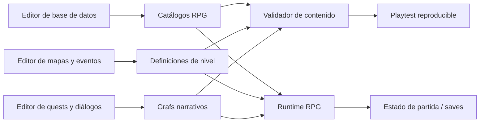
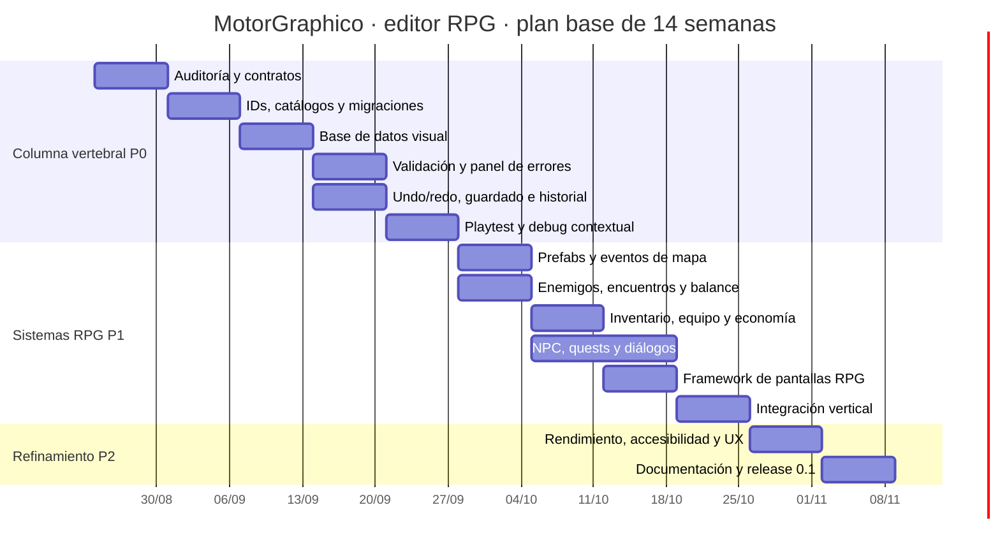

# Hoja de ruta del editor RPG

## Objetivo

Convertir MotorGraphico en un editor capaz de llevar una idea desde el diseño
hasta un nivel jugable sin saltar continuamente entre JSON, código y archivos
sueltos. El editor debe servir a tres perfiles:

- **Diseñador de juego:** define reglas, enemigos, objetos, economía y balance.
- **Diseñador de niveles:** construye mapas, coloca eventos y conecta escenas.
- **Escritor/autor:** crea diálogos, quests, elecciones y condiciones.

La referencia visual será el JRPG clásico: menús jerárquicos, lectura clara,
paneles de estado y una navegación consistente. RPG Maker aporta el patrón de
flujo `Database → Map → Event → Playtest`, pero no se copiará su interfaz.

## Estado actual

**Hito P0 iniciado.** `EditorValidation::checkRpg()` ya añade una pasada de
contenido sobre la validación geométrica existente. Comprueba referencias de
skills contra `SkillCatalog`, sprites contra el atlas disponible cuando se le
proporciona, salud/maná de enemigos, power/precio de pickups, configuración de
NPCs y transiciones. El demo GL-free `demo_editor_state` cubre tanto un catálogo
roto como uno válido y mantiene el resto de pruebas de round-trip TMX/JSON.

## Qué hemos aprendido de otros equipos y usuarios

En experiencias públicas de desarrolladores se repiten estas necesidades:

1. La edición manual de datos funciona al principio, pero se vuelve frágil
   cuando crecen monstruos, objetos, quests y diálogos. Se pide búsqueda,
   filtros, edición masiva, IDs estables y detección de referencias rotas.
2. El contenido narrativo no debe estar repartido entre código, CSV, mapas y
   notas: el autor necesita ver relaciones, condiciones y estado desde una
   herramienta visual.
3. Un editor sin playtest y depuración contextual deja al diseñador esperando
   a ingeniería; el ciclo `editar → validar → jugar → inspeccionar → corregir`
   debe ser corto.
4. Inventario, quests y diálogos tienen muchas interacciones entre sí. Por eso
   conviene diseñar primero contratos de datos simples y reutilizables, no
   añadir pantallas aisladas.
5. Las pantallas RPG son contenido, no únicamente HUD: pausa, batalla, tienda,
   diálogo, equipo, diario y mapa deben compartir navegación, focus, selección,
   confirmación, cancelación y estilos.

Estas conclusiones proceden de discusiones de desarrolladores sobre editores de
contenido, sistemas de diálogo, quests e inventario, además de guías de flujo de
RPG Maker. No son una encuesta estadística; las usamos como señales de riesgo y
como hipótesis para validar con prototipos.

## Núcleo de necesidades

### P0 — Imprescindible para que el editor escale

| Área | Necesidad | Criterio de terminado |
|---|---|---|
| Datos | Catálogo único con IDs estables para enemigos, NPC, objetos, skills, estados y pantallas | Cada referencia se puede buscar, renombrar con migración y validar |
| Autoría | Base de datos con filtros, búsqueda, duplicar, plantillas y edición por lotes | Crear un enemigo u objeto no requiere tocar C++ ni JSON a mano |
| Mapas | Capas, paleta de prefabs, eventos, spawns, transiciones y propiedades por instancia | Colocar y configurar un objeto desde el mapa produce un nivel exportable |
| Validación | Referencias rotas, sprites ausentes, IDs duplicados, colisiones, accesibilidad y softlocks | El botón Playtest explica cada error con archivo, entidad y coordenada |
| Playtest | Lanzar el juego desde el editor y volver al mismo contexto | El error se puede inspeccionar desde mapa/entidad sin perder la selección |
| Persistencia | Guardado atómico, undo/redo, historial y export reproducible | Un cambio se puede deshacer y el JSON resultante es estable en Git |

### P1 — Lo que define un RPG completo

| Área | Necesidad | Alcance inicial |
|---|---|---|
| Enemigos | Arquetipos, stats, resistencias, skills, loot, IA, fases y recompensas | Enemigo normal, élite y jefe con fases configurables |
| Combate | Varios aliados/enemigos, turnos, estados, targeting y preview de daño | Ampliar el MVP actual sin romper `BattleState` |
| Inventario | Consumibles, armas, armaduras, key items, stacks, peso/capacidad y equipo | Catálogo + inventario de partida + pantalla visual |
| NPC | Diálogo, tienda, horario/estado, facción y condiciones | NPC reutilizable con referencias a diálogo y quest |
| Narrativa | Quests, objetivos, flags, variables, condiciones y diálogos ramificados | Grafo visual con preview de caminos y warnings |
| Pantallas | Pausa, batalla, tienda, diálogo, equipo, diario y mapa | Plantillas de pantalla con componentes compartidos |

### P2 — Refinamiento y productividad

- Prefabs de mapa y variantes locales.
- Multi-selección, copiar/pegar, alineación y edición masiva.
- Vista de dependencias: “qué mapas, quests y diálogos usan este ID”.
- Simulador de economía y balance de encuentros.
- Hot reload de catálogos y localización.
- Telemetría de errores de autoría y accesibilidad del editor.

## Arquitectura propuesta

La regla principal será: **el catálogo define el tipo; el mapa define la
instancia; la partida define el estado mutable**.

### Contratos que debemos estabilizar

- `ObjectDefinition`: tipo reutilizable; ya existe y debe crecer sin mezclar
  estado de partida.
- `ObjectSpawn`: instancia dentro de un nivel; ya existe y debe absorber
  eventos, loot overrides y condiciones locales.
- `SkillDefinition`: skill y efectos; debe salir de la lógica implícita de
  `BattleState`.
- `ItemDefinition` / `EquipmentDefinition`: separar pickup del objeto que se
  puede equipar, conservando compatibilidad con `PickupData`.
- `QuestDefinition` / `DialogueGraph`: nodos, condiciones, acciones y
  referencias estables.
- `ScreenDefinition`: composición de una pantalla y sus comandos, no código
  específico de cada menú.

No conviene migrar todo de golpe. Primero se añade validación y compatibilidad
con los JSON actuales; después se migran categorías y se retiran los campos
antiguos solo cuando exista una herramienta de migración.

## Gantt propuesto

Plan base de 14 semanas para una persona desarrollando el núcleo con revisiones
frecuentes. Las semanas son relativas para no fijar fechas artificiales; al
comenzar una fase se debe añadir una demo verificable y un conjunto de datos de
prueba.

| Trabajo | P0 | P1 | P2 | Dependencias |
|---|:---:|:---:|:---:|---|
| **S1 · Auditoría y contratos** | █ |  |  | Estado actual |
| **S2 · IDs, catálogos y migraciones** | █ |  |  | S1 |
| **S3 · Base de datos visual** | █ |  |  | S2 |
| **S4 · Validación y panel de errores** | █ |  |  | S2, S3 |
| **S5 · Undo/redo, guardado e historial** | █ |  |  | S3 |
| **S6 · Playtest y debug contextual** | █ |  |  | S4, S5 |
| **S7 · Prefabs y eventos de mapa** |  | █ |  | S3, S4 |
| **S8 · Enemigos, encuentros y balance** |  | █ |  | S2, S6 |
| **S9 · Inventario, equipo y economía** |  | █ |  | S2, S8 |
| **S10 · NPC, quests y diálogos** |  | █ |  | S2, S4, S7 |
| **S11 · Framework de pantallas RPG** |  | █ |  | S3, S9 |
| **S12 · Integración vertical** |  | █ |  | S7–S11 |
| **S13 · Rendimiento, accesibilidad y UX** |  |  | █ | S12 |
| **S14 · Documentación, ejemplos y release 0.1** |  |  | █ | S12, S13 |

### Hitos de aceptación

- **H1 — Semana 4:** crear un enemigo, objeto y NPC desde la base de datos; el
  validador detecta un ID roto y lo lleva al origen.
- **H2 — Semana 6:** abrir un mapa, colocar un prefab de cofre/enemigo/NPC,
  guardar, lanzar playtest y volver con la coordenada seleccionada.
- **H3 — Semana 9:** una batalla con varios combatientes consume objetos,
  concede loot y conserva el inventario al volver a explorar.
- **H4 — Semana 11:** una quest cambia un diálogo, habilita una tienda y abre
  una transición de mapa sin lógica hardcodeada.
- **H5 — Semana 12:** demo vertical de 10 minutos hecha solo con las
  herramientas del editor.
- **H6 — Semana 14:** release 0.1 con documentación, ejemplo reproducible,
  validación automática y formato de contenido versionable.

## Priorización práctica

Durante las próximas iteraciones no conviene empezar por más decoración visual
del HUD. El orden que ofrece más retorno es:

1. **Validación + catálogo navegable.** Evita que el contenido crezca roto.
2. **Prefabs/eventos de mapa.** Convierte el editor en una herramienta útil de
   producción, no solo en un pintor de tiles.
3. **Playtest contextual.** Reduce el tiempo entre una decisión y su prueba.
4. **Inventario/equipo y pantallas.** Da forma al RPG jugable.
5. **Quests/diálogo visual.** Evita que la narrativa termine repartida en
   código y archivos desconectados.
6. **Pulido visual y productividad.** Solo después de validar el flujo completo.

## Preguntas de producto que debemos resolver antes de P1

- ¿El RPG será principalmente por turnos, táctico por casillas o híbrido?
- ¿Habrá equipo con estadísticas o solo consumibles/key items en la primera
  versión?
- ¿Las quests tendrán ramas reales o estados lineales con condiciones?
- ¿El mapa será siempre isométrico 2:1?
- ¿El formato público seguirá siendo JSON/TMX o aceptaremos una base SQLite
  interna con exportación?

Mi recomendación es mantener JSON/TMX en la primera release por transparencia,
Git y facilidad de inspección, pero construir una capa de repositorio que pueda
usar SQLite más adelante sin cambiar la interfaz del editor.

## Fuentes consultadas

- [RPG Maker MV Quickstart: map editor, event editor y database](https://steamcommunity.com/sharedfiles/filedetails/?id=691462881)
- [RPG Maker XP guide: database, mapas y eventos](https://steamcommunity.com/sharedfiles/filedetails/?id=239704501)
- [Experiencia sobre el coste de construir herramientas de producción](https://www.reddit.com/r/gamedev/comments/1dejr8l/the_time_between_building_the_tools_to_make_the/)
- [Experiencias sobre datos, editores de quests y depuración contextual](https://www.reddit.com/r/gamedev/comments/1chldlr/how_do_you_internally_handle_side-quests/)
- [Experiencias sobre la dificultad de los sistemas de diálogo](https://www.reddit.com/r/gamedev/comments/1sxuzzn/where_do_dialogue_systems_in_unity_start_breaking/)
- [Experiencias sobre inventarios y complejidad RPG](https://www.reddit.com/r/gamedev/comments/1cuhn13/the_reality_of_game_dev_for_my_past_year/)
