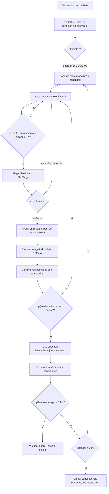
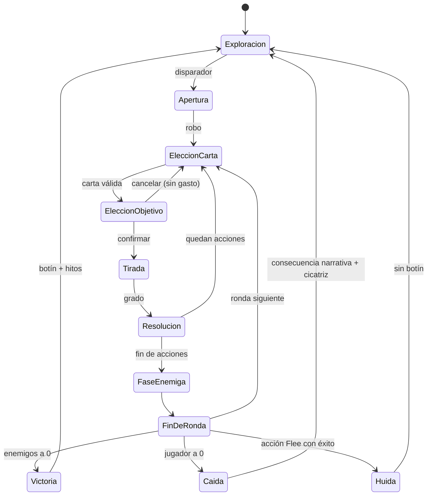

# WF-01 — Combate táctico: cartas, pool de d6 y caída sin «Game Over»

> **Estado**: DISEÑO. Especifica *lo que debe pasar*, no lo que el motor hace hoy.
> **Fuente**: `DOCUMENTO_DE_ALCANCE_Y_VISION.md` §6, §10.6, §10.7. Reglamento: dndWeebCC Ed. 3/Ed. 4 (BITÁCORA 2.1: manda sobre este documento).
> **Referentes**: Baldur's Gate 3 (riqueza táctica y turno legible) + juego de mesa (mano de cartas y dados sobre la mesa).
> **Convención de rutas**: las evidencias son relativas a `MotorGraphico-main/MotorGraphico/`.
> **Gantt**: AV5-01…AV5-10, AV1-04, AV1-05, AV3-02, AV9-05, AV12-04.
> **Objetivo BG3 (Oriol, 14/10)**: el tablero, el alcance, las áreas, la IA y el gamefeel están en `../COMBATE_BG3.md` y en las fases AV13 y AV14 ([D0014](../../decisiones/D0014-combate-roce-esbirros-y-objetivo-bg3.md)). Aquí siguen mandando las reglas.
> **Se cruza con**: WF-04 (cicatrices, venas de maná, delito por matar), WF-06 (mazo, tier, botín→peso), WF-02 (ruido del combate), WF-03 (oro robado al caer), FS-01 (guardias), FS-07 (decorado destruible).

---

## 1. Qué tiene que sentir el jugador

Que está jugando una mesa de rol con dados de verdad, no un *hack and slash* con números ocultos. Cada decisión del turno se ve: la carta que eliges, lo que cuesta, los dados que ruedan en el centro de la pantalla y por qué has ganado o perdido ese intercambio. Y cuando pierdes, **el mundo sigue**: te despiertas atado a un árbol con una cicatriz nueva y menos oro, no delante de una pantalla de carga.

## 2. Actores y estado

| Entidad | Datos que aporta | Dónde vive hoy | Quién manda |
|---|---|---|---|
| Personaje jugador | tier, PV, clase y segunda clase, hitos, oro, moral, facción primaria, equipo | `include/RPG/CharacterSheet.h` | cartas (dndWeebCC) |
| Bando aliado | compañeros con personalidad y sus propias cartas | `include/Game/Companeros.h` | canon (Onegai 2) |
| Enemigo | ficha por tier, cerebro táctico, `lootIds` | `include/Game/EnemyBrainData.h`, `EnemyCatalogBridge.h` | cartas |
| Carta de habilidad | `SkillDefinition`: coste, enfriamiento, alcance, `SkillTarget`, magnitud por grado | `include/RPG/Definitions/SkillDefinition.h`, `include/RPG/SkillTarget.h` | cartas |
| Mazo y mano | `maxSkillCards` y `startingCards` de la clase; `handLimit`, `maxDivineCards` del tier | `include/RPG/Catalogs/CatalogLoadersPersonaje.h`, `include/RPG/TierRules.h` | cartas |
| Tirada | pool de d6, éxitos, grado, crítico, pifia | `include/RPG/DicePoolEngine.h` + `RandomEngine.h` | cartas (Ed. 3) |
| Condiciones | sangrado, veneno, bendición: `roundsRemaining`, `stacks`, stacking | `include/RPG/ConditionEngine.h` | cartas |
| Botín | tabla de drop por monstruo | `include/RPG/LootResolver.h`, `GameSession::repartirBotin` | motor |
| Campo | cobertura, objetos arrojadizos, fuego | `include/World/World.h` (parcial) | motor |

## 3. Magnitudes del flujo

| Magnitud | Rango | Origen / fórmula | Escribe | Lee |
|---|---|---|---|---|
| Éxitos del pool | 0, 0.5, 1.0, 1.5… | N d6 con N = stat efectivo; 6 = 1 éxito, 5 = 0.5 | `DicePoolEngine` | resolución de daño y salvaciones |
| Grado | BOTCH / PARTIAL / SUCCESS / CRITICAL | enfrentada `opposed_degree()` | `DicePoolEngine` | `SkillDefinition::magnitude_by_degree` |
| PV | 0…`healthCap` (125 en T5) | tier + `healthBonus` | combate | HUD, `GameOver`, cobarde huye a 25 % |
| Mano | 0…`handLimit` (28 en T5) | tier | fase de robo | HUD de cartas |
| Coste de carta | PM / PA (por decidir, D-COMB-06) | `SkillDefinition` | fase de acción | HUD, validación |
| Enfriamiento | rondas | `SkillDefinition` | resolución | carta atenuada en la mano |
| Hitos | entero, `needed = tier + 1` | concesión narrativa | victoria / hito de historia | `tierUp()` |
| Cicatriz | acumulativa, permanente | cada derrota | WF-04 | apariencia y reacción de NPC |

## 4. Disparadores

1. **Hostilidad declarada**: el jugador ataca, roba con testigo o falla un soborno (FS-01).
2. **Detección**: un enemigo con estado rojo identifica al jugador (FS-06 patrullas).
3. **Emboscada guionizada**: un beat narrativo fuerza el combate (`NarrativeBeat`, `SessionCommandHost`).
4. **Defensa de terceros**: atacar a un aliado de una facción en su territorio (§10.3.C).

## 5. Flujo paso a paso (una ronda)

| Paso | Qué pasa | Regla dura | Si falla |
|---|---|---|---|
| Entrada | `GameMode::Battle`; el mundo deja de avanzar | una sola fuente de turno | si el reloj sigue, las rentas se cobran durante el combate |
| Robo | se rellena la mano desde el mazo | `handLimit` del tier; mazo agotado → barajar descarte | sin barajado, el combate largo se vuelve imposible |
| Elección | la carta muestra coste, alcance y enfriamiento | no se puede jugar en rojo | mensaje del motivo (patrón `whyCannotUse`) |
| Objetivo | `SkillTarget` resuelve válidos en el mapa | área y línea de visión | si no hay objetivo legal, la carta no se consume |
| Tirada | pool enfrentado, dados visibles | Ed. 3: sin CA ni CD, **todo** es enfrentada | daño plano = volver al motor pre-`DicePoolEngine` |
| Efecto | magnitud por grado + condiciones | stacking: reemplazar / refrescar / sumar | condiciones que se apilan infinitamente |
| Baja | enemigo muere → `repartirBotin` | el botín entra **una** vez | duplicar oro/objetos |
| Enemigo | IA agresivo / cobarde (huye a 25 %) / emboscador | el cobarde huye de verdad | IA que se suicida quita tensión |
| Derrota | noqueo + robo, rescate del eremita, cicatriz | sin pantalla negra (§10.6.B) | `GameOver` terminal corta la partida |

## 6. Máquina de estados

## 7. Reglas y números (con su procedencia)

- **Pool**: N d6, N = stat o valor efectivo de la fuente. Cada **6 = 1 éxito**, cada **5 = 0.5**. Ventaja: los 4 también suman 0.5. Desventaja: solo cuentan los 6. (`DicePoolEngine.h`, GDD Llibre II + Ed. 3, BITÁCORA 2.17.)
- **Crítico**: **todos** los dados son 6. **Pifia (Ed. 3)**: ningún 5 ni 6 **y** mínimo dos 1es. Un pool de 0 dados no es pifia: no suma nada y resuelve la enfrentada.
- **Sin CA ni CD**: toda resolución (combate, hechizos, checks narrativos) es una tirada enfrentada (`opposed_degree()`).
- **Tier**: 0…5. `handLimit` crece con el tier (T5 = 28), `healthCap` 125, `healthBonus` 25, `maxDivineCards` 8, `maxSummons` 6, multiclass permitido según tier (`TierRules.h` ← `assets/rules/tier_rules.json`).
- **Progresión**: el reglamento **no va de XP, va de hitos** (`CharacterSheet.h:72`): T0→T1 = 1 hito, T1→T2 = 2, T2→T3 = 3 (`needed = tier + 1`).
- **Cartas de Creadores**: legendarias, ligadas a Run'Vel / Voluntades Gemelas / TML, alteran clima o física del campo (§6.2). Tope por `maxDivineCards`.
- **Caída**: bandidos → noqueo + robo del oro de la bolsa; fieras → rescate del eremita; ambas → **cicatriz permanente** (§10.6.B).

## 8. Consecuencias cruzadas (quién se entera)

| Evento del combate | Efecto fuera del combate | Flujo dueño |
|---|---|---|
| Derrota del jugador | cicatriz nueva, oro robado, salto de calendario | WF-04, WF-03, WF-05 |
| Muerte de un civil o guardia con testigo | delito mayor → niveles de alerta 1-5 | FS-01 |
| Matar en territorio de una facción | ±reputación en esa facción y en la rival | WF-04 |
| Lanzar hechizos repetidamente | venas de maná visibles | WF-04 |
| Combate ruidoso en ciudad | patrullas en estado naranja/rojo | FS-01, FS-06 |
| Flecha incendiaria sobre cortina o tonel | incendio que propaga y vacía la sala | FS-07 |
| Botín recogido | peso → banda de carga → movilidad y ruido | WF-06, WF-02 |
| Victoria sin matar (resolver por diálogo) | hitos igual, y reputación distinta | WF-07, WF-04 |

## 9. Feedback al jugador

- **Dados**: animación 3D de d6 en el centro del HUD, información sintética (éxitos, crítico, pifia) y **sin pantallas de texto farragosas** (§6.3). Tarea AV1-04.
- **Mano visible**: cartas con coste, enfriamiento en gris y alcance; límite de mano marcado por el tier (AV5-01).
- **Condiciones**: iconos con rondas restantes (AV1-05).
- **Barra contextual** `[ESC] [I] [E] [M]` adaptada al modo combate (AV1-02).
- **Log de batalla** con el motivo de cada cambio (mismo principio que `Morality::record(delta, reason)`): el jugador debe poder responder «¿por qué he fallado?».

## 10. Casos límite, abusos y antipatrones

1. Mano vacía y mazo agotado → barajar el descarte (el catálogo ya contempla `restorePileCards` en objetos).
2. Cancelar después de elegir objetivo **no** gasta recurso ni enfriamiento.
3. Huir no suelta botín y deja al enemigo vivo (ya probado en H2-05).
4. Enemigo cobarde que huye: no debe dar botín ni hitos completos.
5. Combate dentro de una instancia privada: el Master puede pausar el mundo (AV6-15) — definir si el combate se congela entero.
6. Dos facciones enfrentándose a la vez: ¿un solo combate con tres bandos o dos combates encadenados?
7. Abuso: entrar y salir del combate para reiniciar enfriamientos → el enfriamiento debe persistir entre rondas y tras huir.
8. `pool = 0` por condiciones que restan dados: no es pifia (ya resuelto aguas abajo).

## 11. Qué YA existe en el motor y qué falta

| Pieza | Estado | Evidencia |
|---|---|---|
| Turno por bandos sin iniciativa | **existe** (deliberado: «sin velocidad/iniciativa») | `include/Game/BattleState.h:24-32` |
| Acciones Attack / UseSkill / Item / Flee | existe | `BattleState.h` (`BattleActionType`) |
| Pool de d6 Ed. 3 (éxitos, crítico, pifia, ventaja) | existe, GL-free y sin estado | `include/RPG/DicePoolEngine.h` |
| IA enemiga con comportamiento | existe | `include/Game/EnemyBrain.h`, `EnemyBrainData.h` |
| Condiciones con rondas y stacking | existe | `include/RPG/ConditionEngine.h` |
| Datos de mazo (mano, cartas iniciales, divinas) | existe **como datos**, no como runtime | `CatalogLoadersPersonaje.h:34-48`, `TierRules.h` |
| Botín al ganar | existe y verificado 28/09 (`test_game_session` 24/24) | `GameSession::repartirBotin` (H2-05) |
| Menú de combate en HUD | existe | `include/Game/BattleMenuState.h`, `BattleMenuActions.h` |
| Mano de cartas visible y robo | **falta** | AV5-01 |
| Dados animados en el HUD | **falta** (solo `rolls` en el resultado) | AV1-04 |
| Iniciativa | **falta** y el motor la evita a propósito | D-COMB-03 |
| Cobertura, objetos arrojadizos, incendios | **falta** | AV5-08, AV9-05 |
| Caída sin Game Over | **contradicho**: `GameMode::GameOver` es terminal | `include/Game/SessionTipos.h:25`, `GameSession.h:461`, `GameOverScreen.h` |
| Cicatrices | **falta** (no hay sistema de apariencia) | AV3-01 |

## 12. Decisiones de diseño — respuesta de Oriol (28/09/2026)

> **Estado:** Oriol respondió en la última columna de esta tabla y en la columna «USUARIO DICE» de `DISCREPANCIAS_Y_DECISIONES.md`. Su texto se reproduce literal; las consecuencias para el plan y las tareas que las recogen están en `../DECISIONES_RESUELTAS.md` (generado por `build.py`). **Asumidas (confirmar):** D-COMB-02, D-COMB-05 — Oriol dejó en blanco la aclaración y se aplica la recomendación.

| #         | Pregunta                                                                                             | Opciones                                                                 | Recomendación                                                                 | Bloquea         |                                                                                                                           |
| --------- | ---------------------------------------------------------------------------------------------------- | ------------------------------------------------------------------------ | ----------------------------------------------------------------------------- | --------------- | ------------------------------------------------------------------------------------------------------------------------- |
| D-COMB-01 | ¿Qué caras cuentan como éxito? El doc §10.6 dice 4-5-6; el reglamento Ed. 3 dice 6 = 1 y 5 = 0.5     | (a) reglamento Ed. 3, (b) doc de visión                                  | **(a)**: BITÁCORA 2.1 pone cartas por encima del doc; corregir §10.6          | AV5-03, AV12-04 |                                                                                                                           |
| D-COMB-02 | Crítico y pifia: doc dice «doble 6» / «doble 1»; motor dice «todos 6» / «ningún 5-6 y ≥2 unos»       | (a) motor/Ed. 3, (b) doc                                                 | **(a)** y reescribir §10.6.A.4                                                | AV5-03          |                                                                                                                           |
| D-COMB-03 | ¿Hay iniciativa (1d6 + DES) o se mantiene el turno simple por bandos?                                | (a) sin iniciativa, (b) iniciativa ligera, (c) iniciativa completa       | **(b)** solo si el contenido la exige: el motor la evitó por sobre-ingeniería | AV5-06          |                                                                                                                           |
| D-COMB-04 | ¿La «carta» es una vista visual de `SkillDefinition` o una entidad nueva con su propio catálogo?     | (a) vista, (b) entidad nueva                                             | **(a)**: los catálogos ya traen `maxSkillCards`, `startingCards`, `handLimit` | AV5-01          | Son las habilidades referenciadas por ejemplo en las clases referenciadas en discrepancias_y_decisiones                   |
| D-COMB-05 | Caída sin Game Over: ¿se retira `GameMode::GameOver` terminal o se reinterpreta como «consecuencia»? | (a) reutilizarlo como estado de consecuencia, (b) modo nuevo `Derrotado` | **(a)** con salida narrativa obligatoria                                      | AV5-07          |                                                                                                                           |
| D-COMB-06 | ¿El coste de carta es PA, PM o ambos?                                                                | (a) PM único, (b) PA por ronda + PM para magia                           | **(b)**: distingue el guerrero del mago                                       | AV5-02          | Solo es cooldown dependiendo si es reposo corto o largo, si no esta indicado en una habilidad contaremos todas como largo |
| D-COMB-07 | Vida por tier vs `healthCap` (T5 = 128/192 contra tope 125) — ya está en «Esperando a Oriol»         | (a) subir el tope, (b) bajar la vida por tier                            | decidir con el reglamento delante                                             | AV12-04         | Vida fija + equipo para ampliarla                                                                                         |

## 13. Criterio de cierre y guion de prueba jugable

**Cerrado cuando** un jugador pueda: entrar en combate, ver su mano con el límite del tier, jugar una carta con coste y alcance, ver los dados y el grado, recibir condiciones con sus rondas, ganar y cobrar el botín una sola vez, perder y despertar con una cicatriz y menos oro — todo sin salir del ejecutable y sin pantalla de Game Over.

**Guion de prueba** (se ejecuta en la partida guionizada de AV12-02):
1. Hablar con el bandido y elegir la opción hostil → entra en combate.
2. La mano se llena hasta `handLimit` del tier actual.
3. Jugar una carta sin PM suficiente → motivo visible, nada se gasta.
4. Jugar un ataque → dados animados, éxitos contados, daño coherente con el grado.
5. Cancelar en la elección de objetivo → la carta vuelve a la mano intacta.
6. Matar al enemigo → línea de botín con el nombre del objeto, una sola vez.
7. Recibir sangrado → icono con rondas restantes que descuenta.
8. Perder el combate siguiente → despertar en la cuneta, oro reducido, cicatriz nueva en la ficha.
9. Comprobar que el reloj de rentas no ha cobrado durante el combate.
10. Repetir con la misma semilla (`RandomEngine`) → la batalla es idéntica.
