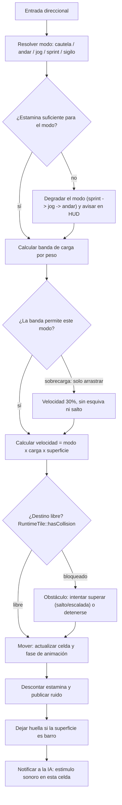
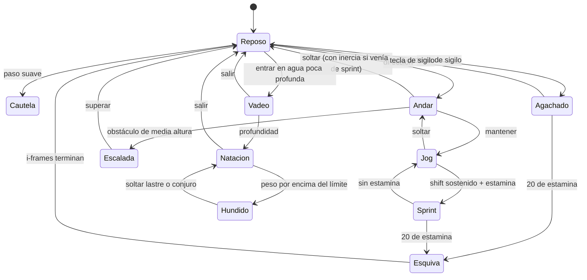

# WF-02 — Movimiento del jugador: locomoción, estamina, ruido y carga

> **Estado**: DISEÑO. Especifica *lo que debe pasar*, no lo que el motor hace hoy.
> **Fuente**: `DOCUMENTO_DE_ALCANCE_Y_VISION.md` §10.12 (A modos, B carga, C biomecánica) y §10.1.B (propagación acústica).
> **Referentes**: GTA 5 (mundo abierto vivo y multitudes) + Fallout (el peso importa) + sigilo de mesa.
> **Convención de rutas**: relativas a `MotorGraphico-main/MotorGraphico/`.
> **Gantt**: AV7-01…AV7-07, AV1-07, AV8-01 (el ruido alimenta los conos de visión).
> **Se cruza con**: WF-06 (peso del inventario), FS-01 (ruido → sospecha → guardia), FS-06 (patrullas que escuchan), WF-01 (esquiva en combate).

---

## 1. Qué tiene que sentir el jugador

Que su cuerpo pesa y hace ruido. Correr con placas de hierro por un callejón de barro no es «ir más rápido»: es firmar tu propia orden de detención. Cada modo de locomoción es una decisión táctica con un precio visible (estamina) y un precio invisible (ruido que otros escuchan).

## 2. Actores y estado

| Entidad | Datos | Dónde vive hoy | Quién manda |
|---|---|---|---|
| Jugador | posición en celda, dirección, fase de animación | `GameSession::tryMovePlayer(dx,dy)`, `Render/Player.h` | motor |
| Entrada direccional | orden de pulsación, tap pendiente, repetición | `include/Game/PlayerControlsData.h` | motor |
| Baldosa | `tilesetID`, `collision`, `variant` | `include/Runtime/RuntimeTile.h` | motor |
| Mapa | capas de baldosas y objetos | `include/Render/TileMap.h`, `include/Map/MapDocument.h` | motor |
| Ficha | Fuerza (para la banda de carga), equipo con `weightCategory` | `include/RPG/CharacterSheet.h`, `InventoryEngine::check_weight` | cartas |
| Estamina | **no existe** | — | por decidir (AV0-01) |
| Ruido | **no existe** | — | por decidir (AV0-01) |
| Superficie | **no existe**: la baldosa sabe si bloquea, no de qué es | — | motor |

## 3. Magnitudes del flujo

| Magnitud | Rango | Fórmula / origen | Escribe | Lee |
|---|---|---|---|---|
| Velocidad | 0.3×…2.6× | modo de locomoción × banda de carga × superficie | locomoción | animación, IA |
| Estamina | 0…100 | −2/s en jog, −12/s en sprint, −20 instantáneos en esquiva; recupera en reposo | locomoción | HUD (AV1-07), esquiva |
| Ruido | 0…8 m | modo + calzado + armadura + superficie | locomoción | conos de visión (AV8-01), patrullas |
| Peso | kg | suma del inventario; bandas contra `Fuerza × 5 kg` | WF-06 | movilidad, natación, fat roll |
| Huellas | 45 s | barro o lluvia + paso | superficie | rastreo por sabuesos (FS-01) |
| Tracción | 60 %…100 % | material del suelo | superficie | derrape, caída en hielo |

## 4. Disparadores

1. Entrada direccional del jugador (tecla o stick) → modo por defecto.
2. Tecla de modo: agacharse, sprint sostenido, esquiva, saltar/escalar, interactuar con el agua.
3. Cambio de baldosa → recalcular superficie, ruido y huellas.
4. Cambio de inventario → recalcular banda de carga (WF-06 avisa).
5. Clima → la lluvia convierte adoquín en superficie resbaladiza y ruidosa (FS-07).

## 5. Flujo paso a paso (un paso de movimiento)

| Paso | Qué pasa | Regla dura | Si falla |
|---|---|---|---|
| Modo | se elige por entrada y por lo que el cuerpo permite | la sobrecarga **prohíbe** modos, no solo los ralentiza | el jugador corre con 150 kg |
| Estamina | se gasta por segundo de modo | sin estamina se degrada el modo, nunca se queda «pegado» | sprint infinito |
| Carga | cuatro bandas contra `Fuerza × 5 kg` | la banda cambia la esquiva (fat roll) y el ruido | el peso se vuelve decorativo |
| Superficie | adoquín 100 %, barro 60 % + huellas, hielo/aceite con salvación, madera crujiente | la salvación de hielo es DC 11 (§10.12.C) | resbalar sin regla = arbitrariedad |
| Colisión | la celda destino decide | una sola fuente: `RuntimeTile::hasCollision` | atravesar muros |
| Ruido | se publica como dato consultable | la IA lo lee, no lo adivina | sigilo imposible de balancear |
| Multitud | chocar a 2.6× desequilibra al civil | el civil tira lo que lleva y se enfada | atropellar NPC sin consecuencia |

## 6. Máquina de estados

## 7. Reglas y números (procedencia: §10.12)

| Modo | Velocidad | Ruido | Estamina |
|---|---|---|---|
| Paseo cautelo | suave | 0 m | 0 |
| Caminar | 1.0× | 3 m | 0 |
| Carrera ligera (jog) | 1.8× | 8 m | 2/s |
| Sprint | 2.6× | por calzado y armadura | 12/s |
| Sigilo (agachado) | reducido | amortiguado; silueta −50 % | 0 |
| Esquiva (roll/dash) | impulso | — | −20 instantáneos, i-frames o +4 a la defensa |

- **Inercia**: frenar en seco o girar 180° en sprint → derrape de 0.4 s con polvo o barro.
- **Carga** (contra `Fuerza × 5 kg`): ligera <33 % → 100 % movilidad; media 33-66 % → 85 % y +25 % de gasto; pesada 66-100 % → 65 %, sin sprint continuo, fat roll, la armadura suena; sobrecarga >100 % → 30 %, sin esquiva ni salto, y >150 % daño lumbar gradual.
- **Agua**: vadeo al 70 % con chapoteo audible; natación imposible con placas (~30 kg) → hundimiento y asfixia salvo conjuro.
- **Superficies**: barro 60 % + huellas 45 s rastreables; hielo/aceite → salvación de Destreza DC 11, caída 2 s y vulnerabilidad a críticos; madera vieja → «¡CRACK!» aleatorio que alerta la habitación contigua.
- **Radio sonoro**: placas corriendo = 8 m; botas de cuero agachado = 0 m (§10.1.B).

## 8. Consecuencias cruzadas

| Evento | Quién se entera | Efecto |
|---|---|---|
| Ruido por encima del umbral del NPC | FS-01, FS-06 | barra de sospecha, estado amarillo de patrulla |
| Huellas en barro | FS-01 | sabuesos y cazarrecompensas siguen el rastro exacto |
| Chapoteo en vadeo | FS-01 | delata la posición en sigilo |
| Chocar con un civil a sprint | WF-04, FS-01 | enfado inmediato, posible delito menor si empuja |
| Entrar con armadura ruidosa en distrito noble | WF-04 | percepción social, guardias atentos |
| Peso alto al nadar | WF-06 | hundimiento y daño por asfixia |
| Pisar madera crujiente en modo sigilo | FS-06 | alerta instantánea de la sala |
| Fatiga acumulada por trabajos forzados | WF-04, FS-02 | estamina máxima reducida y musculatura ensanchada |

## 9. Feedback al jugador

- Barra o anillo de **estamina** en el HUD, y contrato único de lectura (AV1-07): estamina, ruido y carga por el mismo canal.
- **Indicador de ruido** discreto (ondas al pisar) cuando el paso supera los 3 m.
- **Icono de banda de carga** al abrir el inventario y aviso al cruzar de banda.
- Animación: fase al caminar, reposo orientado y profundidad visual (ya en vuelo en CONTROLES-01/02 de Codex).
- Audio espacial: chapoteo, crujido de madera, cascabeleo de placas (FS-07 y `RPG/Audio.h`).
- Derrape con polvo/barro y huella visible durante 45 s.

## 10. Casos límite, abusos y antipatrones

1. Pulsar y soltar rápido: **un solo tap pendiente**, y una pulsación nueva lo sustituye (ya resuelto en `PlayerControlsData`).
2. Cambiar de dirección nunca adelanta el paso anterior (`nextDirectionStep`).
3. Sprint con estamina a 0 → degrada a jog, no detiene al jugador en seco.
4. Esquiva encadenada: el coste de 20 debe impedir el «dash infinito».
5. Sobrecarga al 150 %: el daño lumbar no puede matar (es un freno, no una ejecución).
6. Nadar con el inventario lleno: o se ahoga o suelta lastre — debe existir una salida visible.
7. Entrar en una casa ajena agachado de día sigue siendo allanamiento (FS-01), aunque no hagas ruido.
8. El ruido no debe propagarse a través de muros: la distancia acústica necesita oclusión por capas.

## 11. Qué YA existe en el motor y qué falta

| Pieza | Estado | Evidencia |
|---|---|---|
| Movimiento por celdas con colisión | existe | `GameSession::tryMovePlayer(dx,dy)`, `RuntimeTile::hasCollision()` |
| Orden de pulsación, tap pendiente y repetición | existe (en vuelo CONTROLES-01/02) | `include/Game/PlayerControlsData.h` |
| Fase al caminar, reposo orientado, profundidad | en vuelo (Codex, 27-28/09) | TABLERO, fila CONTROLES-02 |
| Peso como **categoría** (light/medium/heavy) contra `maxArmorWeight` de la clase | existe | `include/RPG/InventoryEngine.h:70-101` |
| Estamina | **falta** (0 apariciones en `include/` y `src/`) | AV7-01, AV0-01 |
| Ruido como magnitud publicable | **falta** | AV7-07 |
| Superficie material de la baldosa | **falta**: solo `collision` y `variant` | AV7-05 |
| Peso en kg y bandas de carga | **falta**: el motor va por categorías | D-MOV-03 |
| Inercia, derrape e impacto en multitudes | **falta** | AV7-02 |
| Natación y hundimiento | **falta** | AV7-06 |
| Huellas rastreables | **falta** | AV7-05 |

## 12. Decisiones de diseño — respuesta de Oriol (28/09/2026)

> **Estado:** Oriol respondió en la última columna de esta tabla y en la columna «USUARIO DICE» de `DISCREPANCIAS_Y_DECISIONES.md`. Su texto se reproduce literal; las consecuencias para el plan y las tareas que las recogen están en `../DECISIONES_RESUELTAS.md` (generado por `build.py`). **Abiertas:** D-MOV-05 — sin respuesta; se planifica con la recomendación y siguen en su bandeja.

| #        | Pregunta                                                                        | Opciones                                                 | Recomendación                                                                                                                                          | Bloquea        |                                                                         |
| -------- | ------------------------------------------------------------------------------- | -------------------------------------------------------- | ------------------------------------------------------------------------------------------------------------------------------------------------------ | -------------- | ----------------------------------------------------------------------- |
| D-MOV-01 | ¿El movimiento sigue siendo **por celdas** o pasa a continuo con física?        | (a) celdas con interpolación visual, (b) continuo libre  | **(a)**: todo el motor (`tryMovePlayer`, `RuntimeTile`, IA, editor) está construido sobre celdas; lo continuo invalida colisión, patrullas y el editor | AV7-01…AV7-07  |                                                                         |
| D-MOV-02 | ¿La estamina es una magnitud nueva de la ficha o un recurso de combate?         | (a) nueva, fuera de la ficha D&D, (b) dentro de la ficha | **(a)**: el reglamento no la tiene; debe nacer en el motor y declararse en AV0-01                                                                      | AV0-01, AV7-01 | La estamina se usaria para correr o nadar o volar cosas asi, saltar etc |
| D-MOV-03 | Peso: ¿kg reales (Fuerza × 5) o categorías (light/medium/heavy) que ya existen? | (a) kg, (b) categorías mapeadas a bandas, (c) híbrido    | **(c)**: kg como dato de catálogo y bandas calculadas, respetando `check_weight` existente                                                             | AV7-04, WF-06  |                                                                         |
| D-MOV-04 | ¿El ruido se guarda por baldosa o se calcula al paso?                           | (a) evento puntual con radio, (b) campo persistente      | **(a)**: la IA solo necesita «estímulo en esta celda»                                                                                                  | AV7-07, AV8-01 | por calculo de tirada+ruido del sitio + si esta iluminado o sombreado   |
| D-MOV-05 | ¿La esquiva da i-frames o +4 a la defensa? El doc ofrece las dos                | (a) i-frames, (b) bonificador, (c) por tipo de esquiva   | **(b)**: encaja en la enfrentada Ed. 3 sin inventar invulnerabilidad                                                                                   | AV7-01, WF-01  |                                                                         |

## 13. Criterio de cierre y guion de prueba jugable

**Cerrado cuando** el jugador pueda distinguir cinco modos de movimiento con su coste, vea su estamina y su banda de carga, haga ruido distinto según calzado y suelo, y un guardia reaccione a ese ruido — todo medible desde el HUD y reproducible en una prueba GL-free.

**Guion de prueba**:
1. Andar por adoquín: sin gasto de estamina, ruido 3 m.
2. Sprint sostenido: la estamina baja a 12/s y al agotarse degrada a jog.
3. Recoger botín hasta carga pesada: el sprint queda prohibido y la esquiva se vuelve fat roll.
4. Cruzar un charco de barro: velocidad al 60 % y huella visible 45 s.
5. Pisar hielo corriendo: salvación de Destreza DC 11 y caída de 2 s si falla.
6. Pasar agachado junto a un guardia: no te detecta; pasar corriendo con placas: estado amarillo.
7. Chocar con un civil en sprint: se le cae la cesta y se enfada.
8. Entrar en el río con armadura de placas: se hunde y pierde PV por asfixia hasta soltar lastre.
9. Guardar y cargar la partida: estamina, banda y huellas coherentes.
10. Repetir el recorrido 3 con el mismo inventario → mismo resultado (determinismo de bandas).
