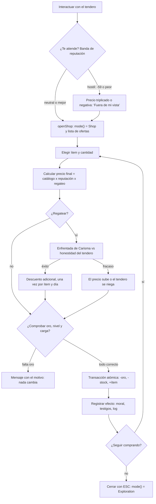
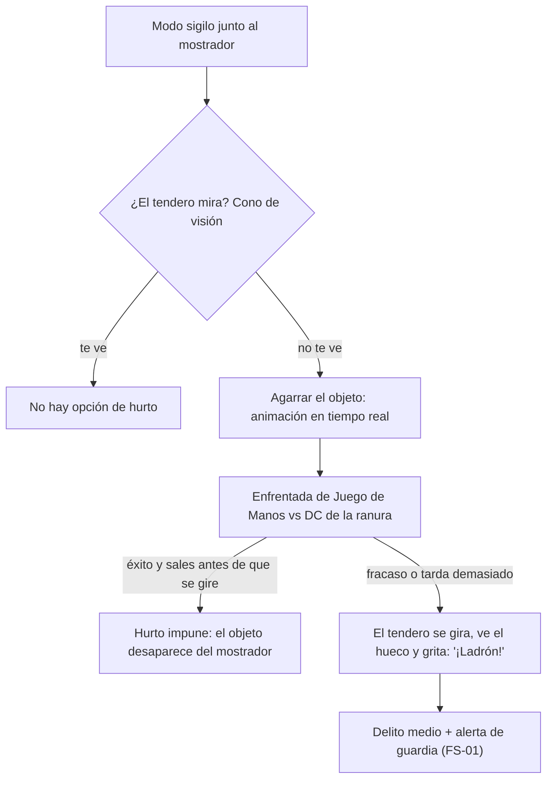
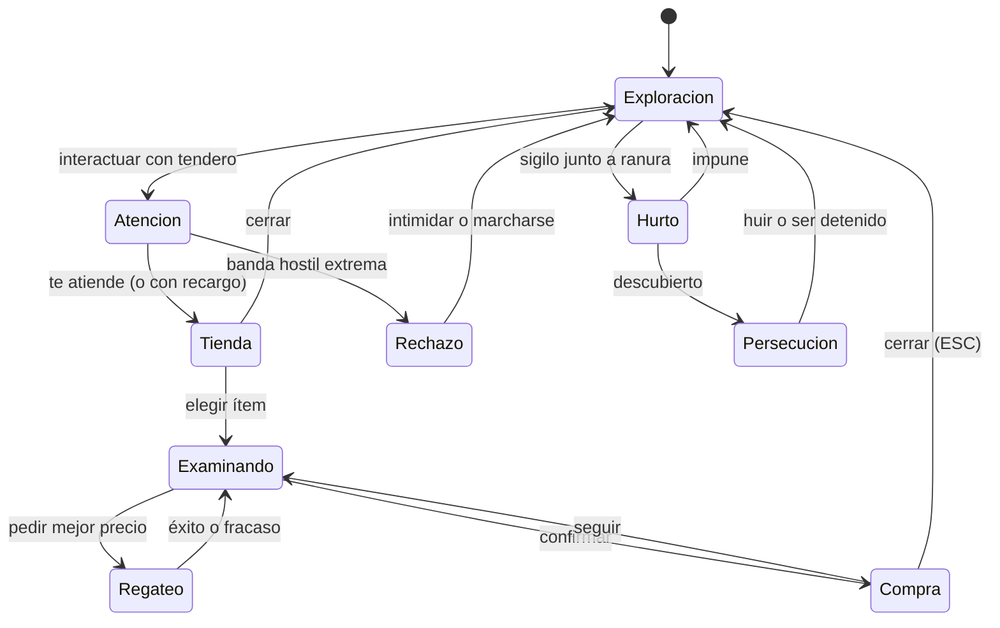

# WF-03 — Compras, ventas y regateo: el comercio como acto social

> **Estado**: DISEÑO. Especifica *lo que debe pasar*, no lo que el motor hace hoy.
> **Fuente**: `DOCUMENTO_DE_ALCANCE_Y_VISION.md` §5.4 (comercio profundo), §10.14.C (mercancía física y hurto), §11.7 (ranuras de mercancía en el editor).
> **Referentes**: Fable 2 (economía con consecuencias) + BG3 (el trato depende de quién eres).
> **Convención de rutas**: relativas a `MotorGraphico-main/MotorGraphico/`.
> **Gantt**: AV4-01, AV4-02, AV9-08, AV6-12, AV12-03; depende de AV0-01 (glosario) y AV10-02 (reloj de mundo para el restock).
> **Se cruza con**: WF-04 (reputación → descuento o precio triplicado), WF-05 (el oro viene de las rentas), WF-06 (lo comprado pesa y equipa), FS-01 (hurto = delito), FS-06 (el tendero es un NPC con rutina).

---

## 1. Qué tiene que sentir el jugador

Que la tienda es un **lugar**, no un menú: la poción está sobre el mostrador, la tendera se gira a buscar una tela y tú decides si la pagas o la coges. Que tu fama entra contigo por la puerta — el héroe de la región paga un 15 % menos y el proscrito ve los precios triplicados o directamente no es atendido. Y que el oro que gastas viene de algún sitio: de un botín, de una renta o de un trabajo.

## 2. Actores y estado

| Entidad | Datos | Dónde vive hoy | Quién manda |
|---|---|---|---|
| Oferta de tienda | `objectId`, `name`, `price` | `include/Game/SessionTipos.h:75-79` (`ShopOffer`) | motor |
| Ítem de vitrina (paralelo) | `id`, `name`, `price`, `stock`, `moralImpact`, `vendible`, `requiredLevel` | `include/Game/ShopEngine.h` (`ShopItem`) | motor |
| Tienda del mundo | objeto del catálogo con capacidad `tienda` | `GameSession::openShop(shopObjectId)` (E-04), `include/Level/LevelDefinition.h:109` | motor |
| Oro del jugador | `gold()` | `GameSession`, `CharacterSheet::gold`, `SaveGame` | motor |
| Precio base | `EquipmentDefinition::price` | catálogos de equipo (413 precios generados) | cartas |
| Reputación | banda por facción | **falta** (ver WF-04) | canon/cartas |
| Ranura física de mercancía | prop + ítem + DC de hurto + restock | **falta** (AV6-12, AV9-08) | editor |
| Reloj de mundo | horas y días para el restock | **parcial**: el reloj de rentas cuenta pasos, no tiempo | AV10-02 |

## 3. Magnitudes del flujo

| Magnitud | Rango | Origen | Escribe | Lee |
|---|---|---|---|---|
| Oro | 0… | botín, rentas, oficio, encargos | WF-03, WF-05 | compras, fianzas, sobornos, inversiones |
| Precio de compra | catálogo × modificador de reputación | `EquipmentDefinition::price` + banda de facción | comercio | HUD de la tienda |
| Precio de venta | 50 % del precio (hoy) | `ShopEngine::sell` | comercio | inventario |
| Stock | entero por ítem | `ShopItem::stock`; reposición cada 24 h de juego | comercio | editor, IA del tendero |
| Descuento / recargo | −15 %…+200 % | banda de reputación (§10.3.A) | WF-04 | precio final |
| DC de hurto | p. ej. 14 | ranura de mercancía en el editor | editor | tirada de Juego de Manos |
| Impacto moral | hoy `moralImpact` 0.0…0.1 por compra | `ShopItem` | comercio | **conflicto de escala** con `Morality` (−100…+100) |

## 4. Disparadores

1. **Interactuar con el tendero** (`[E]`) → `openShop` → `GameMode::Shop`.
2. **Cartel u objeto de tienda** en el mapa (E-04 ya permite abrirla sin estar delante: decisión D-COM-08).
3. **Modo sigilo junto a una ranura de mercancía** → opción de hurto (FS-01).
4. **Diálogo con opción de comerciar** desde el árbol de conversación (AV6-04).
5. **Cierre de la jornada** del oficio propio → vender en el mostrador propio (WF-05).

## 5. Flujo paso a paso

**Rama de hurto (mercancía física, §10.14.C):**

| Paso | Qué pasa | Regla dura | Si falla |
|---|---|---|---|
| Apertura | la tienda muestra nombre, precio y stock reales | precios del catálogo, no inventados por la UI | 413 precios que nadie lee (ya pasó: H2-08) |
| Validación | oro, nivel requerido, carga máxima | **todo o nada**: si falla, no se modifica nada | oro negativo o ítem a medias |
| Transacción | una sola resta de oro por `buy()` | no doble acción | duplicar oro/ítems |
| Moral | comprar según qué bienes mueve la reputación | una sola escala (ver WF-04) | dos morales que se contradicen |
| Venta | reembolso del 50 % | el mismo motivo textual cuando falla | vender objetos sin precio (precio 0) |
| Hurto | el objeto **desaparece del mundo** y entra al inventario | la DC vive en la ranura, no en el ítem | robar dos veces el mismo frasco |
| Restock | reposición cada 24 h de juego si el tendero vive | necesita reloj de mundo | tiendas vacías para siempre |

## 6. Máquina de estados

## 7. Reglas y números

- **Atomicidad**: `ok=false` implica que no se modificó **ni oro, ni stock, ni moral** (regla ya defendida en `ShopEngine.h`).
- **Compra**: resta `price × qty`. **Venta**: devuelve el 50 % del precio.
- **Vendibilidad**: los ítems con `price <= 0` o `vendible == false` no se venden (hoy la tienda los descarta y dice «eso no tiene precio aquí»).
- **Nivel requerido**: `requiredLevel` impide la compra.
- **Reputación** (§10.3.A): +20…+59 → **−15 %**; −59…−20 → **precios triplicados**; −100…−60 → el posadero niega cama y el tendero puede negarse.
- **Mercado real medido** (H2-08): poción 30, éter 45, pan 8; 282 piezas de equipo alcanzables por botín, clase o pregenerado.
- **Regateo**: enfrentada de Carisma contra la honestidad del tendero (Ed. 3: sin CD, tirada enfrentada). Una vez por ítem y día de juego.
- **Hurto**: DC por ranura (ejemplo del doc: 14), comprobación de sospecha del tendero y desaparición física del objeto.
- **Restock**: cada 24 h de juego si el tendero sigue vivo.

## 8. Consecuencias cruzadas

| Evento | Quién se entera | Efecto |
|---|---|---|
| Comprar armas caras | WF-04 | impacto en la reputación (hoy `moralImpact`) |
| Regatear con éxito repetido | FS-06 | el tendero te recuerda: diálogo ambiental |
| Hurto descubierto | FS-01 | delito medio → nivel de alerta y posible prisión |
| Hurto impune | FS-01 | el objeto falta en el mostrador al reponer |
| Comprar mucho en una tienda | WF-05 | stock agotado hasta el restock |
| Gastar el oro de las rentas | WF-05 | ciclo económico: el oro vuelve al NPC y a la economía local |
| Comprar una propiedad | WF-05 | escritura y renta |
| Precio triplicado por mala fama | WF-04 | la reputación cuesta oro, no solo diálogos |

## 9. Feedback al jugador

- Lista de ofertas con **nombre, precio y stock**, y el motivo textual cuando algo falla (patrón `whyCannotUse` / `ShopTransaction::message`).
- Oro visible en el HUD antes de confirmar; el precio final muestra el desglose (catálogo ± reputación ± regateo).
- Aviso de peso: «esto te pasa a carga pesada» (WF-02/WF-06) antes de confirmar.
- Animación del intercambio y de la mano al guardar el objeto.
- En el hurto: indicador del cono de visión del tendero y barra de sospecha (FS-01).
- Barra contextual `[ESC] [I] [E] [M]` en modo tienda (AV1-02).

## 10. Casos límite, abusos y antipatrones

1. **Comprar y vender en bucle** para generar oro: el reembolso al 50 % lo impide, pero el regateo no debe poder aplicarse dos veces al mismo ítem.
2. Ítem sin precio en el catálogo → la tienda no lo ofrece (ya sucede) y se registra como deuda de contenido (AV12-05).
3. Stock 0 → no se ofrece, no se muestra en gris eterno.
4. Robar a un tendero muerto o inconsciente: sigue siendo delito si hay testigos.
5. Cargar la partida dentro de la tienda: el modo debe restaurarse coherente (`SaveGame`).
6. Comprar con el inventario lleno o por encima de la banda de sobrecarga.
7. Instancia privada con Master: ¿el Master puede alterar precios en vivo (AV6-15)?
8. MMO: precios unificados por servidor; el contenido de expansión es el único válido (§2).

## 11. Qué YA existe en el motor y qué falta

| Pieza | Estado | Evidencia |
|---|---|---|
| Abrir la tienda de un objeto del catálogo | existe (E-04) | `GameSession::openShop`, `include/Game/GameSession.h:336-363` |
| Ofertas con nombre y precio | existe, mínimo | `SessionTipos.h:75-79` (`ShopOffer`) |
| Compra atómica con motivo de fallo | existe | `GameSession::buyOffer`, `GameSessionComercio.cpp` |
| Oro del jugador y persistencia | existe | `GameSession::gold()`, `SaveGame` |
| Motor de tienda GL-free con stock, nivel y moral | existe **pero no lo usa `GameSession`** | `include/Game/ShopEngine.h`, `src/Game/ShopEngine.cpp` (solo sus tests) |
| Precios reales del catálogo | existen en datos, **nadie los leía** | `EquipmentDefinition::price`; parche H2-08 escrito y sin aplicar (28/09) |
| `basePriceOf()` | existe en `GameSession.cpp`, destino natural `GameSessionComercio.cpp` | TABLERO, fila H2-08 |
| Venta de objetos por el jugador | existe en `ShopEngine` (50 %), **no** en `GameSession` | D-COM-01 |
| Regateo | **falta** | AV4-02 |
| Mercancía física en mostrador y ranuras | **falta** | AV6-12, AV9-08 |
| Hurto en tiempo real con DC | **falta** | AV9-08 + FS-01 |
| Restock por reloj de mundo | **falta** | AV10-02 |
| Impuestos y diezmos locales | **falta** | AV4-09 |

## 12. Decisiones de diseño — respuesta de Oriol (28/09/2026)

> **Estado:** Oriol respondió en la última columna de esta tabla y en la columna «USUARIO DICE» de `DISCREPANCIAS_Y_DECISIONES.md`. Su texto se reproduce literal; las consecuencias para el plan y las tareas que las recogen están en `../DECISIONES_RESUELTAS.md` (generado por `build.py`). **Todas cerradas.**

| #        | Pregunta                                                                                                                                                                     | Opciones                                                                                                       | Recomendación                                                                                                               | Bloquea         |                                                                                      |
| -------- | ---------------------------------------------------------------------------------------------------------------------------------------------------------------------------- | -------------------------------------------------------------------------------------------------------------- | --------------------------------------------------------------------------------------------------------------------------- | --------------- | ------------------------------------------------------------------------------------ |
| D-COM-01 | Hay **dos** motores de comercio: `GameSession::openShop/buyOffer` (llega al jugador) y `Game::ShopEngine` (stock, nivel, moral, venta; solo lo usan sus tests). ¿Cuál manda? | (a) `GameSession`, (b) `ShopEngine` como modelo de reglas inyectado en `GameSession`, (c) retirar `ShopEngine` | **(b)**: conservar las reglas GL-free ya escritas y probadas y conectarlas; es exactamente el patrón de `setInventoryRules` | AV4-01          |                                                                                      |
| D-COM-02 | El impacto moral de comprar es `float 0.0…0.1` en `ShopEngine` y `int −100…+100` en `Morality`. ¿Una sola escala?                                                            | (a) unificar a `Morality`, (b) mantener las dos                                                                | **(a)** y declararlo en AV0-01                                                                                              | AV0-01, WF-04   | unificar la moral en multiples valores a tener en cuenta como he dicho anteriormente |
| D-COM-03 | ¿El precio de venta es siempre el 50 % o depende de reputación mercantil y facción?                                                                                          | (a) 50 % fijo, (b) 50 % ± banda                                                                                | **(b)** con tope duro para evitar arbitraje                                                                                 | AV4-01, AV12-03 | depende                                                                              |
| D-COM-04 | ¿Se aplica H2-08 (`basePriceOf` leyendo `EquipmentDefinition::price`) antes de construir la pantalla de compra nueva?                                                        | (a) sí, es el prerrequisito, (b) no, precios por tienda                                                        | **(a)**: sin él, 282 piezas alcanzables valen 0 y no se pueden vender                                                       | AV4-01          |                                                                                      |
| D-COM-05 | El regateo, ¿es una enfrentada de Carisma (Ed. 3) o un minijuego de números?                                                                                                 | (a) enfrentada, (b) minijuego                                                                                  | **(a)**: reutiliza `DicePoolEngine` y se ve en el HUD                                                                       | AV4-02          | enfrentada                                                                           |
| D-COM-06 | ¿El hurto exige mercancía física en el mundo (entidad que desaparece) o basta con el stock de la tienda?                                                                     | (a) física, (b) stock                                                                                          | **(a)**: es lo que el doc promete y lo que da la anécdota                                                                   | AV9-08          | Ambos pueden ser                                                                     |
| D-COM-07 | El restock y los impuestos necesitan tiempo de mundo; hoy el reloj de rentas cuenta **pasos**. ¿Se crea el calendario?                                                       | (a) calendario global, (b) contadores por sistema                                                              | **(a)** (AV10-02): rentas, cosechas, restock y prisión comparten reloj                                                      | AV10-02         | ya te dije que pienso del tiempo                                                     |
| D-COM-08 | E-04 permite abrir una tienda **sin estar delante**. ¿Se mantiene para depuración o se exige proximidad?                                                                     | (a) mantener con flag de depuración, (b) exigir proximidad                                                     | **(a)** con la puerta cerrada en la build de juego                                                                          | AV4-01          | delante                                                                              |

## 13. Criterio de cierre y guion de prueba jugable

**Cerrado cuando** el jugador pueda entrar en una tienda real, ver precios que salen del catálogo, comprar y vender sin que el oro se descuadre ni un céntimo, notar el descuento o el recargo de su reputación, regatear una vez por ítem, y —si prefiere el camino feo— robar el frasco del mostrador con su tirada y su grito.

**Guion de prueba**:
1. Entrar en la tienda de Luisarda: la poción roja está en el mostrador con precio 25 (no 0).
2. Comprar con oro suficiente: el oro baja exactamente 25, el stock baja 1, el ítem aparece en el inventario.
3. Comprar sin oro: mensaje con el motivo, nada cambia.
4. Vender la poción: devuelve el 50 % y el motivo si no es vendible.
5. Vender una pieza de botín de las 282 alcanzables: devuelve un precio real (requiere H2-08).
6. Entrar con reputación +30 en la facción local: los precios muestran −15 %.
7. Entrar con reputación −40: precios triplicados y diálogo hostil.
8. Regatear: éxito baja el precio; segundo intento sobre el mismo ítem y día → no se concede.
9. Hurto en sigilo con el tendero de espaldas: el frasco desaparece del mostrador y entra al inventario.
10. Hurto fallido: grito, delito medio y patrulla en camino.
11. Volver 24 h de juego después: la ranura se ha repuesto.
12. Guardar y cargar dentro de la tienda: oro, stock y modo coherentes.
