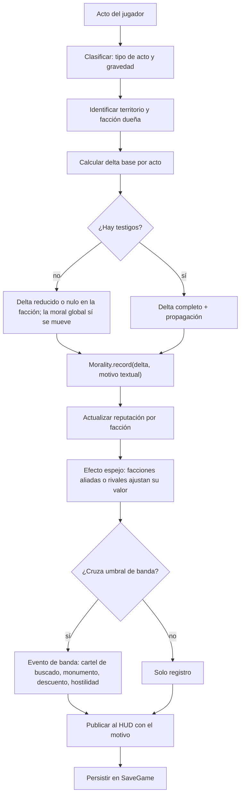
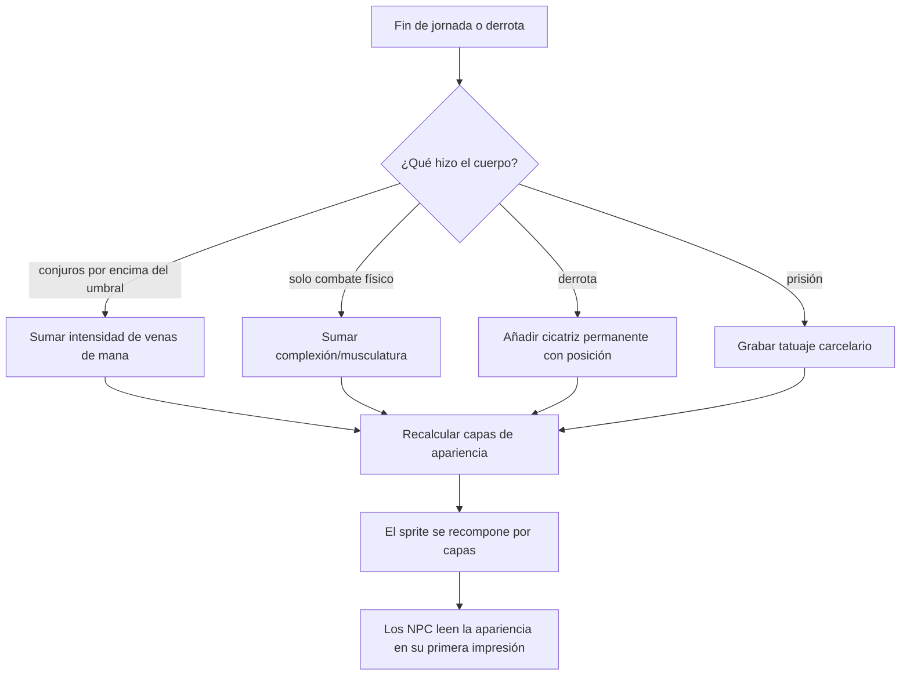
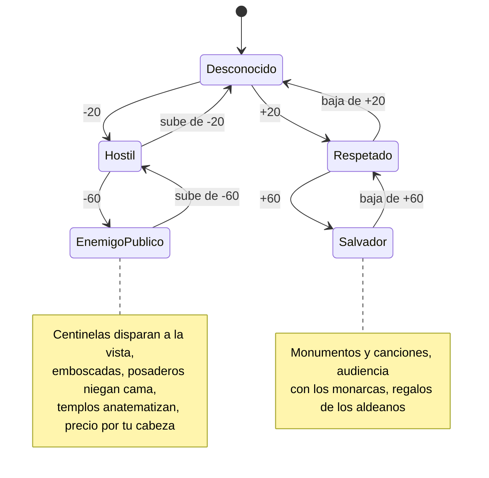

# WF-04 — Moral, reputación territorial y mutación física del cuerpo

> **Estado**: DISEÑO. Especifica *lo que debe pasar*, no lo que el motor hace hoy.
> **Fuente**: `DOCUMENTO_DE_ALCANCE_Y_VISION.md` §3 (legado Fable), §10.3 (geopolítica Ecla vs Drow), §10.5 (corrupción y redención).
> **Referentes**: Fable 2 (el cuerpo refleja cómo juegas) + Fallout (facciones contradictorias) + GTA 5 (la calle te conoce).
> **Convención de rutas**: relativas a `MotorGraphico-main/MotorGraphico/`.
> **Gantt**: AV3-01…AV3-07, AV1-01, AV0-01; alimenta AV4-* (precios), AV5-07 (cicatrices), AV8-* (delitos).
> **Se cruza con**: todos. Es el flujo que **escribe** lo que los otros seis **leen**.

---

## 1. Qué tiene que sentir el jugador

Que el mundo lleva la cuenta. Que no existe un «karma» plano: puedes ser un criminal buscado en Ecla y un héroe venerado bajo las Galerías Drow, y las dos cosas son verdad a la vez. Y que tu cuerpo es un historial: la cicatriz del labio recuerda aquella derrota, las venas de maná delatan que abusas de la magia, los hombros ensanchados dicen que nunca lanzaste un conjuro.

## 2. Actores y estado

| Entidad | Datos | Dónde vive hoy | Quién manda |
|---|---|---|---|
| Moral del jugador | eje único −100…+100 con motivo e historial | `include/Game/Morality.h` (`record`, `value`, `fraction`, `label`, `history`) | motor |
| Moral serializada | `moralityValue` | `include/Game/SaveGame.h:109`, `CharacterSheet::morality` | motor |
| Moral de la tienda | `float 0.0…1.0` (`moralBase`, `moralImpact`) | `include/Game/ShopEngine.h` | motor (duplicado) |
| Facción primaria | `primaryFactionId` | `include/RPG/CharacterSheet.h:94` | cartas |
| Reputación por facción | `factionRep` (mapa id → −100…+100), `getRep`, `adjustRep`, `repPriceModPct` | `include/RPG/CharacterSheet.h:95,239-240`, `src/RPG/CharacterSheet.cpp:130-152` | canon (Onegai 2) |
| Apariencia por capas | **falta**: no hay cicatrices, venas ni musculatura | — | motor + arte |
| Brújula moral del NPC | **falta** (solo `bondId`, `idealId`, `virtueId` en la ficha) | `CharacterSheet.h:84-90` | canon |
| HUD | barras PV/PM/Moral (hoy con solapamientos conocidos) | `include/Render/HudManager.h`, `HudElement.h` | motor |

## 3. Magnitudes del flujo

| Magnitud | Rango | Fórmula / origen | Escribe | Lee |
|---|---|---|---|---|
| Moral global | −100…+100, acotada con `std::clamp` | suma de `record(delta, motivo)` | alquiler, y en el futuro robar/ayudar/perdonar | HUD, bandas, diálogos |
| Reputación por facción | −100…+100 por facción | acto + territorio donde ocurre | WF-04 | precios (WF-03), guardias (FS-01), acceso (fronteras) |
| Banda | 5 tramos (§10.3.A) | valor → banda | WF-04 | efectos visibles |
| Cicatrices | contador + posición | cada derrota en combate | WF-01 | apariencia, reacción de NPC |
| Venas de maná | intensidad 0…1 | abuso de magia (conjuros por jornada) | WF-01 | apariencia, atracción de ciertos NPC |
| Musculatura | complexión 0…1 | combate físico exclusivo, trabajos forzados | WF-01, FS-02 | apariencia, intimidación |
| Tatuaje carcelario | marca permanente | paso por prisión | FS-02 | rechazo social, reconocimiento entre ladrones |
| Historial de motivos | 12 entradas (`kHistoryLimit`) | últimos `record()` | WF-04 | HUD y «¿por qué cambió mi fama?» |

## 4. Disparadores

1. **Acto con testigos o con efecto territorial**: robar, matar, ayudar, perdonar, liberar esclavos, ejecutar a un noble.
2. **Alquiler de un negocio propio** (hoy la única fuente real): `GameSession::adjustCurrentRent`.
3. **Derrota en combate** → cicatriz (WF-01).
4. **Uso repetido de magia o de fuerza** → mutación gradual.
5. **Entrar en un territorio** → se activa la reputación de esa facción y sus efectos.
6. **Diálogo con NPC** → se consulta la banda para decidir el trato.

## 5. Flujo paso a paso (un acto con consecuencia moral)

**Rama de mutación física (gradual, no instantánea):**

| Paso | Qué pasa | Regla dura | Si falla |
|---|---|---|---|
| Clasificar | el acto tiene un tipo y una gravedad (menor/medio/mayor) | catálogo de actos, no `if` sueltos | cada sistema mueve la moral a su manera |
| Territorio | el delta se aplica a la facción dueña del suelo | la moral **no** es plana | un héroe global sin matices |
| Testigos | sin testigos, la facción no se entera (pero tú sí cambias) | diferencia entre delito y pecado | robar de día y de noche cuesta igual |
| Registro | `record(delta, motivo)` con motivo textual | delta 0 no registra nada | historial lleno de ruido |
| Espejo | las facciones vinculadas ajustan | tabla de vínculos declarada en datos | Drow indiferentes a lo que haces en Ecla |
| Banda | cruzar un umbral dispara un evento visible | umbrales únicos y públicos | el número se mueve y nada cambia |
| Mutación | gradual y **permanente** | la cicatriz no se borra al cargar | consecuencia de usar y tirar |

## 6. Máquina de estados (bandas de reputación por facción)

## 7. Reglas y números

- **Bandas del doc (§10.3.A)**: −100…−60 Enemigo Público · −59…−20 Hostil · −19…+19 Neutral · +20…+59 Respetado (−15 % en tiendas, acceso a barrios cerrados) · +60…+100 Salvador.
- **Bandas del motor (`Morality::label()`)**: ≤−60 VILLANO · ≤−20 CANALLA · <40 NEUTRAL · <75 JUSTO · resto HÉROE. **No coinciden** con las del doc en el tramo positivo → D-MOR-03.
- **Escala acotada**: `std::clamp` a [−100, +100]; cien acciones pequeñas no producen un número sin significado.
- **Modificador de precios ya escrito** (`repPriceModPct`, marcado «P0 simplificado»): lineal `-0.75 × rep` → rep −100 = +100 % de precio, rep 0 = 0 %, rep +100 = −50 %. **No coincide** con las bandas del doc (hostil = precios triplicados, respetado = −15 %) → D-MOR-08.
- **Reputación inicial por nación**: el catálogo de mundo ya carga `factionRepDefault` (`faction_rep_default`), es decir, se puede nacer mal visto en un territorio.
- **Historial**: 12 motivos máximo (`kHistoryLimit`), del más reciente al más antiguo; es material de HUD, no contabilidad.
- **Etiquetas sin acentos ni minúsculas** porque la `BitmapFont` del motor solo tiene mayúsculas (nota: `label()` devuelve «HÉROE» con tilde → riesgo real de glifo inexistente; verificar en AV1-01).
- **Efecto espejo (§10.3.B)**: ejecutar a un noble esclavista de Ecla → −40 en Ecla y **+60** con los Drow («Rompedor de Cadenas», medallón de sangre).
- **Fronteras vivas (§10.3.C)**: la guardia de Ecla duda en cruzar; los arqueros Drow abren fuego defensivo para proteger a su salvador.
- **Mutaciones (§3.1)**: venas de maná por abuso de magia; ensanche y postura bárbara con cero magia; cicatriz por cada derrota; tatuaje carcelario; la ropa determina estatus percibido.

## 8. Consecuencias cruzadas

| Evento                             | Quién se entera                  | Efecto                                                 |     |
| ---------------------------------- | -------------------------------- | ------------------------------------------------------ | --- |
| Cruzar a Hostil en una facción     | WF-03                            | precios triplicados o negativa a comerciar             |     |
| Cruzar a Enemigo Público           | FS-01                            | centinelas disparan a la vista, precio por tu cabeza   |     |
| Cruzar a Respetado                 | WF-03, WF-05                     | −15 %, acceso a barrios cerrados, mejores tratos       |     |
| Cicatriz nueva                     | FS-04 (romance), FS-06           | respeto de veteranos o rechazo; primera impresión      |     |
| Venas de maná                      | FS-04 (primera impresión), FS-03 | a una hechicera le atraen; a un puritano le espantan   |     |
| Tatuaje carcelario                 | FS-01, WF-03                     | te reconocen ladrones y alguaciles                     |     |
| Alquiler usurero (ya implementado) | WF-05                            | baja la moral, sube el oro, genera odio y delincuencia |     |
| Corrupción exitosa de un NPC       | FS-04                            | el sacerdote deja el hábito y se vuelve compañero      |     |
| Redención de un NPC                | FS-04                            | la mercenaria jura defender inocentes                  |     |

## 9. Feedback al jugador

- **Barra de moral** sin solaparse con PV/PM (AV1-01 arregla exactamente esto).
- **Aviso de cambio con motivo**: «Subiste el alquiler de la Posada» — el patrón `record(delta, reason)` ya obliga a explicarlo.
- **Libro de reputación**: tabla de facciones conocidas con su banda y los últimos motivos (no existe hoy; AV3-03).
- **Espejo visible**: al ganar fama con los Drow, debe aparecer la línea de que en Ecla te buscan.
- **Cuerpo**: el sprite cambia por capas; la ficha muestra cicatrices con su fecha/hecho.
- **Reacción social viva**: aplausos, huida, escupitajos o pleitesía según banda (AV3-05).

## 10. Casos límite, abusos y antipatrones

1. **Blanqueo de reputación**: ¿se puede reparar −100 donando oro? Si sí, el precio debe ser prohibitivo y público.
2. **Granjear moral** repitiendo la misma acción buena: rendimiento decreciente por acto y por día.
3. Actos en tierra de nadie (capa roja del editor): sin facción → solo moral global.
4. Dos facciones aliadas: el espejo no debe sumar dos veces el mismo acto.
5. Cargar partida: `setValue()` **no** registra motivo (ya está bien resuelto).
6. La moral no debe bloquear contenido: el villano juega, no es expulsado del juego.
7. Mutación y equipo: una cicatriz en el torso no se ve con armadura completa → decidir si importa.
8. **Tres morales** conviven hoy (`Morality` int, `CharacterSheet::morality`, `ShopEngine::moral` float): mientras no se unifiquen, cualquier cambio puede contradecirse en pantalla.

## 11. Qué YA existe en el motor y qué falta

| Pieza | Estado | Evidencia |
|---|---|---|
| Eje de moral −100…+100 con motivo e historial | existe, GL-free y probado sin ventana | `include/Game/Morality.h`, `src/Game/Morality.cpp`, `examples/demo_ciudad.cpp` |
| Bandas con etiqueta (VILLANO…HÉROE) | existe, **umbrales distintos a los del doc** | `src/Game/Morality.cpp:28-45` |
| Fuente real que mueve la moral | existe **una sola**: el alquiler de tus negocios | `GameSession::adjustCurrentRent` (H3-05) |
| Persistencia de la moral | existe | `SaveGame.h:109` (`moralityValue`) |
| Facción en la ficha | existe como **campo suelto** | `CharacterSheet::primaryFactionId` |
| Reputación por facción: modelo y modificador de precios | **existe pero nadie lo llama** (solo `CharacterSheet` y los cargadores de mundo) | `src/RPG/CharacterSheet.cpp:130-152`, `DefinicionesMundo.h:106` (`factionRepDefault`) |
| Referencias a facción en narrativa | existen en catálogos y beats | `RPG/Narrative/AdventureScript.h`, `NarrativeBeat.h`, `CatalogLoadersContenido.h` |
| Tabla de efectos por banda y catálogo de facciones | **falta** | AV3-03, AV0-02 |
| Afinidad cruzada (efecto espejo) | **falta** | AV3-04 |
| Reacción social del NPC según banda | **falta** | AV3-05 |
| Fronteras vivas y salvoconductos | **falta** | AV3-06 |
| Apariencia por capas (cicatrices, venas, musculatura, tatuajes) | **falta** (0 apariciones en `include/` y `src/`) | AV3-01, AV3-02 |
| Corrupción y redención de NPC | **falta** | AV3-07 |
| Catálogo de las 19 naciones | **falta** | AV0-02 |

## 12. Decisiones de diseño — respuesta de Oriol (28/09/2026)

> **Estado:** Oriol respondió en la última columna de esta tabla y en la columna «USUARIO DICE» de `DISCREPANCIAS_Y_DECISIONES.md`. Su texto se reproduce literal; las consecuencias para el plan y las tareas que las recogen están en `../DECISIONES_RESUELTAS.md` (generado por `build.py`). **Abiertas:** D-MOR-09 — sin respuesta; se planifica con la recomendación y siguen en su bandeja.

| #        | Pregunta                                                                                                                                          | Opciones                                                                             | Recomendación                                                                                                                                           | Bloquea          |                                                                                                       |
| -------- | ------------------------------------------------------------------------------------------------------------------------------------------------- | ------------------------------------------------------------------------------------ | ------------------------------------------------------------------------------------------------------------------------------------------------------- | ---------------- | ----------------------------------------------------------------------------------------------------- |
| D-MOR-01 | ¿Reputación territorial **además** de la moral global, o una sustituye a la otra?                                                                 | (a) dos magnitudes: moral personal + reputación por facción, (b) solo por facción    | **(a)**: la moral personal explica tu cuerpo y tus diálogos; la reputación explica el trato de cada territorio                                          | AV3-03, AV0-01   | la moral personal explica tu cuerpo y tus diálogos; la reputación explica el trato de cada territorio |
| D-MOR-02 | Hay **tres** morales en el código (`Morality` −100…100, `CharacterSheet::morality`, `ShopEngine::moral` 0…1). ¿Cuál es la fuente de verdad?       | (a) `Morality` manda, las otras se derivan, (b) cada una en lo suyo                  | **(a)**: `Morality` es la única con motivo e historial; `SaveGame.moralityValue` es su serialización y `ShopEngine.moral` debe retirarse o reescribirse | AV0-01, D-COM-02 | unificar la moral en un valor complejo de mas de un factor                                            |
| D-MOR-03 | Umbrales: el motor tiene NEUTRAL hasta +39 y JUSTO hasta +74; el doc dice Neutral −19…+19 y Respetado +20…+59. ¿Quién gana?                       | (a) doc de visión, (b) motor                                                         | **(a)** para la reputación por facción (es diseño nuevo) y actualizar `label()`; el doc manda en diseño, el código se ajusta                            | AV3-03, AV1-01   |                                                                                                       |
| D-MOR-04 | ¿La mutación física se implementa como capas de sprite o como modificadores de ficha sin arte?                                                    | (a) capas, (b) solo datos y texto, (c) datos primero, capas después                  | **(c)**: primero el modelo y el registro (AV3-01), las capas cuando haya arte                                                                           | AV3-01           | Como capas si                                                                                         |
| D-MOR-05 | ¿Cuántas facciones entran en el primer corte? Las 19 naciones canónicas son mucho                                                                 | (a) 3 (Ecla, Drow, Gremio), (b) 19                                                   | **(a)**: el efecto espejo del doc solo necesita dos y una neutra                                                                                        | AV3-03, AV3-04   | Poco a poco de momento la de los humanos y ya iremos ampliando                                        |
| D-MOR-06 | ¿La reputación se degrada con el tiempo o es permanente?                                                                                          | (a) permanente, (b) decae hacia neutral, (c) decae solo lo malo                      | **(c)**: las hazañas se recuerdan, los rumores se olvidan                                                                                               | AV3-03           | Se degrada con los siglos sin interactuar                                                             |
| D-MOR-07 | ¿Puede el jugador ver la tabla completa de facciones o solo lo que sabe?                                                                          | (a) todo visible, (b) solo facciones conocidas                                       | **(b)**: coherente con «sin iconos flotantes» y con la investigación (§10.10)                                                                           | AV1-01           | Las que sabe                                                                                          |
| D-MOR-08 | Precios por reputación: ¿fórmula lineal del motor (`-0.75 × rep`) o bandas del doc (×3 hostil, −15 % respetado)?                                  | (a) lineal existente, (b) bandas del doc, (c) bandas con interpolación lineal dentro | **(c)**: conserva `repPriceModPct` como interpolación y hace legible el salto de banda                                                                  | AV3-03, WF-03    |                                                                                                       |
| D-MOR-09 | `factionRep` vive en la ficha pero **nadie lo llama** (mismo patrón que `setInventoryRules` antes del 28/09). ¿Se cablea ya o se espera a AV3-03? | (a) cablear lectura en comercio y HUD, (b) esperar                                   | **(a)**: una magnitud que no se lee no se puede balancear ni probar                                                                                     | AV3-03, AV4-01   |                                                                                                       |

## 13. Criterio de cierre y guion de prueba jugable

**Cerrado cuando** un mismo acto produzca dos efectos opuestos en dos facciones, el jugador pueda leer por qué cambió su fama, su cuerpo muestre al menos una marca permanente de su historia, y un NPC reaccione de forma distinta según la banda — todo visible en el HUD y persistente al guardar.

**Guion de prueba**:
1. Subir el alquiler de un negocio propio al 200 %: la moral baja con motivo visible y el oro sube (ya funciona hoy).
2. Bajarlo al 50 %: la moral sube, el inquilino regala algo (WF-05).
3. Liberar a los esclavos del noble de Ecla: −40 en Ecla, +60 con los Drow, dos líneas en el historial.
4. Entrar en Ecla: guardias hostiles, precios triplicados.
5. Cruzar la frontera drow: los arqueros te defienden de la partida de Ecla.
6. Perder un combate: cicatriz registrada en la ficha y visible en la cara.
7. Lanzar 20 conjuros en una jornada: la intensidad de venas de maná sube.
8. Jugar una jornada entera sin magia: sube la complexión.
9. Abrir el libro de reputación: tres facciones con su banda y sus últimos motivos.
10. Guardar y cargar: moral, reputaciones y marcas idénticas.
