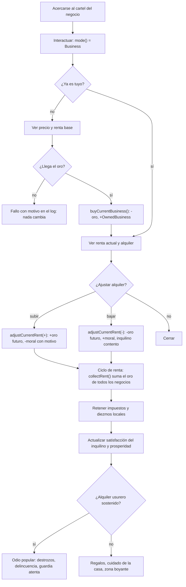
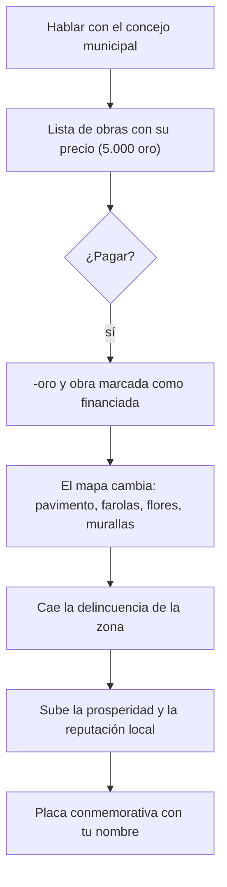
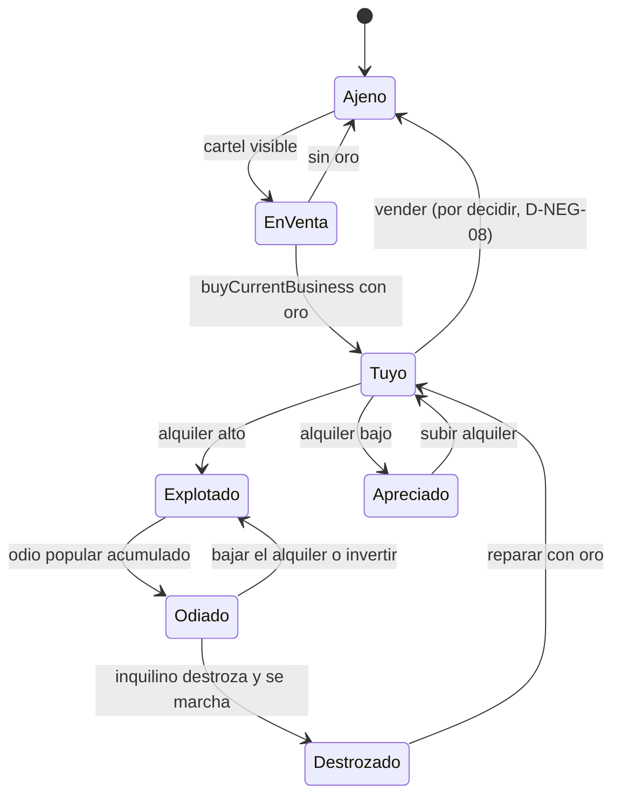

# WF-05 — Negocios, propiedades, rentas e inversión urbana

> **Estado**: DISEÑO sobre una base **ya funcionando**: comprar un negocio, ajustar el alquiler y cobrar la renta existe y está probado.
> **Fuente**: `DOCUMENTO_DE_ALCANCE_Y_VISION.md` §5, §10.8 (oficios), §10.9 (inmobiliario y urbanismo), §11.4 (editor: inmueble comprable).
> **Referentes**: Fable 2 (comprar la taberna y vivir de ella) + Fallout (la comunidad cambia con tu dinero).
> **Convención de rutas**: relativas a `MotorGraphico-main/MotorGraphico/`.
> **Gantt**: AV4-03…AV4-09, AV6-10, AV10-02, AV12-03; prerrequisito AV0-01.
> **Se cruza con**: WF-04 (el alquiler mueve la moral **hoy**), WF-03 (el oro circula), WF-07 (encargos del gremio), FS-02 (trabajos forzados), FS-05 (oficios), FS-08 (hogar y decoración).

---

## 1. Qué tiene que sentir el jugador

Que puede dejar de ser aventurero y vivir del pueblo: comprar la posada, decidir si exprime a los inquilinos o se gana su cariño, reparar la plaza con su fortuna y ver cómo la aldea se transforma. Y que cada decisión económica tiene una sombra moral — ya la tiene hoy: subir el alquiler al 200 % enriquece y ensucia.

## 2. Actores y estado

| Entidad | Datos | Dónde vive hoy | Quién manda |
|---|---|---|---|
| Negocio propio | id, nombre, precio, renta | `OwnedBusiness` en `GameSession` (`businesses()`, `ownsBusiness()`) | motor |
| Negocio abierto | `currentBusinessId/Name/Price/Income` | `GameSession.h:366-393` | motor |
| Alquiler | porcentaje 50…200 | `kMinRent`/`kMaxRent`, `adjustCurrentRent(deltaPercent)` | motor |
| Reloj de rentas | cuenta **pasos** (`kStepsPerRentCycle = 40`) | `GameSession.h:186` | motor |
| Moral | se mueve al ajustar el alquiler | `Morality::record` vía `adjustCurrentRent` | motor |
| Inmueble comprable en el editor | precio, renta semanal base, capacidad de muebles | **falta** | AV6-10 |
| Vivienda y muebles | grid 2.5D de decoración | **falta** | AV4-04 |
| Inquilino | identidad, satisfacción, pagos | **falta** | AV4-05 |
| Prosperidad del pueblo | inversión pública y su efecto visual/social | **falta** | AV4-06 |
| Oficio del jugador | herrería, alquimia, maestría | **falta** | AV4-07…AV4-09 |
| Calendario de mundo | días, cosechas, impuestos | **falta** (el reloj cuenta pasos) | AV10-02 |

## 3. Magnitudes del flujo

| Magnitud | Rango | Fórmula / origen | Escribe | Lee |
|---|---|---|---|---|
| Oro | 0… | renta cobrada − impuestos − compras | WF-03, WF-05 | todo |
| Precio del inmueble | p. ej. 2.500 | editor (`AV6-10`) o catálogo | autor | compra |
| Renta base | p. ej. 120/semana | editor | autor | `collectRent()` |
| Alquiler | 50 %…200 % de la renta base | `adjustCurrentRent` | jugador | oro y moral |
| Delta de moral | por ajuste de alquiler | `Morality::record(delta, motivo)` | WF-05 | WF-04 |
| Satisfacción del inquilino | 0…100 | alquiler bajo → alta; usurero → odio | WF-05 | regalos, destrozos, delincuencia |
| Prosperidad de la zona | 0…100 | inversión pública + alquileres + delincuencia | WF-05 | estética del pueblo, precios, crimen |
| Maestría de oficio | por oficio | jornadas trabajadas y calidades logradas | FS-05 | calidad de lo fabricado |

## 4. Disparadores

1. **Cartel de «Se Vende»** o puerta de un negocio → `GameMode::Business` (ya existe).
2. **Ajustar el alquiler** desde la pantalla del negocio (ya existe).
3. **Ciclo de pasos** → `collectRent()` (ya existe; debe pasar a calendario).
4. **Entrar en tu vivienda** → modo decoración con cuadrícula isométrica.
5. **Donar al concejo** → inversión pública.
6. **Abrir el taller** al amanecer → jornada de oficio.
7. **Fin de día** → contar monedas, pagar diezmos e impuestos.

## 5. Flujo paso a paso

**Rama de inversión pública (§10.9):**

| Paso | Qué pasa | Regla dura | Si falla |
|---|---|---|---|
| Compra | falla si ya es tuyo o no llega el oro | motivo en el log, nada a medias | dos escrituras del mismo edificio |
| Alquiler | acotado a [50, 200] | el cambio **mueve la moral con motivo** | oro sin consecuencia |
| Renta | se cobra por ciclo, no por segundo | un solo reloj para rentas, cosechas y restock | cobrar rentas durante un combate o en prisión |
| Impuestos | se retienen al cobrar | el oro sale de la economía del jugador y entra en la del pueblo | economía que solo acumula |
| Inquilino | satisfacción por alquiler y tiempo | un inquilino no es un número: regala o destroza | rentas sin vida |
| Inversión | cambia el mapa de forma persistente | el cambio es visible y medible (delincuencia) | donar oro sin efecto |
| Oficio | jornada con minijuego y calidad resultante | la calidad depende de la maestría y del material | crafteo decorativo |

## 6. Máquina de estados

## 7. Reglas y números

- **Alquiler**: `kMinRent = 50`, `kMaxRent = 200` (porcentaje de la renta base). Comentario del motor: «50 % es regalar media renta; 200 % es el máximo que aguanta el inquilino antes de marcharse».
- **Ciclo de renta**: `kStepsPerRentCycle = 40` pasos del jugador (no segundos). `pause()` es no-op fuera de exploración.
- **`collectRent()`** cobra un ciclo de **todos** los negocios propios y devuelve el total.
- **Moral**: el ajuste del alquiler es hoy la **única** fuente real de cambio moral del juego (H3-05).
- **Editor** (§11.4): precio de compra (ej. 2.500), renta semanal base (ej. 120), capacidad de muebles (ej. 35 celdas interiores).
- **Inversión pública** (§10.9): 5.000 oro por obra; efecto visible + delincuencia a cero + placa conmemorativa.
- **Oficios** (§10.8): herrería con calidades Tosca / Estándar / Refinada / Obra Maestra (con ranura de runa); alquimia con recetas; diezmo e impuestos al cierre del día.
- **Persistencia**: la partida guardada incluye vida, oro, inventario, moral y **negocios** (`SaveGame.h:23`).

## 8. Consecuencias cruzadas

| Evento | Quién se entera | Efecto |
|---|---|---|
| Alquiler al 200 % | WF-04 | la moral baja con motivo «Subiste el alquiler de la Posada» |
| Alquiler al 50 % sostenido | WF-04, FS-06 | inquilinos que te quieren, vecinos que lo cuentan |
| Alquilar usurero durante días | FS-01 | odio popular → delincuencia en la zona |
| Invertir en la plaza | FS-07, WF-04 | cambia la estética del distrito y baja el crimen |
| Cobrar rentas | WF-03 | oro disponible para compras, sobornos o fianzas |
| Estar en prisión | WF-05 | salto temporal: se pierden cosechas y cobros (§10.1) |
| Trabajar un oficio | WF-02 | fatiga y musculatura (trabajos forzados ensanchan) |
| Fabricar obra maestra | WF-07 | EXP/hito por vía no violenta (§10.7) |
| Comprar una casa | FS-08 | decoración, matrimonio y beneficios de hogar |

## 9. Feedback al jugador

- Pantalla del negocio con precio, renta base, alquiler actual y **efecto previsto** sobre oro y moral antes de confirmar.
- Línea de log con el motivo de cada cambio (patrón ya establecido por `Morality::record`).
- Aviso de ciclo cobrado: «Rentas cobradas: 240 oro (2 negocios)».
- Estado del inquilino visible en la casa (contento, harto, furioso) y destrozos físicos.
- Mapa del pueblo que cambia con la inversión: pavimento, farolas, flores, placa con tu nombre.
- Barra de prosperidad por distrito en el HUD cuando estás en él.

## 10. Casos límite, abusos y antipatrones

1. **Comprar el mismo negocio dos veces**: `buyCurrentBusiness()` ya falla si es tuyo.
2. Cobrar renta mientras el jugador está en combate, tienda o diálogo: `pause()` es no-op fuera de exploración.
3. Prisión: los ciclos siguen corriendo → ¿se cobra solo o se pierde? El doc dice que se pierden cosechas y rentas.
4. Subir y bajar el alquiler 20 veces en un minuto: ¿cada ajuste mueve la moral? Hace falta un tope por ciclo.
5. Inversión pública repetida sobre la misma obra: la segunda no debe cobrar.
6. Vender un negocio (no existe hoy): si se añade, el precio de recompra debe evitar el arbitraje.
7. MMO: la propiedad debe sobrevivir a la reconexión y ser del jugador (AV11-04).
8. Instancia privada: ¿el Master puede expropiar o fijar rentas?

## 11. Qué YA existe en el motor y qué falta

| Pieza | Estado | Evidencia |
|---|---|---|
| Comprar un negocio desde el cartel | existe y probado | `GameSession::buyCurrentBusiness`, `GameMode::Business` |
| Ajustar alquiler acotado | existe | `adjustCurrentRent`, `kMinRent/kMaxRent` |
| Cobrar rentas por ciclo | existe | `collectRent()`, `kStepsPerRentCycle = 40` |
| Moral movida por el alquiler | existe | `Morality::record` (H3-05) |
| Persistencia de negocios | existe | `SaveGame.h:23` |
| Pruebas del ciclo completo | existen (verificadas 26/09) | `comprar_negocio_cobrar_renta_aumenta_oro`, `comprar_negocio_subir_alquiler_cobrar_renta_tiene_coste`; commit `ec73653` |
| Viviendas (no negocio) y escrituras | **falta** | AV4-03 |
| Decoración en cuadrícula 2.5D | **falta** | AV4-04 |
| Inquilinos con satisfacción y comportamiento | **falta** | AV4-05 |
| Inversión pública y prosperidad | **falta** | AV4-06 |
| Oficios (herrería, alquimia) y jornada | **falta** | AV4-07…AV4-09 |
| Impuestos y diezmos | **falta** | AV4-09, AV12-03 |
| Reloj de mundo (días y cosechas) | **falta**: el reloj cuenta pasos | AV10-02 |
| Marcar inmueble en el editor | **falta** | AV6-10 |

## 12. Decisiones de diseño — respuesta de Oriol (28/09/2026)

> **Estado:** Oriol respondió en la última columna de esta tabla y en la columna «USUARIO DICE» de `DISCREPANCIAS_Y_DECISIONES.md`. Su texto se reproduce literal; las consecuencias para el plan y las tareas que las recogen están en `../DECISIONES_RESUELTAS.md` (generado por `build.py`). **Todas cerradas.**

| #        | Pregunta                                                                            | Opciones                                                            | Recomendación                                                                   | Bloquea         |                                                                                          |
| -------- | ----------------------------------------------------------------------------------- | ------------------------------------------------------------------- | ------------------------------------------------------------------------------- | --------------- | ---------------------------------------------------------------------------------------- |
| D-NEG-01 | El reloj de rentas cuenta **pasos** (40). ¿Se sustituye por el calendario de mundo? | (a) calendario, (b) pasos, (c) pasos hasta que exista el calendario | **(c)** y luego (a): rentas, cosechas, restock y prisión deben compartir reloj  | AV10-02, AV4-05 |                                                                                          |
| D-NEG-02 | ¿La renta es semanal (doc §11.4) o por ciclo?                                       | (a) semanal del calendario, (b) ciclo de pasos                      | **(a)** en cuanto exista el calendario                                          | AV4-05          | Diaria                                                                                   |
| D-NEG-03 | ¿Qué es una «propiedad»? Solo negocios con renta, o también viviendas sin renta     | (a) ambos con un mismo contrato, (b) dos sistemas                   | **(a)**: un inmueble con capacidad de renta 0 es una vivienda                   | AV4-03          | Todo lo que sea Comprable y una cosa construida que sea de alguien                       |
| D-NEG-04 | El inquilino, ¿es una entidad con IA o un registro abstracto con satisfacción?      | (a) NPC con rutina, (b) registro                                    | **(b)** primero y (a) cuando exista FS-06 (rutinas): evita bloquear la economía | AV4-05          | registro de eventos indirectos y directos del jugador hacia el beneficio de vida del npc |
| D-NEG-05 | La inversión pública, ¿cambia el mapa de verdad o solo la reputación?               | (a) cambio visual persistente, (b) solo fama                        | **(a)**: es la promesa del doc y lo que da la anécdota                          | AV4-06          | Mejora calidad de la infrastructura o la degrada                                         |
| D-NEG-06 | Oficios: ¿minijuego de ritmo (yunque) o resolución por tirada enfrentada?           | (a) minijuego, (b) tirada, (c) ambos                                | **(c)**: minijuego para la ejecución y tirada para la calidad final             | AV4-07          | Minijuego a ritmo                                                                        |
| D-NEG-07 | Los impuestos, ¿son un sumidero de oro o financian la prosperidad del pueblo?       | (a) sumidero, (b) alimentan la economía local                       | **(b)**: cierra el ciclo económico que AV12-03 debe medir                       | AV12-03         | Financian la prosperidad del pueblo y lo amplian si van superando ciertas quotas         |
| D-NEG-08 | ¿Se puede vender un negocio propio? Hoy no existe                                   | (a) sí, al 50 %, (b) no                                             | **(a)** con el mismo criterio que la venta de objetos                           | AV4-03          | Si                                                                                       |
| D-NEG-09 | ¿Cada ajuste de alquiler mueve la moral o solo el valor sostenido?                  | (a) cada ajuste, (b) el valor al cierre del día                     | **(b)**: evita el abuso de subir y bajar para granjear moral                    | AV4-05, WF-04   | Todo, los muebles pueden subir su valor y reformarla tambien                             |

## 13. Criterio de cierre y guion de prueba jugable

**Cerrado cuando** el jugador pueda comprar dos inmuebles distintos, ajustar el alquiler de cada uno, cobrar la renta en el momento correcto del calendario, ver cómo la satisfacción del inquilino y la prosperidad del pueblo responden, pagar impuestos y comprobar que el oro total del mundo cuadra.

**Guion de prueba**:
1. Comprar el negocio del cartel con oro suficiente → aparece en `businesses()` y el oro baja exactamente su precio.
2. Intentar comprarlo otra vez → falla con motivo.
3. Subir el alquiler al 200 % → la moral baja con motivo y el log lo explica.
4. Esperar un ciclo completo → `collectRent()` suma la renta de los dos negocios, una sola vez.
5. Entrar en combate durante el ciclo → no se cobra renta.
6. Bajar el alquiler al 50 % y esperar tres ciclos → el inquilino regala algo y la casa está cuidada.
7. Mantener el 200 % durante una semana de juego → destrozos y delincuencia en la zona.
8. Donar 5.000 al concejo → la plaza se pavimenta, la delincuencia cae y aparece la placa.
9. Trabajar una jornada de herrería → calidad resultante coherente con el material y la maestría.
10. Guardar y cargar → negocios, alquileres, oro y prosperidad idénticos.
