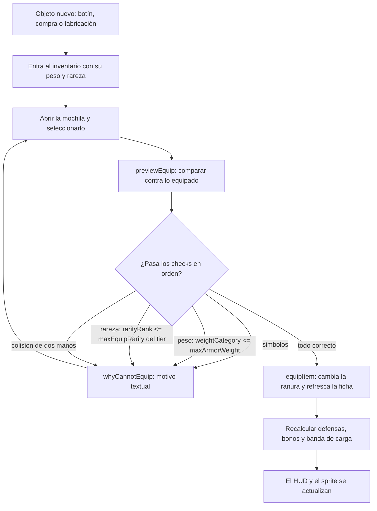
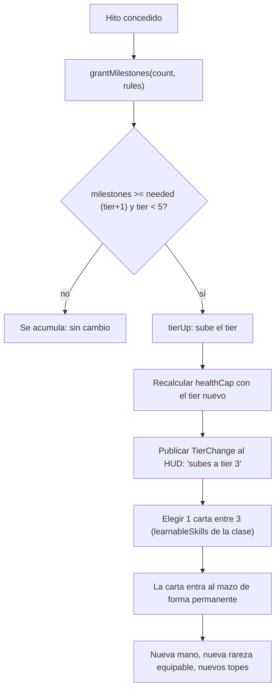
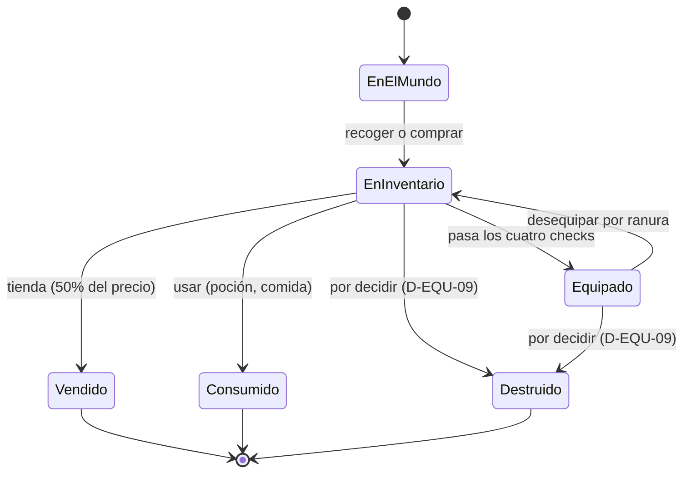

# WF-06 — Equipo, ficha de personaje y progresión por hitos

> **Estado**: DISEÑO sobre una base **sólida y ya probada**: la ficha, el tier, los hitos y las reglas de equipamiento existen.
> **Fuente**: `DOCUMENTO_DE_ALCANCE_Y_VISION.md` §10.7 (progresión), §6.1 (mazo), §10.12.B (peso), §3.1 (ropa y estatus).
> **Referente**: Baldur's Gate 3 (la ficha se construye y se nota) + Fable 2 (lo que llevas puesto dice quién eres).
> **Convención de rutas**: relativas a `MotorGraphico-main/MotorGraphico/`.
> **Gantt**: AV5-09, AV5-10, AV5-01, AV7-04, AV12-04; prerrequisito AV0-01.
> **Se cruza con**: WF-01 (mazo y tier en combate), WF-02 (peso → movilidad), WF-03 (comprar y vender equipo), WF-04 (ropa y estatus).

---

## 1. Qué tiene que sentir el jugador

Que su personaje es una construcción con decisiones irreversibles y que cada objeto que recoge tiene un lugar y un precio: pesa, ocupa, requiere tier y cambia cómo le mira la gente. Y que progresar no es acumular una barra de experiencia, sino **vivir hitos** que el mundo reconoce.

## 2. Actores y estado

| Entidad | Datos | Dónde vive hoy | Quién manda |
|---|---|---|---|
| Ficha | clase, segunda clase, raza, trasfondo, deidad, tier, hitos, oro, facción, moral, vínculos (bond/fear/flaw/goal/ideal/personality/virtue) | `include/RPG/CharacterSheet.h` | cartas (dndWeebCC) |
| Atributos | **CON, DES, INT, CAR** con rango 0…8 | `include/RPG/Stat.h:11-15`, `CharacterSheet::stat()` | cartas |
| Tier y hitos | tier 0…5, `milestones`, `needed = tier + 1` | `CharacterSheet::grantMilestones/tierUp`, `include/RPG/TierRules.h` | cartas |
| Reglas de tier | `handLimit`, `maxEquipRarity`, `healthCap` 125, `healthBonus`, `allowMulticlass`, `multiclassHandLimit`, `maxSummons`, `maxFeats`, `maxDivineCards` | `assets/rules/tier_rules.json` → `TierRules.h` | cartas |
| Equipo | `EquipmentDefinition`: ranura, `weightCategory`, rareza, precio, símbolos, dos manos | `include/RPG/Definitions/`, `include/RPG/InventoryEngine.h` | cartas |
| Inventario | objetos, equipados por ranura | `GameSession::useItem/equipItem/unequipItem`, `InventoryScreen.h` | motor |
| Reglas de equipar | `InventoryRules` (equipo + catálogo de condiciones) | `GameSession::setInventoryRules` | motor |
| Botín | tabla por monstruo | `include/RPG/LootResolver.h` | cartas |
| Mazo | `maxSkillCards` (10 por defecto), `startingCards{skills, spells, passives, learnableSkills}` | `include/RPG/Catalogs/CatalogLoadersPersonaje.h:34-48` | cartas |
| PV actuales | **no viven en la ficha** | los guarda `Player`/`BattleState` | motor |

## 3. Magnitudes del flujo

| Magnitud | Rango | Fórmula / origen | Escribe | Lee |
|---|---|---|---|---|
| Tier | 0…5 (`TIER_MIN`…`TIER_MAX`) | `grantMilestones(count, rules)` | hitos | mano, rareza equipable, vida tope |
| Hitos | entero histórico | concesión narrativa o por contenido | WF-07, WF-01 | `tierUp` |
| Atributo | 0…8 por stat (`STAT_RANK_MIN/MAX`) | creación y progreso | ficha | pools de dados (N = stat) |
| Vida tope | `healthCapWith(rules, baseHealth)`, tope 125 | clase + tier | ficha | combate, HUD |
| Rareza equipable | hasta `maxEquipRarity` del tier | `TierRules` | ficha | `InventoryEngine::check_rarity` |
| Peso | categoría light/medium/heavy (¿o kg? D-EQU-04) | objeto + `maxArmorWeight` de la clase | inventario | WF-02 |
| Bonos de equipo | `equipArmorBonus`, `equipShieldBonus` | objetos equipados | inventario | defensas (`DefenseBlock`) |
| Tamaño del mazo | `maxSkillCards` de la clase | catálogo | autor | personalización |
| Mano | `handLimit(tier, multiclass)` | `TierRules` | ficha | WF-01 |

## 4. Disparadores

1. **Recoger o comprar un objeto** → entra al inventario y pesa.
2. **Abrir la mochila** (`[I]`) → equipar, desequipar, usar, comparar.
3. **Conceder hitos** (fin de misión, contenido, obra maestra de oficio) → `grantMilestones`.
4. **Subir de tier** → nueva mano, nueva rareza permitida, nueva vida tope y **elección de carta**.
5. **Crear personaje** → clase, raza, trasfondo, deidad, atributos y cartas iniciales.
6. **Descansar / dormir** → recuperar PV y condiciones (FS-08).

## 5. Flujo paso a paso

| Paso | Qué pasa | Regla dura | Si falla |
|---|---|---|---|
| Equipar | los checks van **en orden**: símbolos → peso → rareza → dos manos | el primer fallo devuelve el motivo y no toca nada | equipar algo imposible sin explicación |
| Desequipar | por ranura (`EquipSlot`), con motivo si no se puede | la ranura vuelve a quedar libre de verdad | objetos fantasma equipados |
| Vista previa | `EquipPreview` compara antes de confirmar | el jugador nunca equipa a ciegas | arrepentirse sin poder volver |
| Hito | `count <= 0` no desordena nada | un hito no se concede dos veces por lo mismo | inflar el tier |
| Tier | único camino público: `grantMilestones` | `tierUp` a mano está prohibido desde el juego | ficha incoherente (ya pasó: `healthCap` del tier viejo, H2-04) |
| Vida tope | se recalcula al subir de tier | los PV actuales los decide quien los guarda | subir de tier y morir |
| Carta | 1 entre 3 opciones de la clase | la carta entra al mazo **permanentemente** | mazo que crece sin límite |
| Peso | cambia la banda de carga | la banda se recalcula al equipar y al recoger | correr con placas sin consecuencia |

## 6. Máquina de estados (del objeto en manos del jugador)

## 7. Reglas y números

- **Atributos del motor**: solo **CON, DES, INT, CAR**, rango 0…8 (`STAT_RANK_MIN/MAX`). El doc §10.7 pide seis (FUE, DES, CON, INT, SAB, CAR) → D-EQU-02.
- **Progresión**: «el reglamento no va de XP: va de hitos» (`CharacterSheet.h:72`). T0→T1 = 1 hito, T1→T2 = 2, T2→T3 = 3… `needed = tier + 1`. El doc habla de EXP y niveles → D-EQU-01.
- **Rareza**: 6 niveles (Common…Mythic); `maxEquipRarity` del tier limita lo que puedes llevar.
- **Vida**: `healthCap` 125 en T5 con `healthBonus` 25; los PV actuales **no** viven en la ficha.
- **Mano**: `handLimit(tier, multiclass)`; T5 = 28, y 24 con multiclass.
- **Peso**: hoy por categoría contra `maxArmorWeight` de la clase; el doc pide kg contra `Fuerza × 5`.
- **Mazo**: `maxSkillCards` 10 por defecto; `startingCards` con skills, spells, passives y learnableSkills.
- **Botín**: 28 `lootIds` reales sobre 432 monstruos (deuda de contenido, AV12-05).
- **Precios**: `EquipmentDefinition::price` existe en 413 piezas y **nadie lo leía** hasta el parche H2-08 (escrito, sin aplicar el 28/09).

## 8. Consecuencias cruzadas

| Evento | Quién se entera | Efecto |
|---|---|---|
| Equipar armadura pesada | WF-02 | banda de carga, ruido de placas, fat roll |
| Subir de tier | WF-01 | más mano, más vida tope, cartas divinas permitidas |
| Elegir carta | WF-01 | cambia el estilo del combate siguiente |
| Recoger botín | WF-03 | se puede vender; su precio sale del catálogo |
| Llevar ropa fina | WF-04, FS-03 | estatus percibido y primera impresión |
| Vender el equipo | WF-05 | oro que puede ir a rentas o inversión |
| Fabricar obra maestra | FS-05, WF-07 | objeto con ranura de runa y posible hito |
| Multiclass | WF-01 | mano distinta (`multiclassHandLimit`) y mazo mezclado |

## 9. Feedback al jugador

- `previewEquip`: comparación lado a lado con las diferencias marcadas (patrón ya implementado en G12).
- **Motivo textual** cuando algo no se puede: `whyCannotUse`, `whyCannotEquip`, `whyCannotUnequip` (ya existen; el HUD debe mostrarlos tal cual).
- Aviso de subida de tier con su `TierChange` («subes a tier 3») y de la nueva vida tope.
- Pantalla de elección de carta: 3 opciones con su descripción, coste y rareza.
- Ficha visible (`FichaVista.h`) con atributos, tier, hitos hacia el siguiente, equipo y mazo.
- Icono de banda de carga y de peso al recoger objetos.

## 10. Casos límite, abusos y antipatrones

1. **Reglas sin inyectar**: `setInventoryRules` no se llamaba en ningún sitio del motor hasta el arreglo del 28/09 (`ApplicationNivel.cpp`); sin ellas, `equipmentFor()` devolvía `nullptr` y nada se podía equipar. Regla: toda regla inyectable debe tener una prueba que falle si no se inyecta.
2. Subir de tier con los PV a 1: ¿se rellenan al nuevo tope? (D-EQU-06).
3. Equipar un objeto de dos manos con escudo: colisión detectada, motivo visible.
4. Rareza por encima del tier: no se equipa aunque la tengas.
5. Objeto sin `price`: no se puede vender (WF-03) — es deuda de contenido, no un bug del inventario.
6. Retirar cartas del mazo: si es gratis e ilimitado, el jugador optimiza el juego fuera del juego.
7. Cambiar de equipo durante el combate: o se prohíbe o cuesta la acción.
8. Cargar partida con equipo puesto: los bonos deben recalcularse (`recompute_derived`), no sumarse dos veces.

## 11. Qué YA existe en el motor y qué falta

| Pieza | Estado | Evidencia |
|---|---|---|
| Ficha con clase, raza, trasfondo, deidad y vínculos | existe | `include/RPG/CharacterSheet.h:63-98` |
| Atributos CON/DES/INT/CAR con rango 0…8 | existe | `include/RPG/Stat.h:11-15` |
| Progresión por hitos y tier con recálculo del tope | existe (H2-04, verificado por zcode 28/09) | `grantMilestones`, `tierUp`, `TierChange` |
| Reglas de tier desde JSON | existe | `assets/rules/tier_rules.json`, `TierRules.h` |
| Checks de equipamiento en orden con motivos | existe | `include/RPG/InventoryEngine.h:32-101` |
| Equipar/desequipar/usar con vista previa desde el juego | existe (G12) | `GameSession::equipItem/unequipItem/previewEquip`, `InventoryScreen.h` |
| Botín al ganar | existe y verificado | `GameSession::repartirBotin` (H2-05) |
| Creación de personaje | existe | `include/RPG/CharacterCreation.h`, `CharacterCreationScreen.h` |
| Datos de mazo y cartas iniciales | existe en catálogos | `CatalogLoadersPersonaje.h:34-48` |
| Multiclass | existe como dato y regla (`allowMulticlass`, `multiclassHandLimit`) | `CharacterSheet::secondClassId`, `TierRules` |
| Elección de 1 carta entre 3 al subir | **falta** (solo el dato `learnableSkills`) | AV5-09 |
| Personalización del mazo entre combates | **falta** | AV5-10 |
| Peso en kg y bandas de carga | **falta**: solo categorías | AV7-04, D-EQU-04 |
| Precio de equipo leído por la tienda | **escrito y sin aplicar** | H2-08 |
| Ropa como estatus social | **falta** | AV3-01, FS-03 |
| Ranura de runa para obra maestra | **falta** | FS-05 |

## 12. Decisiones de diseño — respuesta de Oriol (28/09/2026)

> **Estado:** Oriol respondió en la última columna de esta tabla y en la columna «USUARIO DICE» de `DISCREPANCIAS_Y_DECISIONES.md`. Su texto se reproduce literal; las consecuencias para el plan y las tareas que las recogen están en `../DECISIONES_RESUELTAS.md` (generado por `build.py`). **Todas cerradas.**

| #        | Pregunta                                                                                                  | Opciones                                                     | Recomendación                                                                                                    | Bloquea         |                                                                                                              |
| -------- | --------------------------------------------------------------------------------------------------------- | ------------------------------------------------------------ | ---------------------------------------------------------------------------------------------------------------- | --------------- | ------------------------------------------------------------------------------------------------------------ |
| D-EQU-01 | El doc §10.7 habla de **EXP y niveles**; el reglamento y el motor van de **hitos y tiers**. ¿Quién manda? | (a) hitos/tiers, (b) EXP/niveles, (c) los dos                | **(a)** y reescribir §10.7: BITÁCORA 2.1 pone el reglamento por encima del doc de visión                         | AV5-09, AV12-04 |                                                                                                              |
| D-EQU-02 | ¿Cuatro atributos (CON/DES/INT/CAR) o seis (con FUE y SAB)? El doc pide seis; el motor tiene cuatro       | (a) cuatro, (b) seis                                         | **(a)**: ampliar el enum rompe pools de dados, catálogos y tests; FUE se resuelve con equipo y SAB con INT o DES | AV0-01, WF-07   |                                                                                                              |
| D-EQU-03 | «Elegir 1 carta entre 3» al subir de tier: ¿las tres salen de `learnableSkills` de la clase?              | (a) sí, (b) mezcladas con cartas de historia                 | **(a)** y reservar `grantStoryCardId` para el contenido                                                          | AV5-09          | Sí                                                                                                           |
| D-EQU-04 | Peso: ¿kg (`Fuerza × 5`) o categorías (`light/medium/heavy`) que ya funcionan?                            | (a) kg, (b) categorías, (c) kg como dato y bandas calculadas | **(c)** — mismo criterio que D-MOV-03                                                                            | AV7-04          |                                                                                                              |
| D-EQU-05 | ¿La ropa y el equipo tienen efecto social (estatus, primera impresión)?                                   | (a) sí, con un valor de estatus por pieza, (b) no            | **(a)**: es la promesa de §3.1 y alimenta FS-03                                                                  | AV3-01          | Sí y efectos de aumentar caracteristicas                                                                     |
| D-EQU-06 | Al subir de tier, ¿los PV actuales se rellenan al tope nuevo?                                             | (a) sí, (b) no, (c) solo si estaba por debajo del tope viejo | **(c)**: premia subir sin regalar curación                                                                       | AV5-09          | Si                                                                                                           |
| D-EQU-07 | ¿Se expone la multiclass al jugador en este corte?                                                        | (a) sí, (b) no, solo contenido                               | **(b)**: ya está en datos; exponerla exige equilibrar dos mazos                                                  | AV5-10          | Sí                                                                                                           |
| D-EQU-08 | Retirar cartas del mazo, ¿es gratis?                                                                      | (a) gratis entre combates, (b) cuesta oro o un hito          | **(a)** entre combates y nunca durante                                                                           | AV5-10          | Entre combates es gratis, en un combate se penaliza con un turno para desaprendre y otro turno para aprender |
| D-EQU-09 | ¿Existe la destrucción o degradación de equipo?                                                           | (a) no, (b) sí con durabilidad                               | **(a)** en este corte: la durabilidad multiplica el trabajo del inventario                                       | —               | Sí                                                                                                           |

## 13. Criterio de cierre y guion de prueba jugable

**Cerrado cuando** el jugador pueda crear un personaje, equipar y desequipar con motivos visibles, recoger botín que pese, subir de tier por hitos, elegir una carta entre tres y ver cómo cambian su mano y su vida tope — con la ficha coherente al guardar y cargar.

**Guion de prueba**:
1. Crear una guerrera: atributos, clase y cartas iniciales visibles en la ficha.
2. Equipar una cota de malla: pasa los checks y sube `equipArmorBonus`.
3. Intentar equipar una pieza legendaria en tier 1: motivo «rareza por encima del tier».
4. Equipar un mandoble con escudo: motivo de colisión de dos manos.
5. Recoger botín hasta cambiar de banda de carga: el sprint se prohíbe (WF-02).
6. Conceder 1 hito en tier 0: sube a tier 1, `healthCap` recalculado y línea en el HUD.
7. Elegir carta entre 3: la elegida entra al mazo y se ve en la mano del siguiente combate.
8. Retirar una carta obsoleta entre combates: la mano lo refleja.
9. Vender la cota de malla: devuelve un precio real del catálogo (requiere H2-08).
10. Guardar y cargar: tier, hitos, equipo, bonos y mazo idénticos, sin bonos duplicados.
