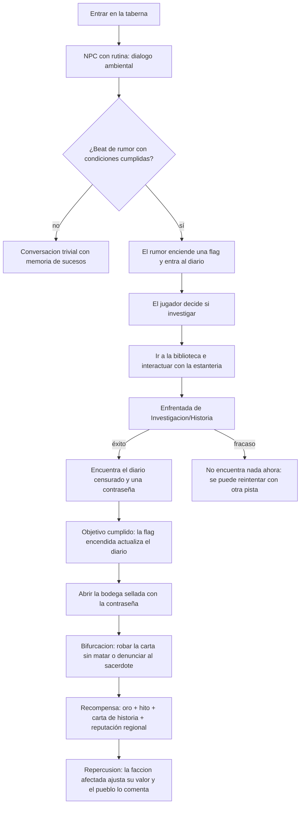
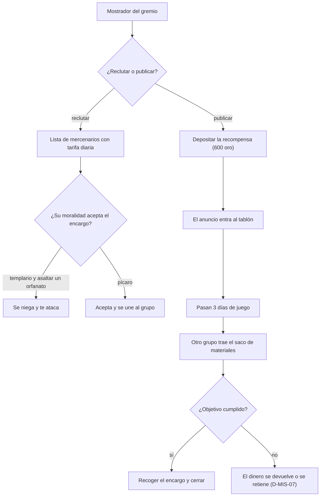
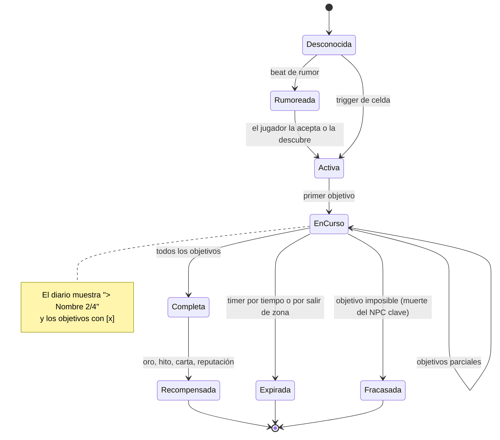

# WF-07 — Misiones orgánicas, investigación y narrativa

> **Estado**: DISEÑO sobre una base **ya funcionando**: el motor narrativo (aventuras, beats, flags, temporizadores) y el diario de misiones existen.
> **Fuente**: `DOCUMENTO_DE_ALCANCE_Y_VISION.md` §7 (exploración y secretos), §10.10 (misiones orgánicas y bibliotecas), §10.11 (gremio y encargos), §11.2 (editor de misiones).
> **Referentes**: BG3 (la historia aparece cuando toca) + Fallout (el rumor vale más que el marcador) + GTA 5 (encargos por dinero).
> **Convención de rutas**: relativas a `MotorGraphico-main/MotorGraphico/`.
> **Gantt**: AV10-01…AV10-06, AV4-13, AV4-14, AV6-04, AV6-05; prerrequisito AV10-02 (calendario).
> **Se cruza con**: WF-04 (reputación regional por resolver misiones), WF-06 (hitos y cartas de historia como recompensa), WF-01 (resolver sin sangre), FS-06 (rutinas que hacen creíble el rumor).

---

## 1. Qué tiene que sentir el jugador

Que la aventura **no le persigue con un icono flotante**: nace de escuchar una conversación en la taberna, de leer un diario censurado en una estantería prohibida, de seguir una pista que él mismo ha deducido. Y que puede pagar para que otro la resuelva por él. El canon aparece cuando toca y, cuando aparece, importa.

## 2. Actores y estado

| Entidad | Datos | Dónde vive hoy | Quién manda |
|---|---|---|---|
| Aventura (misión) | `id`, `name`, `description`, `objectives`, `beats`, `timers` | `include/RPG/Narrative/AdventureScript.h:92-97` | canon (Onegai 2) |
| Objetivo | `id`, `text`, `done`, `doneFlag` | `AdventureScript.h:31-39` (`ObjectiveDefinition`) | canon |
| Temporizador | `arrancaPor`, `expiraPorTiempo`, `expiraPorSalirDeZona`, `zona`, `flagExpira`, `avisos` | `AdventureScript.h:74-86` (`TimerDefinition`, `Aviso`) | canon |
| Beat narrativo | disparador (`TriggerType`, target), condiciones y efectos | `include/RPG/Narrative/NarrativeBeat.h` | canon |
| Estado narrativo | flags globales + interruptores locales (máscara de 4 bits A/B/C/D) | `include/RPG/Narrative/NarrativeState.h:163-164` | motor |
| Motor narrativo | `setAdventure`, `fire(type,target,state)`, `talkTo`, `enterLevel`, tick tras cada acción | `include/RPG/NarrativeEngine.h:97-122` | motor |
| Diario | vista de las flags: `DiarioMision{activa, hechos, total, objetivos, estado()}` | `include/Game/DiarioMisiones.h` | motor |
| Diálogo | `dialogueLines()`, `dialogueSpeaker()`, `talkNarrative(npcId)` | `GameSession.h:330-334` | motor |
| Validación y carga | todo-o-nada con nombre de campo, alias y entrada | `RPG/AdventureValidation.h`, `AdventureScriptLoader.h` | motor |
| Recompensas | oro, cartas de historia (`grantStoryCardId`, `grantOnStart/EndStoryCardIds`), reputación | `CatalogLoadersContenido.h:32-86` | cartas |
| Transición de nivel | viaje entre zonas | `LevelTransition` en `GameSession`/`SessionCommandHost` | motor |
| Rumor, biblioteca, gremio | **faltan** | — | AV10-03, AV10-04, AV4-13 |

## 3. Magnitudes del flujo

| Magnitud | Rango | Origen | Escribe | Lee |
|---|---|---|---|---|
| Objetivos hechos / total | 0…N | flags del `NarrativeState` | motor | diario y HUD |
| Flag de misión | on/off | beat o timer | motor | todo el contenido |
| Interruptor local | A/B/C/D por evento | `setLocalSwitch(eventId, letra, valor)` | motor | ramas de diálogo |
| Tiempo hasta expirar | por timer | `updateNarrativeTimers(dt, nivel)` | motor | fracaso de misión, avisos |
| Hitos concedidos | entero | recompensa de misión | WF-07 | WF-06 (tier) |
| Reputación por facción | −100…+100 | repercusión regional | WF-07 | WF-04 |
| Oro de recompensa / de encargo | entero | contenido o jugador | WF-07 | WF-03, WF-05 |
| Pistas y páginas | coleccionables de lore | bibliotecas | WF-07 | diario de lore |

## 4. Disparadores

1. **Hablar con un NPC** (`talkTo`, `TriggerType::Talk`) → beat de rumor o de misión.
2. **Entrar en un nivel** (`enterLevel`, `TriggerType::Enter`) → beat de ambientación o de inicio.
3. **Tick tras cada acción del jugador** → condiciones que se cumplen solas (el motor ya lo hace: «es barato y determinista»).
4. **Interactuar con una estantería** → tirada de Investigación/Historia.
5. **Pisar un trigger de celda con condiciones compuestas** (hora entre 23:00 y 04:00 **y** sigilo activo) → cinemática (§11.2).
6. **Mostrador del gremio** → reclutar mercenarios o publicar un encargo.
7. **Expiración de un timer** → `flagExpira` encendido y aviso.

## 5. Flujo paso a paso

| Paso | Qué pasa | Regla dura | Si falla |
|---|---|---|---|
| Rumor | nace de un beat con condiciones, no de un marcador en el mapa | **sin iconos flotantes** (§10.10) | el mundo se vuelve un GPS |
| Diario | los objetivos son una **vista** de las flags | una sola fuente de verdad (`DiarioMisiones.h`) | dos contadores que se contradicen |
| Investigación | enfrentada Ed. 3 | el fallo no cierra la cadena, la retrasa | misiones imposibles de terminar |
| Bifurcación | dos objetivos alternativos | ambos cierran la misión con consecuencias distintas | «la buena» opción obligatoria |
| Recompensa | oro + hito + carta + reputación | el hito se concede **una** vez | inflar el tier |
| Expiración | timer por tiempo o por salir de zona | `flagExpira` y aviso visibles | misión muerta en el diario para siempre |
| Encargo | el oro se deposita y el tiempo corre | necesita calendario de mundo | cobrar por algo que no llega |

## 6. Máquina de estados (una misión)

## 7. Reglas y números

- **Objetivos del diario**: `hechos / total`; `completa()` exige `total > 0 && hechos == total`; `estado()` devuelve «activa», «hecha» o «pendiente» (clave de icono en `iconos.json`: `misiones.activa` / `misiones.hecha`).
- **Interruptores locales**: máscara de 4 bits por evento (A=1, B=2, C=4, D=8); una entrada con máscara 0 se borra.
- **Temporizadores**: `expiraPorTiempo` (por defecto `true`) y `expiraPorSalirDeZona`; la zona es un nivel (ruta o id).
- **Recompensas de historia**: `grantOnStartStoryCardIds`, `grantOnEndStoryCardIds`, `grantStoryCardId` ya existen en los catálogos.
- **Encargo del gremio** (§10.11): 600 oro de recompensa, 20 pieles de lobo, 3 días de juego hasta la recogida.
- **Gremio**: mercenarios con tarifa diaria y moralidad propia (el templario ataca si le pides asaltar un orfanato).
- **Restricciones duras del workspace** (AGENTS.md, y han mordido de verdad):
  - **Sin tildes ni ñ** en `lines`, `speaker` y `text` de los JSON de aventura (la `BitmapFont` solo tiene mayúsculas y un repertorio limitado).
  - `require()` y **nunca** `assert()` en demos (Release define `NDEBUG`).
  - `ensure_ascii=False` en los generadores Python de contenido.

## 8. Consecuencias cruzadas

| Evento | Quién se entera | Efecto |
|---|---|---|
| Resolver una misión sin sangre | WF-06, WF-04 | hito igual y reputación distinta (§10.7) |
| Denunciar al sacerdote | WF-04 | sube con el templo, baja con el bajo mundo |
| Robar la carta sin matar | FS-01 | delito si hay testigo |
| Dejar expirar una misión | FS-06 | el NPC lo comenta en el diálogo ambiental |
| Recompensa en oro | WF-03, WF-05 | se puede reinvertir en rentas |
| Carta de historia concedida | WF-01 | entra al mazo y cambia el combate |
| Viajar a otra nación | WF-04 | cambia la facción activa y sus efectos |
| Publicar un encargo | WF-05 | el oro sale de tu economía y entra en la del gremio |

## 9. Feedback al jugador

- Diario con una línea por misión (`> Nombre 2/4`) y una por objetivo (`[x] texto`) — formato ya implementado en `lineasDiario`.
- Aviso de nuevo objetivo y de misión expirada (`Aviso` con su flag).
- Diálogo con `speaker` y `lines` visibles, sin tildes por la limitación de la fuente (ver AV1-03).
- Pistas en un cuaderno de lore separado del diario de misiones.
- Tirada de investigación visible con dados (WF-01 comparte el widget, AV1-04).
- **Nada de iconos flotantes en el mundo**: la curiosidad es la interfaz.

## 10. Casos límite, abusos y antipatrones

1. Dos aventuras activas a la vez: el diario pone la activa primero y el resto en orden de campaña.
2. La activa no está en la campaña → `construirDiario` la añade como primera (comportamiento ya definido).
3. Aventuras nulas en la campaña → se saltan sin romper el diario.
4. NPC clave muerto antes de aceptar: la misión debe poder fracasar, no quedar colgada.
5. Rumor escuchado dos veces: no debe conceder dos entradas ni dos recompensas.
6. Encargo publicado y olvidado: ¿caduca? ¿se devuelve el oro?
7. Mercenario contratado que muere: ¿se devuelve la tarifa del día?
8. Contenido con tildes en `text`: hoy se rompe la fuente; la validación debe rechazarlo con nombre de campo (patrón D-01: carga todo-o-nada, sin `catch(...)` mudo).
9. Guardar y cargar a media misión: flags, timer y diario coherentes.

## 11. Qué YA existe en el motor y qué falta

| Pieza | Estado | Evidencia |
|---|---|---|
| Contrato de aventura con objetivos, beats y timers | existe | `include/RPG/Narrative/AdventureScript.h:74-97` |
| Motor de beats con disparadores y condiciones | existe | `include/RPG/NarrativeEngine.h:97-122` |
| Flags e interruptores locales por evento | existe | `include/RPG/Narrative/NarrativeState.h:163-164`, `GameSession::setLocalSwitch` |
| Diario como vista de las flags | existe | `include/Game/DiarioMisiones.h` |
| Diálogo con speaker y líneas | existe | `GameSession::talkNarrative`, `dialogueLines/Speaker` |
| Temporizadores narrativos actualizados desde el juego | existe | `GameSession::updateNarrativeTimers(dt, nivel)` |
| Validación y carga todo-o-nada | existe | `RPG/AdventureValidation.h`, `AdventureScriptLoader.h` |
| Recompensas con cartas de historia | existe en catálogos | `CatalogLoadersContenido.h:32-86` |
| Transición entre niveles | existe | `LevelTransition` (`GameSession`, `SessionCommandHost`) |
| Rumores en la taberna | **falta** | AV10-03 |
| Bibliotecas interactivas con tiradas | **falta** | AV10-04 |
| Cadenas con repercusión regional | **falta** | AV10-05 |
| Gremio, mercenarios y tarifas | **falta** | AV4-13 |
| Publicar encargos propios | **falta** | AV4-14 |
| Calendario de mundo (días de juego) | **falta** | AV10-02 |
| Viaje entre naciones con el atlas | **falta** (existe la transición, no el atlas) | AV10-06 |
| Editor de misiones con triggers de celda | **falta** | AV6-05 |

## 12. Decisiones de diseño — respuesta de Oriol (28/09/2026)

> **Estado:** Oriol respondió en la última columna de esta tabla y en la columna «USUARIO DICE» de `DISCREPANCIAS_Y_DECISIONES.md`. Su texto se reproduce literal; las consecuencias para el plan y las tareas que las recogen están en `../DECISIONES_RESUELTAS.md` (generado por `build.py`). **Abiertas:** D-MIS-03 — sin respuesta; se planifica con la recomendación y siguen en su bandeja.

| #        | Pregunta                                                                                                                                                                                                                | Opciones                                                                                                                                           | Recomendación                                                                                  | Bloquea          |                                                                                                                                                                             |
| -------- | ----------------------------------------------------------------------------------------------------------------------------------------------------------------------------------------------------------------------- | -------------------------------------------------------------------------------------------------------------------------------------------------- | ---------------------------------------------------------------------------------------------- | ---------------- | --------------------------------------------------------------------------------------------------------------------------------------------------------------------------- |
| D-MIS-01 | AV10-01 propone un «contrato QuestDefinition». Ya existe `AdventureScript` con objetivos, beats y timers, y `DiarioMisiones.h` dice explícitamente que **no hay segunda fuente de verdad**. ¿Se crea el contrato nuevo? | (a) no: `AdventureScript` manda, (b) sí como catálogo paralelo, (c) sí pero solo como metadatos (categoría, región, recompensas) sobre la aventura | **(c)** y reescribir AV10-01: duplicar el contrato es la forma más rápida de tener dos diarios | AV10-01          | Unificar y segregar por misiones principales, eventos, misiones secundarias, de professio, de raza, o de evento unico, como casarse tener un hijo etc.                      |
| D-MIS-02 | «Sin iconos flotantes» (§10.10) contra el diario con iconos `misiones.activa/hecha`. ¿Conflicto?                                                                                                                        | (a) no: la prohibición es solo en el mundo 3D, (b) revisar también el diario                                                                       | **(a)** y dejarlo escrito para que nadie «arregle» el diario                                   | AV10-03          | Solo iconos de cosas en el mapa de momento                                                                                                                                  |
| D-MIS-03 | El rumor, ¿es un beat con `TriggerType::Talk` y condiciones, o una entrada de contenido nueva?                                                                                                                          | (a) beat, (b) entidad nueva                                                                                                                        | **(a)**: el motor ya dispara beats al hablar                                                   | AV10-03          |                                                                                                                                                                             |
| D-MIS-04 | ¿Con qué atributo se investiga? El motor no tiene SAB (solo CON/DES/INT/CAR)                                                                                                                                            | (a) INT, (b) DES, (c) añadir SAB                                                                                                                   | **(a)** hasta que se resuelva D-EQU-02                                                         | AV10-04          | Depende, si es investigacion sola, inteligencia, si es conocimiento arcano carisma, etc                                                                                     |
| D-MIS-05 | Recompensa estándar de misión: ¿oro + hito + carta + reputación, o se decide misión a misión?                                                                                                                           | (a) estándar con overrides, (b) siempre a medida                                                                                                   | **(a)**: el contenido excepcional usa `grantStoryCardId`                                       | AV10-01, AV10-05 | Se decide mision a mision que puede dar cada una                                                                                                                            |
| D-MIS-06 | Un mercenario que se niega por moralidad, ¿te ataca o se marcha?                                                                                                                                                        | (a) ataca, (b) se marcha y lo cuenta, (c) depende del vínculo                                                                                      | **(c)** y empezar por (b), que no obliga a combatir                                            | AV4-13           | Depende, podria atacarte o irse o no querer hablar contigo nunca mas o acobardarse                                                                                          |
| D-MIS-07 | Encargos publicados: ¿el oro se devuelve si nadie lo cumple en N días? ¿Quién los cumple en MMO?                                                                                                                        | (a) devuelve, (b) se queda el gremio                                                                                                               | **(b)** con plazo visible; en MMO los aceptan jugadores reales, en instancia NPCs              | AV4-14, AV11-04  | El oro se cobra despues del encargo estar completado                                                                                                                        |
| D-MIS-08 | Los JSON de aventura no admiten tildes ni ñ. ¿Se mantiene la restricción o se arregla la tipografía?                                                                                                                    | (a) mantener, (b) arreglar con UTF-8 (AV1-03)                                                                                                      | **(b)** a medio plazo, **(a)** mientras tanto y validado con nombre de campo                   | AV1-03, AV10-01  |                                                                                                                                                                             |
| D-MIS-09 | ¿Los rumores caducan (`expiraPorTiempo`) o se acumulan para siempre?                                                                                                                                                    | (a) caducan con aviso, (b) se acumulan                                                                                                             | **(a)**: el mundo vivo olvida, y el diario no se vuelve un cementerio                          | AV10-03          | Depende de su caracteristica si es de que han secuestrado a alguien, pueden caducarse, si es de una espada milenaria escondida en una cueva, pues seguiran alli por ejemplo |

## 13. Criterio de cierre y guion de prueba jugable

**Cerrado cuando** el jugador pueda enterarse de una misión sin que nadie se lo marque en el mapa, investigarla con una tirada, recorrerla por dos caminos distintos, cobrar la recompensa una sola vez, ver la repercusión en la región y —si prefiere— pagar para que otro la haga.

**Guion de prueba**:
1. Entrar en la taberna a las 22:00 y escuchar el rumor: entra al diario como pendiente.
2. Ir a la biblioteca e interactuar con la estantería: tirada visible y diario censurado si tiene éxito.
3. Fallar la tirada: no se cierra la cadena y se puede reintentar con otra pista.
4. Usar la contraseña en la bodega de la taberna: se abre y el objetivo se marca.
5. Elegir robar la carta sin matar: misión completa por el camino sigiloso.
6. Elegir denunciar al sacerdote: misión completa por el camino público y reputación opuesta.
7. Comprobar que el hito se concede una sola vez y que el tier puede subir (WF-06).
8. Dejar expirar el timer de una misión secundaria: aviso y `flagExpira` encendido.
9. Publicar un encargo de 20 pieles con 600 oro y volver 3 días después: el saco está.
10. Contratar a un templario y pedirle asaltar un orfanato: se niega (y no rompe la partida).
11. Guardar y cargar a media misión: diario, flags y timers idénticos.
