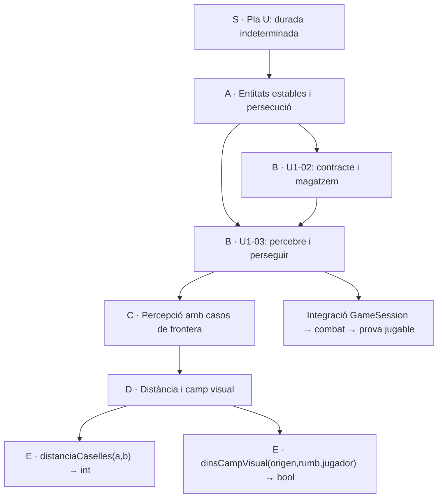

# Pla U descompost: resultats grans, contractes petits

Proposta d’Oriol desenvolupada el **28/10/2026**. Estat: **pla per revisar**.
Aquest lliurament és de planificació: no instal·la `fabrica`, no arrenca `vigilar`
i no implementa C++. Les ordres dels ZIP són referències aportades, no ordres executades.

L’objectiu és poder encarregar una operació precisa, comprovar-la amb poc context
i integrar-la sense perdre el resultat de producte. «Qualitat perfecta» es tradueix
en criteris observables i portes de tancament; no en una garantia d’absència de bugs.

## Escala d’esforç acordada

Una jornada laboral té **7 h 30 min**, cinc jornades per setmana. Aquestes són
categories amb sostre; una B no consumeix necessàriament tres dies.

| Mida | Màxim | Ús |
|---|---:|---|
| **S** | Indeterminat | Objectiu o fase que encara necessita descomposició i revisió d’incerteses. |
| **A** | 37 h 30 min · 5 jornades | Resultat coherent d’una setmana com a màxim. Si no hi cap, es divideix. |
| **B** | 22 h 30 min · 3 jornades | Capacitat integrada, amb recorregut de producte propi. |
| **C** | 7 h 30 min · 1 jornada | Escenari verificable o tall d’una capacitat. |
| **D** | 3 h 45 min · mitja jornada | Unitat de canvi i revisió sobre una mateixa frontera. |
| **E** | Proposta: 15–90 min | Una operació amb entrades, retorn, casos límit i prova; o una decisió documental acotada. |

El sostre E de 90 min és una proposta operativa, perquè Oriol no n’havia fixat
els minuts. La prova unitària i la revisió local formen part de l’E. Integració,
validació del commit i comprovació jugable són treball explícit addicional.
Si una E supera la caixa o necessita una decisió, es retorna amb diagnòstic i es
divideix; no s’amaga feina en una tasca «petita» ni s’encadena feina infinita.

La jerarquia organitza resultats, no classes ni processos nous. No cal crear un
fitxer per funció ni canviar l’arquitectura per reproduir les sis lletres.

## Què es pot consultar

- [Arbre de resultats S–E](ARBRE.md): 20 lots A, conservant els paquets originals.
- [Desglossament complet a tots sis nivells](ARBRE_COMPLET.md): cada D i cadascuna de les seves E.
- [Índex de totes les E](INDEX_E.md): 318 E del Pla U i 12 de preparació addicional.
- [PLAU-01: identitat estable](paquets/U1-02.md) i [persecució](paquets/U1-03.md): primer lot de producte.
- [Contractes exemplificats de funcions](CONTRACTES_U1.md): signatures, exemples i límits precisos.
- [Cooperació i portes de qualitat](COOPERACIO.md): com assignar, integrar i acceptar.
- [Plantilla de l’encàrrec E](PLANTILLA_E.md): context mínim lliurable a un agent.
- [Preparació de l’eina i la base](paquets/PREP.md): inclou revisar `fabrica` abans d’adoptar-la.
- [Auditoria i discrepàncies](AUDITORIA.md): què s’ha comprovat al repo i què segueix proposat.
- [Font editable](pla.json), [referència original](referencia_original.json) i [arbre calculat](arbre.json).

Les signatures noves d’U2–U4 són **contractes de disseny proposats**, amb DTOs i ports
conceptuals. No són una afirmació que aquestes APIs existeixin o compil·lin. Abans
d’assignar codi s’han de substituir pels tipus reals, fixar namespaces, rutes i
consumidor, i congelar una versió v1. Aquesta elaboració pot descobrir més E.

## El pressupost anterior i el nou calendari

El ZIP conté **37 paquets, dues fites de decisió incloses, i 128 jornades**:
U1=16, U2=26, U3=45, U4=41. El seu generador defineix jornada com a **~6 hores**.
Es conserva exactament aquesta referència, amb noms, durades i dependències originals.

- Referència anterior: 128 × ~6 h = **~768 h**, equivalents a **~102,4 jornades** de 7 h 30.
- Si es vol conservar el nombre «128» amb la jornada nova: serien **960 h**.
- Les caixes de les E sumen **417 h de treball identificat provisional**, incloses
  13,5 h de preparació fora del pressupost original. **No són una reestimació total**
  ni una promesa d’acabar el Pla U en menys temps. Especialment U2–U4 encara tenen
  incerteses d’API, relleus i integració que poden afegir tasques.
- Una reserva orientativa del 20% només serveix per comparar capacitat. No
  s’incorpora silenciosament a les 128 jornades ni converteix una fase S en una A.

No es publica una data de finalització amb la falsa hipòtesi que tots els paquets
independents poden córrer alhora. El calendari necessita hores disponibles per
agent, capacitat d’integració, màquines de prova i disponibilitat d’Oriol. Les
dependències del Gantt són necessàries, però no resolen la contenció de fitxers.

## Ordre inicial proposat

1. Revisar el pla, resoldre les discrepàncies del primer lot i completar
   `PREP.E01–E10` de [PREP](paquets/PREP.md). La congelació específica E11 segueix
   la caracterització d’U1-02; el calibratge E12 necessita les primeres cinc E fetes.
2. Congelar el contracte d’identitat i referències de `World`; després adaptar
   el magatzem existent sense alterar semàntica ni desats (`U1-02`).
3. Congelar percepció/retorn, implementar peces pures i integrar el contacte
   amb combat (`U1-03`). Aquesta integració necessita `GameSession`, que no apareix
   a la zona explícita de l’encàrrec adjunt: cal incloure-la al pla aprovat.
4. Guardar/carregar i autoguardat (`G-11` + `G-01`, PLAU-02).
5. Àudio (`U1-01`, PLAU-03); sense recursos sonors no es tanca l’acceptació audible.
6. Rutines i llum (`U1-04` + `U1-05`, PLAU-04).
7. Elaborar els contractes v1 d’U2 sobre el codi resultant; continuar U3 i U4
   amb les portes indicades a cada fitxa.

Això conserva la cua proposada als adjunts. La planificació no ha creat branques
de producte, reclamat implementacions alienes ni adoptat la seva aprovació de C++.



## Com mantenir-lo coherent

Des d’aquesta carpeta:

```bash
python3 eines/renderitza.py
python3 eines/valida.py
python3 eines/renderitza.py --comprovar
```

Les comandes relatives s’executen des de `descomposicio/`. `pla.json` és la font
de les tasques; les fitxes, l’índex i l’arbre es regeneren. La referència original
queda separada per detectar canvis accidentals del pressupost o de les dependències.
Validar el pla comprova estructura i coherència; no acredita que el motor compili
ni que les APIs proposades ja existeixin.
